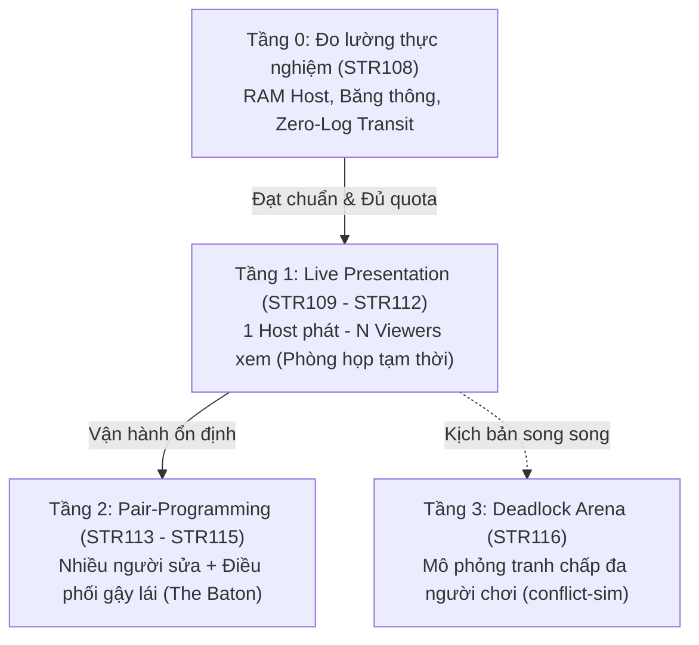

# ĐỀ XUẤT STORY: Team Multiplayer Collaboration (SP024 / SP025 / SP026)

> Trạng thái: **ĐÃ ĐƯỢC CHỦ DỰ ÁN DUYỆT ĐỊNH HƯỚNG (2026-11-23)**. Chốt Hướng A (Pass the Baton) & Quy chế Zero-Log Transit. Sẵn sàng khởi động Tầng 0 (STR108 - Cổng đo lường).
> Nguồn: `_bmad-output/Y_TUONG_TEAM_MULTIPLAYER_COLLABORATION.md` (bản 2.5), phản biện của party mode ngày 2026-11-22 và hội đồng BMAD ngày 2026-11-23.
> Nguyên tắc cốt lõi: Chỉ giữ thứ đứng vững trước `CLAUDE.md` — ngân sách 0 đồng, nhãn kết luận Thật/Mô phỏng, bảo toàn Core Rule 7 (Zero-Log Transit), và "không đoán khi chưa đo đếm thực nghiệm".

---

## 1. Kết luận phản biện: 5 chỗ mâu thuẫn & Lời giải 3 câu hỏi tử huyệt

### 1.1. Năm điểm mâu thuẫn đã được chỉnh đốn

| # | Luận điểm cũ (v2.5) | Đối chiếu thực tế hạ tầng | Giải pháp chuẩn hóa đã chốt |
|---|---|---|---|
| **M1** | Viewer "0 MB WASM, chỉ kéo dữ liệu qua Edge CDN", "Free Unlimited Viewers" | Snapshot phòng live là **trạng thái thay đổi liên tục**. CDN chỉ rẻ khi nội dung tĩnh; live room đổi theo từng lần bấm Run thì cache hit xấp xỉ 0%. Thêm Cloudflare là nhà cung cấp thứ 4 gây phức tạp. | Bỏ Cloudflare CDN. Chuyển sang SSE/PubSub trực tiếp qua Gin trong khung giờ Render thức (7h-24h). |
| **M2** | Mục 3.3: "Broadcast Schema Dump sẽ sập Web Worker máy nhận" | Mục 5.5 lại đòi **Fork to Local Sandbox** (nhân bản toàn bộ schema + dữ liệu). Tự đấm nhau giữa tử huyệt và tính năng. | Giới hạn Fork bằng trần byte nghiêm ngặt (`MAX_SNAPSHOT_TABS = 100`, trần cứng 32 KB, cảnh báo 8 KB — đúng hằng số đang có trong `web/src/modules/share/snapshot.ts:22,25`) và tái sử dụng codec SP022. |
| **M3** | Mục 4: 5 hiểm họa concurrency khi 2 Editor dùng chung một engine | PGlite là đơn luồng, đơn tiến trình Web Worker. Dùng chung engine sinh ra hàng loạt race condition và session poisoning. | **Loại bỏ hoàn toàn Shared Engine**. Duy nhất 1 máy Host chạy engine. Người khác sửa văn bản và luân phiên nhận quyền chạy. |
| **M4** | Snapshot JSON có `sql` và `result_sample` gửi qua mạng | Core Rule 7: Tuyệt đối không lưu vết hoặc rò rỉ SQL của người dùng. | **Quy chế Zero-Log Transit**: Server Gin/Upstash chỉ là broker chuyển tiếp payload trong RAM; tuyệt đối 0 byte lưu DB Neon, 0 dòng log SQL. |
| **M5** | "ĐÃ CHỐT KIẾN TRÚC", sẵn sàng lập Epic ngay | Chưa có một con số thực nghiệm nào về RAM, byte/request hay thời lượng sống của Render free. | Mở đầu bằng **Tầng 0 (STR108: Đo lường thực nghiệm)** trước khi viết bất kỳ dòng code tính năng nào. |

---

### 1.2. Ba câu hỏi tử huyệt & Lời giải chính thức (Chủ dự án duyệt 2026-11-23)

#### ❓ Câu hỏi 1: Ai trả tiền cho máy chạy engine? PGlite đỉnh 1,1 GB RAM. Nếu engine ở máy Host, Host đóng tab thì phòng chết. Giải quyết thế nào?
* **Lời giải chính thức:** **0 ĐỒNG HẠ TẦNG. Engine bắt buộc chạy 100% tại Client của Host.**
  * Render free chỉ có 512 MB RAM, nếu đẩy PGlite lên server sẽ bị OOMKilled ngay lập tức. Đặt engine trên Cloud trả tiền (VPS 4-8GB RAM) sẽ phá vỡ cam kết ngân sách 0 đồng.
  * **Định vị sản phẩm:** Multiplayer của SQLLens không phải là Cloud Database vĩnh cửu, mà là **Ephemeral Session (Cuộc họp tạm thời)** — tương tự Google Meet / Zoom.
  * Khi Host kết thúc buổi làm việc (đóng tab/tắt máy), sự kiện `pagehide` lập tức báo Gin đổi trạng thái phòng sang `offline`.
  * Giao diện Viewer nhận thông báo rõ ràng: *"Host đã đóng phiên làm việc. Bạn có muốn tải bản Snapshot (SP022) về máy để tiếp tục nghiên cứu cá nhân không?"*. Trải nghiệm minh bạch, không treo tiến trình rác trên server.

#### ❓ Câu hỏi 2: Viewer được gì hơn một cái link? SP022 đã có link snapshot miễn phí 0 byte. "Live" hơn ở đúng một điểm: thấy kết quả khi host bấm Run. Có đáng một Epic không?
* **Lời giải chính thức:** **CỰC KỲ ĐÁNG MỘT EPIC.**
  * Link snapshot SP022 là **"Ảnh chụp tĩnh sau cùng" (Static Post-Mortem)**. Live Room là **"Trải nghiệm tương tác đồng bộ" (Interactive Livestream)**.
  * **Giá trị vượt trội của Live:**
    1. *Đồng bộ con trỏ & Focus:* Khi Host giải thích Execution Plan, di chuột đến Node `Index Scan` hay `Hash Join` nào thì màn hình toàn bộ Viewer sáng bừng tại Node đó trong thời gian thực.
    2. *Presence & Tương tác tức thời:* Thấy đồng đội đang soạn thảo, thấy biểu tượng cảm xúc (Emoji reaction) khi query được tối ưu từ 500ms xuống 2ms.
    3. *Đồng bộ nhịp độ tư duy (Synchronicity):* Trong phiên debug khẩn cấp 15 phút hoặc buổi giảng dạy, không ai muốn copy paste 10 cái link SP022 vào Slack rồi bảo nhau F5 liên tục.
  * **Thị trường mục tiêu rõ nét:** (1) Giảng dạy EdTech (1 giảng viên thị phạm cho 30-50 học viên trên mobile/laptop); (2) Phỏng vấn kỹ thuật (Interviewer theo dõi tư duy viết SQL của Candidate).

#### ❓ Câu hỏi 3: Hai người sửa cùng một file .sql để làm gì? Nếu engine chỉ chạy trên máy Host, người thứ hai sửa chữ nhưng không chạy được thì họ đang làm gì?
* **Lời giải chính thức:** **Mô hình Pair-Programming (Driver & Navigator) + Cơ chế "The Baton" (Chuyền gậy lái).**
  * SQL là ngôn ngữ để thực thi, gõ chữ mà bị cấm chạy là trải nghiệm gây ức chế tột độ.
  * Giải pháp không phải là cho mỗi người một engine (Hướng B - gây State Drift và OOM), mà là **Cơ chế The Baton (Request to Run)**:
    1. Cả hai cùng sửa văn bản `.sql` mượt mà qua CRDT (Yjs).
    2. Tại một thời điểm, chỉ có một người giữ quyền bấm Run (*The Active Driver*).
    3. Người thứ hai khi muốn chạy câu lệnh mình vừa sửa chỉ cần bấm **"Xin quyền chạy" (Request to Run)** hoặc phím tắt. Host duyệt (1-click) $\rightarrow$ Quyền bấm Run chuyền sang cho người đó.
    4. Khi người cầm Baton bấm Run, tín hiệu thực thi gửi về Web Worker của Host để chạy PGlite, kết quả sau đó được broadcast ngược lại cho cả phòng cùng xem.
  * Vừa đảm bảo tính duy nhất của dữ liệu (Single Source of Truth), vừa cho phép cộng tác thực chiến bình đẳng.

---

## 2. Phạm vi đề xuất: 3 tầng chặt chẽ có cổng kiểm soát

### Tầng 0 — Quyết định & Đo lường thực nghiệm (Cổng chặn bắt buộc)

| Story | Mục tiêu & Hành vi khi nghiệm thu | Giao diện | Nhãn | Điều kiện tiên quyết |
|---|---|---|---|---|
| **STR108** Đo lường & Thẩm định hạ tầng | Đo đạc số liệu thật trên Chromium & Render free: (1) Đỉnh RAM/CPU của Host khi vừa gõ vừa broadcast; (2) Tần suất & dung lượng byte/request khi N viewer kết nối; (3) Thời gian Render thức; (4) **Kiểm chứng Zero-Log Transit**: Test ép log buffer chứng minh 0 byte SQL lọt vào console/file/DB. | Không | Thật | Không |

---

### Tầng 1 — Live Presentation: 1 Host phát, N Viewer xem (Sau khi STR108 = PASS)

| Story | Mục tiêu & Hành vi khi nghiệm thu | Giao diện | Nhãn | Điều kiện tiên quyết |
|---|---|---|---|---|
| **STR109** Phòng họp & Phân quyền RLS | Tạo phòng live với Room ID duy nhất; chia sẻ link xem có token bảo mật; phân vai `host` / `viewer`; RLS Neon bảo vệ phòng; cơ chế đóng phòng khi Host disconnect. | Có | Thật | STR108 PASS; Chủ dự án duyệt số đo |
| **STR110** Phát sóng Snapshot đa tầng | Host bấm "Phát trực tiếp" $\rightarrow$ Snapshot (Plan 40-token + Kết quả mẫu sanitize) stream tới Viewer trong $\le$ 1,5 giây qua SSE. Đóng tab lập tức đổi trạng thái `offline`. | Có | Thật | STR109 |
| **STR111** Viewer siêu nhẹ (0 MB WASM) | Giao diện `/r/<room-id>` tối ưu cho điện thoại/laptop yếu: Không tải PGlite/SQLite WASM, chỉ dựng DOM hiển thị Plan/B-Tree/Result kèm nhãn rõ ràng: *"Dữ liệu từ máy Host"*. Không có nút Run độc lập. | Có | Thật | STR110 |
| **STR112** Hiện diện & Tương tác thời gian thực | Hiển thị avatar/danh sách người đang xem; đồng bộ vị trí focus node của Host sang Viewer; thả reaction emoji tương tác; hoàn toàn không can thiệp engine. | Có | Thật | STR110 |

---

### Tầng 2 — Pair-Programming: Nhiều người sửa + Chuyền gậy lái (The Baton)

| Story | Mục tiêu & Hành vi khi nghiệm thu | Giao diện | Nhãn | Điều kiện tiên quyết |
|---|---|---|---|---|
| **STR113** Quản lý vai trò Editor | Host cấp quyền `viewer` hoặc `editor` cho từng thành viên trong phòng; thu hồi tức thì; xác thực chặt chẽ tại tầng Gin. | Có | Thật | Tầng 1 vận hành ổn định |
| **STR114** Đồng biên tập (Yjs) & Điều phối Baton | Các Editor cùng sửa code `.sql` thời gian thực (CodeMirror 6 + Yjs). Nút Run có trạng thái: hiển thị ai đang giữ Baton; nút "Xin quyền chạy" (Request to Run) cho phép luân chuyển quyền lái mượt mà. Lệnh chạy thực thi trên Host PGlite. | Có | Thật | STR113 (Chọn dứt khoát Hướng A) |
| **STR115** Fork sang Local Sandbox | Nút "Fork về máy tôi" cho phép bất kỳ ai sao chép toàn bộ schema + dữ liệu mẫu của phòng về PGlite cá nhân để tự do thử nghiệm độc lập; trần kiểm soát $\le$ 32 KB cứng (cảnh báo từ 8 KB) theo hằng số `SNAPSHOT_HARD_LIMIT_BYTES` và `SNAPSHOT_WARN_LIMIT_BYTES` của codec SP022. | Có | Thật | STR114 |

---

### Tầng 3 — Deadlock Arena: Đấu trường tranh chấp tương tác

| Story | Mục tiêu & Hành vi khi nghiệm thu | Giao diện | Nhãn | Điều kiện tiên quyết |
|---|---|---|---|---|
| **STR116** Đấu trường mô phỏng khóa | Phòng học trực quan nhiều người cùng tham gia một kịch bản tranh chấp khóa (dùng lại 5 kịch bản `conflict-sim` đã chuẩn hóa theo Postgres 18). Người tham gia bấm từng bước để thấy đồ thị Cytoscape chuyển màu khóa. Nhãn hiển thị bắt buộc: **Mô phỏng**. Tuyệt đối không chạy 2 engine thật đụng nhau. | Có | Mô phỏng | Tầng 1 hoàn thành |

---

## 3. Những gì BỊ CẮT BỎ VĨNH VIỄN và lý do kỹ thuật

| Thành phần bị cắt bỏ | Lý do kỹ thuật & nguyên tắc dự án |
|---|---|
| **WebRTC P2P DataChannel** | Đã chứng minh thất bại: Bão hòa băng thông upload của Host ($150\text{ KB} \times 20 = 3\text{ MB/s}$ upstream) và tỷ lệ kẹt Symmetric NAT buộc phải thuê TURN server tốn phí. |
| **Cloudflare Workers / Durable Objects / KV** | Tránh đưa vào nhà cung cấp thứ 4; trạng thái phòng live biến thiên liên tục khiến cache hit = 0%; Durable Objects tính phí vượt ngưỡng 0 đồng. |
| **Shared Engine (2 người chạy chung 1 PGlite)** | PGlite chạy đơn luồng; việc chạy chung một engine mở toang cánh cửa dẫn tới 5 tử huyệt Concurrency (Session Poisoning, Lock Starvation, Deadlock ma). |
| **Hướng B (Mỗi người chạy 1 engine trên máy mình)** | Gây State Drift (lệch pha dữ liệu) tức thì giữa 2 máy; ép máy yếu/mobile của Viewer phải nạp 1,1 GB RAM PGlite dẫn đến sập trình duyệt. |
| **B2B Enterprise SaaS ($15–$30/seat)** | Chưa có tệp người dùng cốt lõi; không thiết kế các tính năng monetization phức tạp khi sản phẩm chưa đạt Product-Market Fit. |

---

## 4. Danh mục tài sản tái sử dụng (Tối ưu hóa 100% công sức)

* **Bộ mã hóa Snapshot an toàn (SP022):** Tái sử dụng `SnapshotV1`, `encodeSnapshot`, `decodeSnapshot`, và hằng số an toàn `MAX_SNAPSHOT_TABS = 100` (`web/src/modules/share/codec.ts`).
* **Trang hiển thị chỉ đọc bảo mật (SP022):** Tái sử dụng layout `/share` đã được thiết lập `Referrer-Policy: no-referrer` chống rò rỉ dữ liệu ngoài ý muốn.
* **Bộ nén Plan 40-token (SP018 / Task119):** Thu nhỏ JSON Plan từ hàng chục KB xuống dưới 40 tokens để broadcast qua mạng với chi phí gần như bằng 0.
* **Bộ kịch bản mô phỏng tranh chấp khóa (SP011 / Task050-051):** Tái sử dụng 5 kịch bản chuẩn Postgres 18 của `conflict-sim` cho Đấu trường Deadlock Tầng 3.
* **Hạ tầng RLS & Phân quyền Tenant (SP023):** Kế thừa kiến trúc RLS Neon với role ứng dụng `sqllens_app` và cơ chế phân quyền theo phiên làm việc.

---

## 5. Rào chắn an ninh & Quản trị rủi ro

1. **Rào chắn Core Rule 7 (Zero-Log Transit):**
   * Payload SQL/Plan chỉ được phép trung chuyển qua RAM của tiến trình Gin.
   * Cấm triệt để việc viết câu lệnh `INSERT` chứa nội dung SQL phòng live vào bảng cơ sở dữ liệu Neon.
   * Áp dụng định dạng log lỗi `%T` (như Task150), nghiêm cấm log `body`, `query` hay `tab.sql` ra stdout/file.
2. **Hạn mức Render Free 750 giờ/tháng:**
   * Cơ chế phòng họp tự động đóng (Auto-Disconnect) khi Host thoát hoặc sau 60 phút không có hoạt động để tránh giữ ấm container Render ngoài ý muốn.
3. **Thư viện bên thứ ba (Yjs):**
   * Việc bổ sung `yjs` và `y-codemirror.next` vào `web/package.json` phải được thực hiện minh bạch bởi phiên làm việc chính, tuân thủ đúng `QUY_TRINH.md`.
4. **Phân định ranh giới thi công:**
   * SP024 là luồng nghiên cứu/phát triển tách biệt; không gây xung đột với các mục tiêu đóng SP013 và dọn dẹp `SP999`.

---

## 6. Lịch sử duyệt quyết định của Chủ dự án

| Mốc thời gian | Nội dung quyết định | Ý nghĩa & Tác động kiến trúc |
|---|---|---|
| **2026-11-22** | Chấp thuận tách thành các Tầng kiểm soát; yêu cầu nhiều người cùng sửa được văn bản. | Mở rộng phạm vi từ Live Presentation thuần túy sang Pair-Programming (Tầng 2). |
| **2026-11-23** | **Đồng thuận 100% với 3 câu trả lời tử huyệt** của Hội đồng BMAD. | (1) Engine ở máy Host, mô hình phòng họp tạm thời (Ephemeral Session); (2) Khẳng định giá trị Live đồng bộ cho EdTech/Interview; (3) **Chốt dứt khoát Hướng A (Pass the Baton)**, khai tử Hướng B. |
| **2026-11-23** | **Thông qua quy chế Zero-Log Transit** cho Core Rule 7. | Hợp thức hóa việc truyền tin realtime qua Gin RAM mà không vi phạm nguyên tắc bảo mật dữ liệu người dùng. |
| **2026-11-23** | **Bật đèn xanh cho Tầng 0 (STR108).** | Cho phép thiết lập kịch bản đo đạc thực nghiệm các chỉ số RAM, CPU và network trước khi tạo story chi tiết. |
