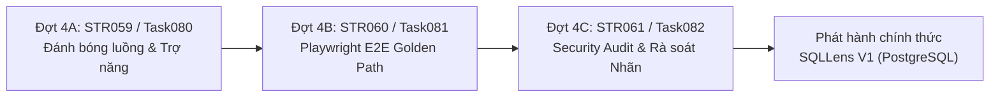

# Kế hoạch chi tiết Lộ trình 1: Đánh bóng & Phát hành V1 PostgreSQL cốt lõi

> **Trạng thái:** Đã phân tích kỹ lưỡng bởi BMad Party Mode (John, Winston, Sally, Amelia, Vex) — Đang chờ Chủ dự án duyệt để khởi chạy.  
> **Mục tiêu tối thượng:** Đưa bản SQLLens V1 chạy PostgreSQL thuần in-browser (PGlite + Web Worker) hoàn thiện 100%, bóng bẩy, mượt mà, bảo mật tuyệt đối, không đứt gãy luồng người dùng và sẵn sàng phát hành chính thức mà không bị phụ thuộc vào bất kỳ hạ tầng bên ngoài nào.

---

## 1. Tóm tắt chiến lược & Hiện trạng

- **Hiện trạng tổng thể:** Đã hoàn thành **53/61 Stories (87%)** với **74 Tasks** đã bàn giao và merge vào nhánh `main`.
- **Đặc tính kỹ thuật cốt lõi:** PostgreSQL trên SQLLens chạy hoàn toàn bằng **PGlite 0.5.14 trong Web Worker** trên trình duyệt khách, nạp theo nhu cầu, hỗ trợ tới 500k dòng, cung cấp dữ liệu B-Tree thật qua `pageinspect`, kiểm tra cú pháp AST thật, hoàn toàn độc lập với backend Go và máy ảo Azure.
- **Phạm vi Lộ trình 1:** Tập trung toàn lực dứt điểm **Epic SP013 (Phát hành)** gồm 3 Story quan trọng:
  1. **Đợt 4A — SP013 / STR059 (Task080):** Đánh bóng luồng trải nghiệm, skeleton, empty states, error boundaries, phím tắt và giảm chuyển động.
  2. **Đợt 4B — SP013 / STR060 (Task081):** Bộ kiểm thử tự động Playwright E2E toàn diện xuyên suốt luồng vàng (Golden Path) trên cả tiếng Việt và tiếng Anh.
  3. **Đợt 4C — SP013 / STR061 (Task082):** Security Audit toàn diện, rà soát 100% nhãn kết luận (loại bỏ triệt để câu hàm ý "thiết kế này ổn"), kiểm tra secret và chốt danh sách phát hành V1.

---

## 2. Phân tích chi tiết từng Bước, Story và Task

---

### ĐỢT 4A: SP013 / STR059 — Đánh bóng luồng trải nghiệm (Task080)

#### 1. Bối cảnh & Các khiếm khuyết được chỉ ra
- **Ẩn thanh Tab khi chưa chạy SQL:** Hiện tại trong `Stage`, nếu `run === null`, toàn bộ cụm Tab bị ẩn và chỉ hiện một dòng text cộc lốc `ts("placeholder.stage")`. Người dùng mới vào không thấy trước được 7 tính năng mạnh mẽ (Sơ đồ, Plan, B-Tree, What-if, Capacity, Mentor, Conflict). Đặc biệt, tab **Conflict Sim** hoàn toàn có thể chạy ngay với 5 kịch bản mẫu mà không cần dán SQL trước!
- **Thiếu Error Boundary:** Nếu một canvas phức tạp (React Flow, GSAP, Cytoscape) gặp lỗi render đột ngột, toàn bộ React component tree bị crash trắng trang. Cần bọc Error Boundary có nút "Thử tải lại tab này" (Retry).
- **Phím tắt trong ô soạn thảo:** Hiện tại người dùng gõ SQL xong phải rê chuột bấm nút "Chạy". Cần phím tắt chuẩn nghề nghiệp: `Ctrl+Enter` (hoặc `Cmd+Enter` trên Mac) kích hoạt chạy SQL ngay lập tức.
- **Kéo Canvas bằng phím Space:** Kiểm tra và đảm bảo phím `Space` cho phép kéo (pan) canvas mượt mà trên cả Sơ đồ bảng (`SchemaDiagram`) và Cây thực thi (`PlanTree`).
- **Giảm chuyển động (`prefers-reduced-motion`):** CSS đã có `@media (prefers-reduced-motion: reduce)`, nhưng các hoạt ảnh GSAP chạy bằng Javascript requestAnimationFrame (như rơi key B-Tree, biểu đồ Capacity, Join animation, trang About) chưa nhận biết để nhảy thẳng tới trạng thái cuối cùng (duration = 0).

#### 2. Phạm vi file tác động
- `web/src/components/error-boundary.tsx` (Tạo mới: Error Boundary hiển thị thân thiện, có nút thử lại).
- `web/src/components/sql-editor/sql-editor-impl.tsx` & `sql-editor.tsx` (Bổ sung keymap `Mod-Enter` gọi `onRun`).
- `web/src/modules/lab/stage/stage.tsx` (Luôn hiển thị thanh Tabs; hiển thị Empty State giàu thông tin cho từng tab khi `!run`; bọc ErrorBoundary).
- `web/src/modules/lab/lab-workspace.tsx` (Truyền `onRun` vào `SqlEditor`, lắng nghe phím tắt toàn cục).
- `web/src/lib/reduced-motion.ts` (Hook/hàm tiện ích kiểm tra `prefers-reduced-motion` trong JS cho GSAP).
- `web/src/modules/btree-reader/anim/btree-drop.tsx` & `web/src/modules/plan-runner/join-anim/join-animation.tsx` (Áp dụng giảm chuyển động).
- `web/messages/vi/labStage.json` & `web/messages/en/labStage.json` (Bổ sung bản dịch empty states, retry, shortcuts).

#### 3. Tiêu chí nghiệm thu chi tiết (Task080 Acceptance Criteria)
- **AC1 (Empty State trực quan):** Khi người dùng chưa dán/chạy SQL (`run === null`), thanh 7 Tabs của Stage vẫn hiển thị đầy đủ. Mỗi tab khi bấm vào có Empty State rõ ràng giải thích tab dùng để làm gì và gợi ý hành động cụ thể (ví dụ nút "Nạp mẫu SQL", hoặc cho phép chuyển thẳng sang Conflict Sim).
- **AC2 (Conflict Sim chạy độc lập):** Khi `run === null`, người dùng bấm vào tab `Tranh chấp` (Conflict) vẫn xem và chạy mô phỏng được 5 kịch bản mẫu bình thường mà không bắt buộc phải chạy SQL ở editor trước.
- **AC3 (Phím tắt `Ctrl+Enter` / `Cmd+Enter`):** Khi con trỏ đang ở trong `SqlEditor`, nhấn tổ hợp phím `Ctrl+Enter` (Windows/Linux) hoặc `Cmd+Enter` (macOS) sẽ kích hoạt nút "Chạy" (tương đương bấm chuột vào nút Chạy), có xử lý debounce tránh bấm liên tục khi đang thực thi.
- **AC4 (Kéo Canvas bằng Space):** Giữ phím `Space` và rê chuột trên canvas Sơ đồ bảng và Cây Plan cho phép kéo thả vùng nhìn (pan view) mượt mà, con trỏ đổi sang hình bàn tay (`cursor: grab` / `grabbing`).
- **AC5 (Error Boundary bảo vệ từng tab):** Mỗi nội dung tab được bọc trong một `StageErrorBoundary`. Nếu xảy ra lỗi Javascript runtime bên trong tab, trang web không bị crash trắng; thay vào đó hiển thị thẻ Alert thông báo lỗi tinh gọn kèm nút "Tải lại tab" (Reset).
- **AC6 (Tuân thủ `prefers-reduced-motion`):** Khi hệ thống bật chế độ giảm chuyển động (`prefers-reduced-motion: reduce`), các hoạt ảnh GSAP (rơi key B-Tree, bước nhảy Range Scan, Join Animation) lập tức hoàn tất ngay ở frame cuối cùng (duration = 0), không gây chóng mặt cho người dùng nhạy cảm chuyển động.
- **AC7 (Độ trễ & Skeleton):** Khi dữ liệu đang tải, hiển thị Skeleton phù hợp với kích thước từng tab, không gây nhảy layout (Cumulative Layout Shift = 0).
- **AC8 (Song ngữ & a11y):** Toàn bộ empty states, tooltip phím tắt và thông báo lỗi có đầy đủ tiếng Việt và tiếng Anh, hỗ trợ đọc màn hình bằng ARIA attributes chuẩn mực.

---

### ĐỢT 4B: SP013 / STR060 — Playwright E2E Suite toàn diện (Task081)

#### 1. Bối cảnh & Các khiếm khuyết được chỉ ra
- Dự án hiện có 33 file test E2E kiểm tra rời rạc từng component (như `btree-range.spec.ts`, `conflict-criteria.spec.ts`, `findings.spec.ts`). Tuy nhiên, chưa có test nào mô phỏng hành trình hoàn chỉnh của một lập trình viên từ lúc bước chân vào website đến khi tìm ra lỗi thiết kế và thử sửa thành công.
- Cần một bộ test E2E "Luồng vàng" (Golden Path) chạy xuyên suốt toàn bộ vòng đời ứng dụng trên cả 2 ngôn ngữ (`/vi` và `/en`) và 2 độ phân giải màn hình chuẩn (Desktop 1440px và Mobile 390px).

#### 2. Kịch bản kiểm thử Golden Path 10 bước
1. **Trang Giới thiệu (Landing `/about`):** Truy cập trang giới thiệu, cuộn qua các khối tính năng, bấm CTA "Vào phòng Lab" để chuyển sang `/vi`.
2. **Nạp mẫu & Ô soạn thảo:** Bấm nút "Mẫu SQL" (có bảng users, orders, composite index, khóa ngoại FK), nội dung hiển thị chuẩn xác trong CodeMirror.
3. **Phím tắt Chạy:** Dùng phím tắt `Ctrl+Enter` để thực thi SQL; PGlite trong Web Worker chạy thành công, lưới kết quả (Result Grid) hiển thị đúng số dòng và nhãn xanh `Thật`.
4. **Sơ đồ bảng (Schema Diagram):** Tab Schema hiển thị trực quan các bảng và đường nối quan hệ khóa ngoại. Kiểm tra thao tác thu phóng (zoom) và giữ `Space` để kéo canvas.
5. **Cây kế hoạch (Plan Tree) & Join:** Tab Plan hiển thị cây kế hoạch truy vấn với nhãn `Thật`. Khối hoạt ảnh Join hiển thị các bước ghép nối dữ liệu.
6. **B-Tree Reader trực quan:** Tab B-Tree cho phép chọn index, kích hoạt animation rơi key, thực hiện Range Scan trượt ngang lá, và thanh so sánh số trang/dòng giữa Seq Scan vs Index Scan.
7. **Bảng Rủi ro (Findings):** Cột bên phải liệt kê các vi phạm schema/query (ví dụ: bọc hàm lên cột có index). Bấm vào một rủi ro: ô soạn thảo SQL tự động tô sáng vùng lỗi, sơ đồ hoặc cây plan tự động focus vào bảng/node tương ứng.
8. **Thử sửa (What-If):** Mở tab What-If, áp dụng gợi ý tạo index trong transaction, kiểm tra bảng đối chiếu số trang và số dòng trước và sau khi tối ưu.
9. **Mô phỏng Tranh chấp (Conflict Sim):** Mở tab Conflict, chọn kịch bản Deadlock, chạy timeline nhịp của 2 session, kiểm tra đồ thị chờ khóa Cytoscape và kiểm tra tiêu chí hỏng với nhãn `Mô phỏng`.
10. **Chuyển ngữ & Điện thoại:** Đổi ngôn ngữ sang `/en`, xác nhận 100% giao diện và nhãn đổi sang tiếng Anh. Kiểm tra trên viewport 390px, thanh tab điều hướng di động mở đóng trơn tru, không có phần tử nào bị vỡ hoặc tràn ngang.

#### 3. Tiêu chí nghiệm thu chi tiết (Task081 Acceptance Criteria)
- **AC1 (Golden Path E2E Suite):** File mới `web/e2e/golden-path.spec.ts` hiện thực trọn vẹn 10 bước trên, chạy pass 100% trong môi trường CI.
- **AC2 (Đa ngôn ngữ `/vi` & `/en`):** Kịch bản chạy kiểm tra thành công trên cả 2 locale tiếng Việt và tiếng Anh, không gặp lỗi missing translation key.
- **AC3 (Đa màn hình Desktop & Mobile):** Kịch bản kiểm tra hoạt động ổn định trên cả viewport 1440x900 (desktop) và 390x844 (mobile), xác nhận thanh trượt ngang `scrollWidth <= clientWidth`.
- **AC4 (Kiểm tra nhãn kết luận):** Kiểm tra tự động xác nhận mọi kết luận hiển thị trên màn hình đều mang đúng 1 trong các nhãn quy định (`Thật`, `Mô phỏng`, `Ước lượng`, `Chưa mô phỏng được`, `Không đặt tiêu chí`).
- **AC5 (Độ ổn định cao - Zero Flakiness):** Sử dụng các locator ngữ nghĩa (`getByRole`, `getByTestId`), tận dụng cơ chế `data-hydrated` từ Task077, không dùng `sleep` cứng; test chạy lặp lại 3 lần liên tiếp không bị flake.
- **AC6 (Tốc độ thực thi):** Bộ test E2E Golden Path hoàn thành trong thời gian dưới 60 giây trên máy local và dưới 90 giây trên CI.

---

### ĐỢT 4C: SP013 / STR061 — Kiểm tra cuối & Security Audit (Task082)

#### 1. Bối cảnh & Các rủi ro cần triệt tiêu
- **Bảo mật Secret & Git:** Đảm bảo không còn bất kỳ secret nào trong working tree, file cấu hình mẫu hoặc tài liệu.
- **An toàn Sandbox SQL (Nguyên tắc 7 & 8):** SQL của người dùng là không đáng tin cậy. Dù PGlite chạy trên trình duyệt client, vẫn phải đảm bảo:
  - Chặn triệt để `SET ROLE`, `RESET ROLE`, `SET SESSION AUTHORIZATION`.
  - Không có bất kỳ dòng log SQL nào của người dùng bị in ra `console.log` trên production hoặc gửi về server telemetry.
  - Xử lý lỗi an toàn: Không phơi bày cấu trúc bộ nhớ WASM hay stack trace nội bộ khi người dùng nhập câu truy vấn phá hoại.
- **Rà soát Nhãn & Ngôn ngữ (Nguyên tắc 1 & 2):**
  - Quét toàn bộ mã nguồn frontend, backend và toàn bộ file ngôn ngữ `web/messages/{vi,en}/*.json`.
  - **Tuyệt đối không để lọt bất kỳ câu nào nói "thiết kế này ổn"**, "query này tối ưu", "tuyệt vời", "không có lỗi gì". Chỉ phát biểu: với giả định này, kịch bản này hỏng hoặc không hỏng ở bước nào.

#### 2. Kế hoạch kiểm tra bảo mật & Rà soát nhãn
- **Bước 1 (Secret Scanning & Git Hygiene):**
  - Chạy công cụ quét secret trên toàn bộ repo (gồm `api/`, `web/`, `_bmad-output/`, `sandbox-agent/`).
  - Kiểm tra các file `.env*`, `.gitignore` để chắc chắn không có secret nhạy cảm nào bị đưa vào tracking.
- **Bước 2 (Sandbox & Input Injection Audit):**
  - Thử nghiệm các payload độc hại: SQL injection thoát chuỗi, ký tự Unicode lạ, lệnh thoát sandbox, tấn công DoS trình duyệt bằng đệ quy vô hạn `WITH RECURSIVE`.
  - Xác nhận timeout và nút "Hủy" của PGlite ngắt truy vấn đúng hạn (sau 5000ms), không làm đơ giao diện chính.
- **Bước 3 (Grep Audit Nhãn kết luận & Không khẳng định "Ổn"):**
  - Chạy script tự động quét các từ khóa cấm trong file dịch và mã nguồn: `"ổn"`, `"tối ưu nhất"`, `"hoàn hảo"`, `"an toàn"`, `"optimal"`, `"perfect"`, `"good design"`.
  - Xác nhận mọi kết luận trên giao diện có gắn badge nhãn chuẩn mực.
- **Bước 4 (Danh mục kiểm tra phát hành - Release Checklist):**
  - Tổng hợp bảng kiểm 10 mục chuẩn bị cho việc gắn tag `v1.0.0-pg`.

#### 3. Tiêu chí nghiệm thu chi tiết (Task082 Acceptance Criteria)
- **AC1 (Báo cáo Security Audit):** Chạy quy trình `security-audit`, xuất báo cáo chi tiết không còn lỗ hổng mức High hoặc Critical.
- **AC2 (Secret Cleanliness):** Xác nhận 100% kho mã nguồn không lưu secret, token, private key; `.gitignore` bảo vệ đầy đủ.
- **AC3 (Chặn vượt quyền SQL):** Unit test và E2E test xác nhận parser chặn thành công 100% các câu lệnh `SET ROLE`, `RESET ROLE`, `SET SESSION AUTHORIZATION`.
- **AC4 (Zero SQL Logging):** Mã nguồn frontend và backend không chứa bất kỳ lệnh ghi log nội dung SQL của người dùng.
- **AC5 (Rà soát nhãn - 100% Tuân thủ Nguyên tắc 1 & 2):** Toàn bộ file dịch và UI không chứa câu hàm ý "thiết kế này ổn". Mọi kết luận đều có nhãn chuẩn (`Thật`, `Mô phỏng`, `Ước lượng`, `Chưa mô phỏng được`, `Không đặt tiêu chí`).
- **AC6 (Build & Lint xanh hoàn hảo):** `npm run check` (typecheck, lint, 512+ unit tests) và `npm run build` (51 static pages) pass 100% không cảnh báo.
- **AC7 (Tài liệu Bàn giao V1 & Release Notes):** Lập file tổng kết phát hành V1 (`_bmad-output/PHAT_HANH_V1.md`) mô tả đầy đủ năng lực của SQLLens PostgreSQL và hướng dẫn sử dụng.

---

## 3. Ma trận thực thi & Phân công trách nhiệm

| Đợt | Task | Nội dung chính | Subagent Dev | Subagent Reviewer | Ước lượng |
|---|---|---|---|---|---|
| **Đợt 4A** | **Task080** | Đánh bóng luồng: empty states, skeletons, error boundaries, phím tắt `Ctrl+Enter`, `prefers-reduced-motion` | `amelia-dev` (Worktree `.worktrees/Task080`) | `task-reviewer` (độc lập, fresh context) | 1 phiên |
| **Đợt 4B** | **Task081** | Bộ test Playwright E2E Golden Path 10 bước xuyên suốt toàn bộ luồng người dùng (vi/en, 1440px/390px) | `amelia-dev` (Worktree `.worktrees/Task081`) | `task-reviewer` (độc lập, fresh context) | 1 phiên |
| **Đợt 4C** | **Task082** | Security Audit toàn diện, rà soát 100% nhãn kết luận, audit secret, lập checklist phát hành V1 | `amelia-dev` / Security Audit (Worktree `.worktrees/Task082`) | `task-reviewer` (độc lập, fresh context) | 1 phiên |

---

## 4. Kế hoạch quản trị rủi ro & Ca biên

| Rủi ro tiềm ẩn | Biện pháp phòng ngừa kỹ thuật |
|---|---|
| **Phím tắt `Ctrl+Enter` xung đột với gõ tiếng Việt (Telex/VNI)** | Chỉ bắt sự kiện khi không đang trong quá trình gõ IME (`!e.isComposing`), đảm bảo người dùng gõ dấu tiếng Việt trong CodeMirror không bị vô tình kích hoạt chạy truy vấn. |
| **Test E2E Golden Path bị flake do PGlite nạp WASM chậm trên CI** | Tận dụng cơ chế `data-hydrated="true"` đã hoàn thiện ở Task077, thiết lập timeout chờ khởi tạo worker PGlite hợp lý (15s cho lần nạp đầu). |
| **GSAP animation bị giật khi tắt bật chuyển động** | Khởi tạo timeline với `duration: prefersReducedMotion ? 0 : normalDuration` thay vì xóa node đột ngột, đảm bảo DOM luôn ở trạng thái kết thúc hoàn chỉnh. |
| **Sót chuỗi dịch khi bổ sung Empty States mới** | Chạy script kiểm tra song ngữ tự động `web/src/i18n` trong `npm run check` để bắt ngay lập tức các key tiếng Anh bị thiếu so với tiếng Việt. |

---

## 5. Kết luận & Đề xuất hành động tiếp theo

Kế hoạch Lộ trình 1 đã được vạch ra chi tiết đến từng file, từng dòng hợp đồng, từng tiêu chí nghiệm thu và ca biên kiểm thử.

**Đề xuất tiếp theo:**  
Chủ dự án xem xét và duyệt bản kế hoạch này. Khi được duyệt, Agent sẽ ngay lập tức:
1. Tạo task spec chi tiết `_bmad-output/SP013/STR059/Task080/task080.md`.
2. Tạo git worktree `.worktrees/Task080` trên nhánh `task/Task080` từ `main`.
3. Cử subagent `amelia-dev` triển khai Đợt 4A (Task080) và subagent `task-reviewer` thẩm định độc lập theo đúng quy trình chuẩn.
