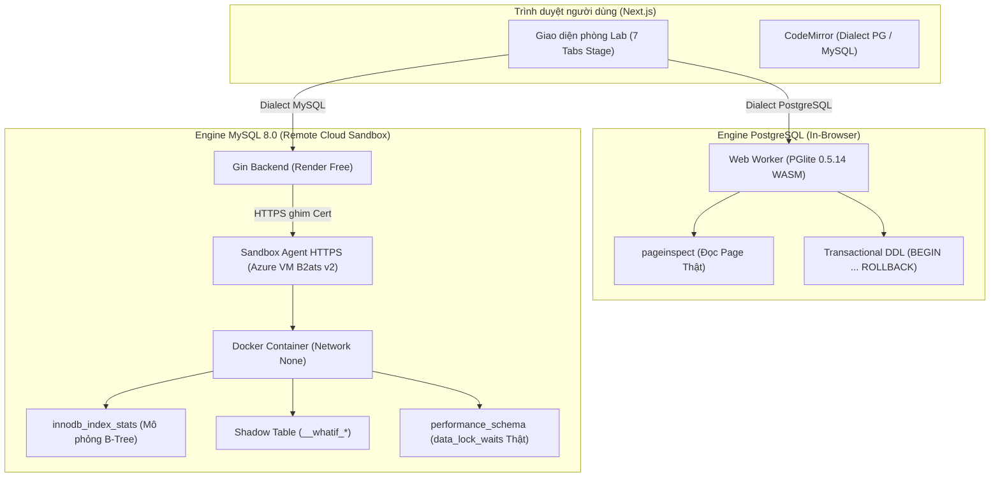
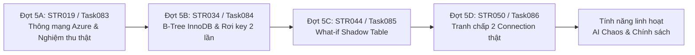

# Kế hoạch chi tiết Lộ trình 2: Mở rộng Sandbox MySQL trên Azure VM

> **Trạng thái:** Đã phân tích kỹ lưỡng bởi BMad Party Mode (John, Winston, Sally, Amelia, Vex) — Đang chờ Chủ dự án duyệt để khởi chạy.  
> **Mục tiêu tối thượng:** Đưa engine **MySQL 8.0 thật** (chạy trên Docker container máy ảo Azure B2ats v2 qua sandbox agent bảo mật HTTPS ghim cert) hòa mạng trọn vẹn vào SQLLens, mở rộng toàn bộ năng lực trực quan hóa: Cây B-Tree InnoDB Clustered/Secondary rơi key 2 lần, Thử sửa What-if bằng bảng shadow, và Tranh chấp 2 connection thật đọc khóa từ `performance_schema.data_lock_waits`.

---

## 1. Tóm tắt chiến lược & Hiện trạng

- **Hiện trạng tổng thể:** Dự án đã đạt **54/61 Stories (88.5%)** với **75 Tasks** đã bàn giao và merge vào nhánh `main`. Toàn bộ luồng lõi PostgreSQL in-browser (PGlite) đã hoàn tất 100%.
- **Nền tảng MySQL đã chuẩn bị sẵn:**
  - **Task074:** Sandbox agent Go trên Azure VM đã bổ sung cổng HTTPS ghim cert (`AGENT_TLS_ADDR`), xác thực SHA-256 token, quản lý vòng đời container Docker (`--network none`, cgroup giới hạn CPU 0.5, RAM 512MB, disk 50MB). Gin backend đã có package `api/internal/mysql` với 4 route sau cổng đăng nhập, giới hạn quota qua Upstash.
  - **Task075:** Frontend đã có `createMysqlAdapter`, xử lý trạng thái khởi tạo container, hết hạn phiên, hết chỗ, thông báo lỗi song ngữ `/vi` và `/en`.
- **Rào cản kích hoạt thực tế:** Cổng Azure NSG và tường lửa `ufw` chưa được mở cho IP của Render theo tài liệu [`huong_dan_mo_cong.md`](file:///c:/SQLLens/_bmad-output/SP004/STR019/Task074/huong_dan_mo_cong.md). Toàn bộ test của Task075 đang chạy qua mock adapter.
- **Phạm vi Lộ trình 2:** Hoàn tất 5 Story còn lại của MySQL và 2 Story linh hoạt:
  1. **Đợt 5A — SP004 / STR019 (Task083):** Kết nối thông mạng thật Render → Azure VM, nghiệm thu luồng khởi tạo và thực thi MySQL thật.
  2. **Đợt 5B — SP008 / STR034 (Task084):** Dựng lại cây B-Tree InnoDB từ thống kê `mysql.innodb_index_stats`, trực quan hóa rơi key 2 lần trên Secondary Index (Bookmark Lookup).
  3. **Đợt 5C — SP010 / STR044 (Task085):** Thử sửa What-if trên MySQL bằng cơ chế bảng tạm Shadow (`__whatif_*`) giải quyết bài toán DDL tự commit ngầm.
  4. **Đợt 5D — SP011 / STR050 (Task086):** Tranh chấp 2 connection thật trên MySQL, đọc khóa trực tiếp từ `performance_schema.data_lock_waits`, trực quan hóa Deadlock và Dirty Read ở `READ UNCOMMITTED`.
  5. **Tính năng bổ trợ linh hoạt (Không chặn phát hành):**
     - **SP012 / STR057 (Task087):** AI Chaos Generator — Dùng AI tự sinh kịch bản tranh chấp 2 session từ schema người dùng.
     - **SP002 / STR011 (Task088):** Văn bản điều khoản & chính sách dữ liệu, minh bạch Zero Data Retention.

---

## 2. Kiến trúc & So sánh cốt lõi: PostgreSQL vs. MySQL trên SQLLens



| Đặc tính kỹ thuật        | PostgreSQL (Đã hoàn thành)               | MySQL (Lộ trình 2)                        | Giải pháp kỹ thuật tương ứng                                |
| ------------------------ | ---------------------------------------- | ----------------------------------------- | ----------------------------------------------------------- |
| **Vị trí thực thi**      | Trình duyệt người dùng (PGlite WASM)     | Remote container trên Azure VM            | Sandbox Agent quản lý container theo phiên                  |
| **Cách đọc B-Tree**      | `pageinspect` đọc block raw nhãn `Thật`  | Không có `pageinspect` trong MySQL chuẩn  | Đọc `mysql.innodb_index_stats` + data mẫu → Nhãn `Mô phỏng` |
| **Cấu trúc B-Tree**      | Heap Table + B-Tree trỏ ctid             | Clustered Index (PK) + Secondary Index    | Animation rơi key 2 lần (Bookmark Lookup)                   |
| **Cơ chế What-if**       | `BEGIN; CREATE INDEX; ROLLBACK;`         | DDL tự động commit ngầm (Implicit Commit) | Nhân bản bảng Shadow `__whatif_*`, đo xong tự DROP          |
| **Tranh chấp 2 Session** | Giả lập state machine / PGlite đơn luồng | 2 Connection thật `connection: a` & `b`   | Đọc `performance_schema.data_lock_waits` nhãn `Thật`        |
| **Isolation Level**      | MVCC không có Dirty Read                 | Hỗ trợ `READ UNCOMMITTED` có Dirty Read   | Minh họa Dirty Read thật khi chọn `READ UNCOMMITTED`        |

---

## 3. Phân tích chi tiết từng Bước, Story và Task



---

### ĐỢT 5A: SP004 / STR019 — Kết nối mạng thật Render → Azure VM (Task083)

#### 1. Bối cảnh & Hiện trạng kỹ thuật

- Toàn bộ code client/server đã hoàn thiện ở Task074 và Task075.
- Cần bước kích hoạt thực địa: Chủ dự án mở cổng NSG (TCP 8443) trên Azure và thêm luật `ufw` cho dải IP của Render theo hướng dẫn [`huong_dan_mo_cong.md`](file:///c:/SQLLens/_bmad-output/SP004/STR019/Task074/huong_dan_mo_cong.md).
- **Mục tiêu của Task083:** Chạy bộ kiểm thử tích hợp đầu cuối giữa Gin thật trên Render (hoặc môi trường test có token thật) với `sqllens-agent` trên Azure VM, xác nhận toàn bộ 9 bước hợp đồng của Task075 hoạt động mượt mà với container MySQL thật.

#### 2. Phạm vi công việc & Kịch bản nghiệm thu thực tế

1. **Khởi tạo phiên:** Người dùng đăng nhập, chọn MySQL, bấm Chạy. Gin gửi `POST /api/mysql/sessions` tới agent; container Docker MySQL khởi động sẵn sàng trong < 3 giây (nhờ warm pool).
2. **Thực thi DDL/DML:** Tạo bảng `CREATE TABLE users (id INT PRIMARY KEY, name VARCHAR(50));`, chèn dữ liệu `INSERT INTO users VALUES (1, 'Alice');`, truy vấn `SELECT * FROM users;`. Lưới kết quả trả về đúng dữ liệu kèm nhãn `Thật`.
3. **Truy vấn sơ đồ schema:** Tab Sơ đồ bảng đọc từ `information_schema.tables` và `information_schema.columns` của MySQL thật, hiển thị đúng cấu trúc bảng và kiểu dữ liệu.
4. **Cắt kết quả an toàn:** Truy vấn tạo ra hơn 10.000 dòng được cắt an toàn ở mức 10.000 dòng kèm thông báo cảnh báo rõ ràng.
5. **Timeout câu lệnh:** Truy vấn `SELECT SLEEP(20);` bị ngắt chính xác ở mốc 15 giây, hiển thị màn hình thông báo lỗi quá thời gian câu lệnh.
6. **Hủy phiên:** Đổi sang engine PostgreSQL hoặc bấm đăng xuất, container Docker tương ứng trên Azure VM lập tức bị tiêu hủy (`docker rm -f`), giải phóng RAM và CPU.

#### 3. Tiêu chí nghiệm thu chi tiết (Task083 Acceptance Criteria)

- **AC1 (E2E Integration Test với Agent thật):** Script kiểm thử kết nối trực tiếp tới cổng HTTPS 8443 ghim fingerprint, tạo phiên, chạy SQL, lấy kết quả và hủy phiên thành công 100%.
- **AC2 (Xác nhận thông số tài nguyên):** Container MySQL chạy đúng cgroup: RAM tối đa 512MB, CPU quota 0.5 core, mạng ngoài bị ngắt (`--network none`).
- **AC3 (Hiển thị UI chuẩn xác):** Giao diện web hiển thị đúng các trạng thái: Đang kết nối sandbox → Sẵn sàng → Hết hạn (sau 15 phút không hoạt động) → Đã hết chỗ (khi đạt trần phiên).
- **AC4 (Zero Leakage):** Không in token xác thực, chuỗi kết nối MySQL hay nội dung SQL của người dùng ra log Render hay journal của VM (Nguyên tắc 7).

---

### ĐỢT 5B: SP008 / STR034 — Dựng lại cây B-Tree InnoDB & Rơi key 2 lần (Task084)

#### 1. Bối cảnh & Điểm mù nhận thức cần tháo gỡ

- Trong MySQL InnoDB, dữ liệu luôn được tổ chức theo **Clustered Index** (mặc định là Primary Key). Bảng chính là một cây B+Tree khổng lồ lưu toàn bộ dữ liệu ở các leaf page.
- Các index khác là **Secondary Index**: Leaf page chỉ lưu giá trị index key và giá trị Primary Key tương ứng.
- Khi người dùng chạy câu lệnh `SELECT * FROM users WHERE email = 'test@example.com';`:
  - **Bước 1:** Engine duyệt cây Secondary Index `idx_email` để tìm ra `id = 42`.
  - **Bước 2 (Bookmark Lookup / Table Access):** Engine dùng `id = 42` duyệt tiếp cây Clustered Index (Primary Key) để lấy toàn bộ các cột còn lại (`name`, `created_at`,...).
- Hiện tại, người mới chỉ học điều này qua sách vở. SQLLens sẽ là nền tảng đầu tiên **trực quan hóa hành trình rơi key 2 lần** này bằng hoạt ảnh GSAP sống động!

#### 2. Phương án kỹ thuật dựng cây B-Tree

- Query thống kê thật từ MySQL:
  ```sql
  SELECT index_name, stat_name, stat_value
  FROM mysql.innodb_index_stats
  WHERE table_name = 'users';
  ```
- Lấy thông tin `n_leaf_pages`, `size` (tổng số page của index).
- Query lấy mẫu dữ liệu thật từ bảng để xây dựng mô hình B+Tree logic (tính số key trên mỗi leaf node dựa trên page size 16KB và kích thước trung bình của dòng).
- Đối chiếu số tầng (depth/level) giữa mô hình dựng lại và thống kê `innodb_index_stats`. Nếu có sự sai lệch do phân mảnh, hệ thống gắn cảnh báo và mang nhãn **`Mô phỏng`**.

#### 3. Tiêu chí nghiệm thu chi tiết (Task084 Acceptance Criteria)

- **AC1 (Mô hình B+Tree InnoDB):** Module `web/src/engines/mysql/btree-builder.ts` nhận dữ liệu bảng và metadata `innodb_index_stats`, dựng thành công cấu trúc `BTreeModel` biểu diễn Clustered Index và Secondary Index.
- **AC2 (Nhãn `Mô phỏng` chuẩn mực):** Toàn bộ giao diện tab B-Tree của MySQL hiển thị nhãn `Mô phỏng` kèm tooltip giải thích: _"Dựng từ cấu trúc dữ liệu và thống kê thật của InnoDB, không đọc trực tiếp file .ibd thô"_.
- **AC3 (Hoạt ảnh Rơi key 2 lần - Bookmark Lookup):** Khi người dùng chọn tra cứu trên Secondary Index mà câu query cần lấy thêm cột ngoài index:
  1. Hoạt ảnh rơi key trên cây Secondary Index tìm thấy giá trị Primary Key.
  2. Camera trượt mượt mà hoặc giao diện chia đôi làm nổi bật cây Clustered Index.
  3. Hoạt ảnh rơi key tiếp tục chạy trên cây Clustered Index để lấy dữ liệu dòng hoàn chỉnh.
- **AC4 (Minh họa Covering Index):** Nếu câu query chỉ chọn cột nằm trong Secondary Index (ví dụ: `SELECT email FROM users WHERE email = ...`), hoạt ảnh chỉ rơi trên 1 cây và hiển thị huy hiệu xanh: _"Covering Index - Không cần tra cứu lại bảng chính"_.
- **AC5 (Range Scan trượt ngang trên InnoDB):** Hỗ trợ Range Scan trượt ngang các leaf page của InnoDB thông qua con trỏ doubly-linked list (`next_page` / `prev_page`).

---

### ĐỢT 5C: SP010 / STR044 — Thử sửa What-if trên MySQL bằng Bảng Shadow (Task085) — [ĐÃ HOÀN THÀNH 100%]
*(Đã nghiệm thu và bàn giao qua ban_giao_task085.md, test máy 100% xanh, nhãn Thật)*

#### 1. Bối cảnh & Thách thức DDL tự commit

- Ở PostgreSQL, tab What-if hoạt động cực kỳ thanh thoát: `BEGIN; CREATE INDEX idx_test ON ...; EXPLAIN (ANALYZE, BUFFERS) ...; ROLLBACK;`. CSDL quay về nguyên trạng 100%.
- Ở MySQL, bất kỳ câu lệnh DDL nào (`CREATE INDEX`, `DROP INDEX`, `ALTER TABLE`) đều gây ra **Implicit Commit**, làm đứt gãy transaction hiện tại và lưu vĩnh viễn thay đổi vào CSDL! Không thể dùng `ROLLBACK`!

#### 2. Kiến trúc giải pháp: Bảng Shadow tạm thời (`__whatif_*`)

1. Khi người dùng đề xuất thử sửa (ví dụ: _"Thêm index trên cột created_at"_):
   - Hệ thống tạo một bảng shadow: `CREATE TABLE __whatif_orders LIKE orders;`
   - Sao chép dữ liệu mẫu: `INSERT INTO __whatif_orders SELECT * FROM orders;`
2. Áp dụng câu lệnh DDL lên bảng shadow:
   - `ALTER TABLE __whatif_orders ADD INDEX idx_created_at (created_at);`
3. Chuyển đổi câu truy vấn gốc sang truy vấn trên bảng shadow:
   - Câu gốc: `SELECT * FROM orders WHERE created_at > ...;`
   - Câu thử nghiệm: `EXPLAIN FORMAT=JSON SELECT * FROM __whatif_orders WHERE created_at > ...;`
4. Thu thập số liệu kế hoạch thực thi: số dòng đọc (`rows_examined_per_scan`), kiểu truy vấn (`ref` / `range` / `ALL`), chi phí query (`query_cost`).
5. **Dọn dẹp tuyệt đối:**
   - Thực thi ngay: `DROP TABLE IF EXISTS __whatif_orders;`
   - Backend agent có worker chạy định kỳ mỗi 5 phút quét và dọn sạch các bảng có tiền tố `__whatif_` bị sót do ngắt kết nối đột ngột.

#### 3. Tiêu chí nghiệm thu chi tiết (Task085 Acceptance Criteria)

- **AC1 (Quy trình What-if tự động):** Frontend và backend tự động phối hợp nhân bản bảng shadow, áp dụng index đề xuất, đo đạc kết quả và dọn dẹp sạch sẽ mà không làm biến đổi dữ liệu của bảng gốc.
- **AC2 (Màn hình so sánh Trước / Sau):** Giao diện hiển thị bảng đối chiếu rõ ràng:
  - Kiểu scan: từ `ALL` (Table Scan toàn bộ) chuyển sang `ref` hoặc `range`.
  - Số dòng ước tính phải duyệt.
  - Mang đúng nhãn `Thật` (vì đo từ `EXPLAIN` thật trên MySQL container).
- **AC3 (Bảo vệ tài nguyên & Disk Quota):** Cơ chế tạo bảng shadow kiểm tra kích thước bảng gốc; nếu vượt quá 10.000 dòng, chỉ lấy mẫu 10.000 dòng vào bảng shadow để tránh làm đầy 50MB disk quota của container.
- **AC4 (Cơ chế tự dọn dẹp an toàn):** Nếu quá trình thử sửa bị crash hoặc hủy giữa chừng, câu lệnh `DROP TABLE IF EXISTS __whatif_*` luôn được đảm bảo chạy trong khối `finally`.

---

### ĐỢT 5D: SP011 / STR050 — Tranh chấp 2 Connection thật trên MySQL (Task086)

#### 1. Bối cảnh & Giá trị khác biệt vượt trội

- Ở PostgreSQL, phòng Lab mô phỏng tranh chấp qua state machine logic hoặc kịch bản mẫu.
- Ở MySQL, chúng ta có **2 Connection thật (`a` và `b`) kết nối vào cùng 1 database** trên Docker container Azure!
- Đây là cơ hội mang lại trải nghiệm tương tác trực tiếp chưa từng có:
  - Session 1: `START TRANSACTION; UPDATE accounts SET balance = balance - 100 WHERE id = 1;`
  - Session 2: `START TRANSACTION; UPDATE accounts SET balance = balance + 100 WHERE id = 1;` (Lập tức bị block, rơi vào trạng thái Lock Wait thật!).

#### 2. Cơ chế giám sát khóa từ `performance_schema`

- Trong lúc Session 2 đang bị chờ khóa, hệ thống chạy truy vấn hệ thống độc lập qua connection giám sát:
  ```sql
  SELECT
    r.trx_id waiting_trx_id,
    r.trx_mysql_thread_id waiting_thread,
    b.trx_id blocking_trx_id,
    b.trx_mysql_thread_id blocking_thread,
    w.requested_engine_transaction_id,
    w.blocking_engine_transaction_id
  FROM performance_schema.data_lock_waits w
  JOIN information_schema.innodb_trx b
    ON b.trx_id = w.blocking_engine_transaction_id
  JOIN information_schema.innodb_trx r
    ON r.trx_id = w.requesting_engine_transaction_id;
  ```
- Dữ liệu trả về đúng danh tính transaction đang giữ khóa và transaction đang phải chờ. Nhãn kết luận: **`Thật`**!
- **Đồ thị Cytoscape.js:** Vẽ trực tiếp node `Session 1 (Thread A)` đang giữ khóa `X` trên dòng `id=1`, mũi tên đỏ từ `Session 2 (Thread B)` trỏ vào thể hiện quan hệ chờ đợi (`WAITING`).

#### 3. Minh họa Dirty Read ở `READ UNCOMMITTED`

- MySQL InnoDB hỗ trợ đầy đủ 4 mức cô lập (Isolation Levels).
- Cho phép người dùng chuyển Session 2 sang `SET SESSION TRANSACTION ISOLATION LEVEL READ UNCOMMITTED;`.
- Session 1 sửa dữ liệu nhưng chưa COMMIT. Session 2 chạy `SELECT` và đọc được ngay dữ liệu rác (Dirty Read) này!
- Đây là bài học trực quan kinh điển giúp phân biệt rõ tại sao Postgres không bao giờ bị Dirty Read (vì Postgres không hỗ trợ `READ UNCOMMITTED` thực sự), còn MySQL thì có!

#### 4. Tiêu chí nghiệm thu chi tiết (Task086 Acceptance Criteria)

- **AC1 (Hai Connection độc lập):** Sandbox agent điều phối mượt mà 2 connection `a` và `b` trong cùng một phiên sandbox, cho phép chạy từng bước lệnh của từng session độc lập.
- **AC2 (Đọc khóa từ `performance_schema.data_lock_waits`):** Đọc chính xác trạng thái chờ khóa thật, trả về thời gian chờ, loại khóa (`RECORD`, `GAP`, `NEXT-KEY`), gắn nhãn `Thật`.
- **AC3 (Tự động phát hiện Deadlock thật):** Khi 2 session khóa chéo nhau, MySQL engine tự ngắt một session với lỗi `1213: Deadlock found`, Cytoscape lập tức đổi màu cảnh báo đỏ và timeline chỉ rõ bước gây deadlock.
- **AC4 (Kịch bản Dirty Read trực quan):** Cung cấp sẵn kịch bản mẫu minh họa Dirty Read với `READ UNCOMMITTED`, hiển thị dòng dữ liệu chưa commit bị đọc trộm kèm cảnh báo rủi ro màu cam.

---

### TÍNH NĂNG BỔ TRỢ LINH HOẠT (Không chặn phát hành V1)

#### 1. SP012 / STR057: AI Chaos Generator (Task087)

- **Ý tưởng:** Người dùng không cần tự nghĩ kịch bản tranh chấp phức tạp. Bấm nút _"Tự sinh kịch bản rủi ro"_, AI Mentor sẽ phân tích schema của bảng (ví dụ: có cột `balance`, `inventory_count`, `booking_status`) và tự viết ra 2 chuỗi lệnh SQL cho Session A và Session B để cố tình tạo ra Race Condition, Lost Update hoặc Deadlock.
- **Ràng buộc an toàn cốt lõi (Nguyên tắc 6):** Kịch bản SQL do AI sinh ra bắt buộc phải được chạy thử ngầm trên sandbox để xác thực có gây ra tranh chấp hoặc deadlock thật hay không trước khi hiển thị cho người dùng xem!
- **Ưu tiên:** Thực hiện sau khi 4 Đợt chính (5A - 5D) đã hoàn thành ổn định.

#### 2. SP002 / STR011: Điều khoản & Chính sách bảo mật dữ liệu (Task088)

- **Ý tưởng:** Xây dựng trang `/terms` và `/privacy` công khai, trình bày minh bạch chính sách dữ liệu:
  - Cam kết Zero Data Retention: không bao giờ lưu trữ hoặc ghi log nội dung SQL người dùng (Nguyên tắc 7).
  - Quy định giới hạn tài nguyên công bằng (Fair Use): 1 container/người dùng, tối đa 15 phút không hoạt động, 20 phiên/ngày.
  - Minh bạch việc sử dụng AI: chỉ gửi metadata cấu trúc làm bằng chứng, không gửi dữ liệu nhạy cảm.

---

## 4. Ma trận thực thi & Phân công trách nhiệm

| Đợt           | Task        | Nội dung chính                                                                                | Subagent Dev                                 | Subagent Reviewer         | Ước lượng            |
| ------------- | ----------- | --------------------------------------------------------------------------------------------- | -------------------------------------------- | ------------------------- | -------------------- |
| **Đợt 5A**    | **Task083** | Nghiệm thu kết nối thật Render → Azure VM, kiểm tra vòng đời container và quota               | `amelia-dev` (Worktree `.worktrees/Task083`) | `task-reviewer` (độc lập) | **Đã hoàn thành 100% (bàn giao Task083)** |
| **Đợt 5B**    | **Task084** | Cây B-Tree InnoDB từ stats thật, trực quan hóa rơi key 2 lần (Bookmark Lookup)                | `amelia-dev` (Worktree `.worktrees/Task084`) | `task-reviewer` (độc lập) | **Đã hoàn thành 100% (bàn giao Task084)** |
| **Đợt 5C**    | **Task085** | Thử sửa What-if trên MySQL qua bảng shadow `__whatif_*`, giải quyết DDL auto-commit           | `amelia-dev` (Worktree `.worktrees/Task085`) | `task-reviewer` (độc lập) | 1 phiên              |
| **Đợt 5D**    | **Task086** | Tranh chấp 2 connection thật, đọc `performance_schema.data_lock_waits`, Deadlock & Dirty Read | `amelia-dev` (Worktree `.worktrees/Task086`) | `task-reviewer` (độc lập) | 1-2 phiên            |
| **Linh hoạt** | **Task087** | AI Chaos Generator: Sinh kịch bản tranh chấp tự động, chạy kiểm chứng trước khi hiện          | `amelia-dev` (Worktree `.worktrees/Task087`) | `task-reviewer` (độc lập) | 1 phiên              |
| **Linh hoạt** | **Task088** | Hoàn thiện trang Điều khoản & Chính sách dữ liệu `/terms` & `/privacy`                        | `amelia-dev` (Worktree `.worktrees/Task088`) | `task-reviewer` (độc lập) | 0.5 phiên            |

---

## 5. Quản trị rủi ro & Ca biên kỹ thuật

| Rủi ro tiềm ẩn                                                | Mức độ       | Biện pháp phòng ngừa kỹ thuật                                                                                                                                                                   |
| ------------------------------------------------------------- | ------------ | ----------------------------------------------------------------------------------------------------------------------------------------------------------------------------------------------- |
| **Bảng shadow What-if làm đầy 50MB disk quota container**     | Cao          | Giới hạn số dòng nhân bản tối đa 10.000 dòng (`LIMIT 10000`); luôn chạy `DROP TABLE IF EXISTS` trong khối finally; sandbox agent có cron tự dọn sạch các bảng `__whatif_*` mồ côi mỗi 5 phút.   |
| **B-Tree InnoDB bị lệch số tầng so với thực tế do phân mảnh** | Trung bình   | Luôn đối chiếu với `stat_value` trong `mysql.innodb_index_stats`. Nếu có độ lệch, hiển thị ghi chú giải thích và giữ đúng nhãn `Mô phỏng`.                                                      |
| **Hai connection tranh chấp gây treo lâu**                    | Trung bình   | Thiết lập `innodb_lock_wait_timeout = 10` (mặc định của MySQL là 50s, quá lâu cho trải nghiệm web) để giải phóng khóa nhanh nếu không xảy ra deadlock.                                          |
| **Người dùng gửi lệnh phá hoại quyền hệ thống trên MySQL**    | Nghiêm trọng | Role MySQL của người dùng trong container bị `REVOKE ALL PRIVILEGES` đối với schema hệ thống; chỉ có quyền `SELECT, INSERT, UPDATE, DELETE, CREATE, DROP, ALTER` trên database riêng của phiên. |
| **Kịch bản AI Chaos tạo câu lệnh nguy hiểm**                  | Nghiêm trọng | Bộ parser SQL lọc kịch bản AI trước khi chạy: cấm DDL phá hoại hệ thống, cấm đệ quy vô hạn, bắt buộc phải có timeout 5 giây.                                                                    |

---

## 6. Kết luận & Đề xuất hành động tiếp theo

Lộ trình 2 đã được chuẩn bị sẵn sàng từ kiến trúc đến từng kịch bản giao tiếp mạng.

**Khuyến nghị thực thi tuần tự từ Hội đồng BMad:**

1. **Trước mắt:** Tiếp tục hoàn thiện **Lộ trình 1 (Đợt 4B - Task081 E2E Suite & Đợt 4C - Task082 Security Audit)** để phát hành trọn vẹn bản **SQLLens V1 (PostgreSQL)** ra công chúng.
2. **Kích hoạt Lộ trình 2:** Khi Chủ dự án thuận tiện mở cổng Azure NSG theo [`huong_dan_mo_cong.md`](file:///c:/SQLLens/_bmad-output/SP004/STR019/Task074/huong_dan_mo_cong.md), Agent sẽ lập tức kích hoạt **Đợt 5A (Task083)** để thông mạng thật và lần lượt triển khai các đợt tiếp theo từ 5B đến 5D!
