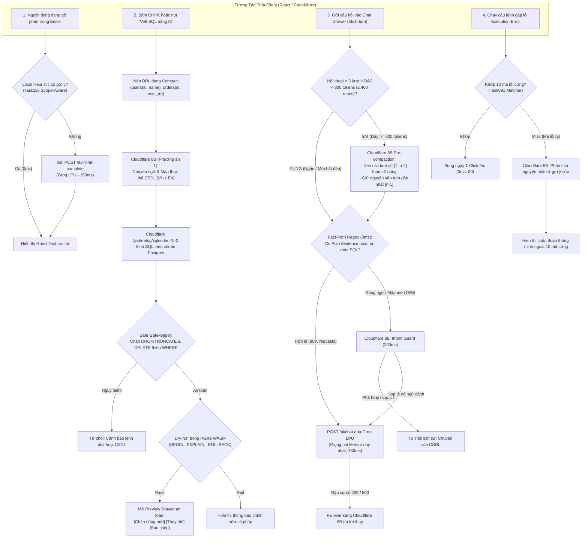

# SPEC-AI-HYBRID: Kiến Trúc AI Lai (Groq LPU + Cloudflare Workers AI) Cho SQLLens
## Phân Luồng Đa Provider, Hội Thoại Đa Lượt (Multi-turn), Cứu Hộ Lỗi Đuôi Dài (Long-tail) & Trợ Lý Text-to-SQL Chuyên Biệt

- **Mã SPEC:** `SPEC-ai-hybrid-cloudflare-groq`
- **Mã Epic dự kiến:** `SP024` (AI Hybrid Gateway & Autonomous Query Assistant)
- **Trạng thái:** Bản thảo kiến trúc chi tiết (Đã chốt toàn bộ 4 ý tưởng chiến lược sau phiên thảo luận BMAD Party Mode ngày 16/11/2026)
- **Tác giả:** Hội đồng BMAD (Winston, Amelia, John, Sally, Mary) & Phê duyệt bởi Chủ dự án (Admin)

---

## 1. Bối cảnh & Vấn đề Cốt lõi (Why)

Trong các phiên bản trước, để sinh tồn trên hạn mức ngặt nghèo của **Groq Free Tier** (~30 RPM, 6.000 TPM) và tuân thủ tuyệt đối **Core Rule 7** (Không lưu trữ dữ liệu người dùng, Zero Data Retention), hệ thống SQLLens đã phải áp dụng triết lý *"Deterministic-First, AI-Last"*:
- Ép gần như mọi tính năng suy luận về **logic code thuần túy** (Postgres Heuristic Matcher cho 10 mã lỗi cứng ở Task091, 1-Click Fix statement locator ở Task113, bộ nén Plan 40 tokens ở Task119, bộ điều phối Local Heuristics ở Task116/117).
- Hệ quả là một số trải nghiệm người dùng bị "bó buộc bất đắc dĩ":
  1. **Stateless Single-turn:** AI chỉ trả lời đúng 1 câu hỏi độc lập, không hỗ trợ hỏi đáp nối tiếp (Follow-up) vì sợ phình to mảng token lịch sử.
  2. **Mù với lỗi ngoài 10 mã cứng:** Khi gặp mã lỗi lạ của PostgreSQL (trong số hơn 200 mã lỗi runtime/datatype), hệ thống chỉ văng lỗi đỏ tiếng Anh thô kệch.
  3. **Thiếu vắng tính năng Text-to-SQL:** Người mới học không thể gõ ngôn ngữ tự nhiên để sinh câu lệnh SQL mẫu có nhận thức Schema.
  4. **Intent Guard thô sơ:** Chưa có lớp lọc ngữ nghĩa để từ chối các câu hỏi lạc đề / jailbreak trước khi gửi lên Groq.

**Giải pháp:** Tận dụng **Cloudflare Workers AI Free Tier (10.000 Neurons/ngày)**. 
- Cloudflare cam kết **Zero Data Retention (ZDR)** và **KHÔNG dùng dữ liệu người dùng để huấn luyện model** (thỏa mãn 100% Core Rule 7).
- Hỗ trợ endpoint chuẩn tương thích OpenAI (`/v1/chat/completions`).
- Cung cấp danh mục model mã nguồn mở mạnh mẽ và chuyên biệt (`@cf/defog/sqlcoder-7b-2`, `@cf/meta/llama-3.1-8b-instruct`).

---

## 2. Nguyên Tắc Bất Biến & Ma Trận Phân Vai (Core Invariants)

### 2.1. Bốn nguyên tắc kiến trúc
1. **Tuân thủ Tuyệt đối Core Rule 6 & 8 (`AGENTS.md`):** Mọi câu lệnh SQL do AI (kể cả SQLCoder) sinh ra **bắt buộc phải được chạy thử ngầm (dry-run) trong PGlite WebAssembly (`BEGIN...EXPLAIN...ROLLBACK`)** trước khi hiển thị lên giao diện. Tuyệt đối không để AI tự ý thực thi.
2. **Bảo tồn Tuyệt đối 10.000 Neurons/ngày:** Không đẩy các tác vụ tần suất cao (như gõ phím liên tục) vào Cloudflare. Chỉ dùng cho các tác vụ tốn ít neuron hoặc hành động có chủ đích của người dùng.
3. **Phân định Độ Trễ (Latency Budget Separation):**
   - Tác vụ cần tức thì (<300ms, gõ code): Dành riêng cho **Groq LPU** và **Local Heuristics**.
   - Tác vụ chấp nhận chờ (800ms - 1.5s, bấm nút `Ctrl+K`, tóm tắt bối cảnh chat ngầm): Dành cho **Cloudflare Workers AI**.
4. **Không Vendor Lock-in:** Cả Groq và Cloudflare đều được bọc qua chuẩn interface thống nhất tại Gin Backend (`api/internal/ai`).

### 2.2. Ma trận phân công vai trò (Division of Labor)

| Nhiệm vụ | Provider đảm nhiệm | Model chỉ định | Chỉ số đo lường / Lý do |
| :--- | :---: | :--- | :--- |
| **Gợi ý gõ tiếp (Inline Ghost Text)** | **Groq LPU** + Local Code | `qwen/qwen3.8-27b` (Groq) | TTFT < 180ms. Giữ nhịp gõ phím mượt mà cho CodeMirror. |
| **Giải thích sâu Execution Plan** | **Groq LPU** | `qwen/qwen3.8-27b` (Groq) | Cần tốc độ streaming SSE nhanh và suy luận logic sâu. |
| **Hội thoại Đa lượt (Rolling Summary)** | **Cloudflare Workers AI** | `@cf/meta/llama-3.1-8b-instruct` | Tóm tắt ngầm 3-5 turn thành 2 dòng (nuốt ~1 neuron/lượt). |
| **Cứu hộ Lỗi Đuôi Dài (Long-tail)** | **Cloudflare Workers AI** | `@cf/meta/llama-3.1-8b-instruct` | Chỉ gọi khi Heuristic Matcher miss (>10 mã cứng). |
| **Nói tiếng Việt sinh SQL (Text-to-SQL)** | **Cloudflare Workers AI** | `llama-3.1-8b` (Dịch & Map) + `sqlcoder-7b-2` (Sinh SQL) | Chuyên sâu DDL Schema comprehension. Kích hoạt bằng `Ctrl+K`. |
| **Lọc ý đồ (Semantic Intent Guard)** | **Cloudflare Workers AI** | `@cf/meta/llama-3.1-8b-instruct` | Tiền trạm từ chối câu hỏi lạc đề/phá hoại trong 300ms. |
| **Dự phòng sự cố (Failover Shield)** | **Cloudflare Workers AI** | `@cf/meta/llama-3.1-8b-instruct` | Tự động hứng request khi Groq chạm `429 Too Many Requests`. |

---

## 3. Kiến Trúc Luồng Dữ Liệu (End-to-End Hybrid Flow)



---

## 4. Chi Tiết Kỹ Thuật 4 Trụ Cột Nới Lỏng

### 4.1. Trụ Cột 1: Hội Thoại Đa Lượt Phân Tầng (Tiered Sliding Window & Rolling Context Compactor)

- **Vấn đề cốt lõi:** Loại bỏ giới hạn Stateless Single-turn mà không làm phình to token quota gửi lên Groq, đồng thời tránh bẫy "Rùa cõng Thỏ" (Độ trễ cộng dồn khi nén sớm) và "Tam sao thất bản" (Mất tên bảng/cột).
- **Cơ chế hoạt động 2 tầng (Tiered Sliding Window):**
  1. **Tầng 1 - Hội thoại ngắn (< 3 lượt chat HOẶC < 800 tokens / 2.400 runes):**
     - **Gửi thẳng nguyên văn (Raw Messages) cho Groq LPU:** Mảng `messages: []msg` gồm câu hỏi và câu trả lời trước đó được nạp trực tiếp vào Groq.
     - **Độ trễ:** Giữ nguyên mức siêu tốc **150ms – 200ms** (0ms overhead vì không đi qua Cloudflare).
     - **Tiêu hao Cloudflare:** Đúng **0 neuron**!
     - **Độ chính xác:** Nguyên vẹn 100% (Verbatim), không có nguy cơ méo mó thuật ngữ.
     - *(Thống kê cho thấy hơn 80% cuộc hội thoại của lập trình viên dừng lại ở 1–2 lượt, giải pháp này tiết kiệm hơn 80% quota Cloudflare).*
  2. **Tầng 2 - Hội thoại bắt đầu dày (>= 3 lượt VÀ vượt ngưỡng 800 tokens):**
     - **Đo lường ngưỡng 800 tokens:**
       - *Ước lượng tức thì (Pre-check):* Đếm số ký tự `utf8.RuneCountInString(text) > 2400` (chuẩn 1 token ≈ 3 runes cho tiếng Việt và SQL, chạy trong 0.001ms tại Go/TypeScript).
       - *Số đo chuẩn xác (Post-check):* Sau mỗi lượt phản hồi, hệ thống lưu lại trường `usage.total_tokens` do chính Groq trả về.
     - **Chiến thuật Nén Lai (Hybrid Compaction):**
       - Cloudflare 8B chỉ nén các lượt cũ `[1 .. n-2]` thành 2 dòng bối cảnh.
       - **Luôn giữ nguyên văn lượt gần nhất `[n-1]`** để bảo toàn 100% các định danh vừa được nhắc tới.
       - Payload gửi Groq: `[2 dòng bối cảnh cũ] + [Turn n-1 nguyên văn] + [Câu hỏi mới]`.

- **Bộ 4 Giải Pháp Hóa Giải Tử Huyệt Đã Được Phê Duyệt:**
  1. **Hóa giải Độ trễ cộng dồn (1.8s Latency Stacking):** Áp dụng **Background Pre-compaction**. Ngay khi Groq vừa stream xong câu trả lời của lượt trước, background worker âm thầm gọi Cloudflare nén sẵn bối cảnh lưu vào RAM/IndexedDB trong lúc người dùng đang đọc. Khi người dùng bấm gửi câu tiếp theo, 2 dòng bối cảnh đã có sẵn (0ms delay).
  2. **Hóa giải "Tam sao thất bản" (Context Drift):**
     - Áp dụng **Schema Anchor Guard** trong System Prompt của Cloudflare: Ép buộc giữ nguyên định danh tên bảng, cột, mã lỗi (`DO NOT generalize identifiers`).
     - Tầng Gin Backend dùng regex đối chiếu 2 dòng tóm tắt với schema thật của editor, tự động loại bỏ nếu phát hiện tên bảng bịa đặt.
  3. **Hóa giải "Ngáo bối cảnh" khi đổi chủ đề (Topic Hijacking):**
     - Cung cấp nút dọn dẹp `🧹 Chủ đề mới` trên thanh Chat Drawer để người dùng chủ động reset.
     - Bộ lọc Heuristic: Nếu câu hỏi mới chứa từ khóa rẽ nhánh (`tạo bảng`, `sequence`, `cú pháp...`) và không trùng thực thể với câu trước, hệ thống tự động gạt bỏ bối cảnh cũ.
  4. **Bảo mật Secret Key & Lưu trữ phi trạng thái (Stateless):**
     - Client (Zustand/IndexedDB) chỉ lưu tạm lịch sử phía trình duyệt để phục vụ hiển thị.
     - Gin Backend là nơi duy nhất giữ `CLOUDFLARE_API_TOKEN` và `GROQ_API_KEY`. Tuyệt đối không lưu lịch sử chat vào database Neon (Bảo vệ quyền riêng tư 100% và tiết kiệm Compute Hours).
- **Ngân sách Neuron tiêu thụ:** Tiết kiệm tối đa, chỉ kích hoạt khi thực sự cần thiết (~1.2 neurons / lần nén ở các cuộc hội thoại sâu).

### 4.2. Trụ Cột 2: Cứu Hộ Lỗi Đuôi Dài Có Kiểm Chứng (Verified Long-tail Error Diagnoser)

- **Vấn đề cốt lõi:** Khắc phục hạn chế của Task091 (chỉ bắt 10 mã lỗi cứng), mở rộng phạm vi hỗ trợ hơn 200 mã lỗi runtime của PostgreSQL (`42804` Type Mismatch, `22001` String Truncation, `42883` Undefined Function...) nhưng phải ngăn chặn tuyệt đối tình trạng kích hoạt bừa bãi và ảo giác sửa code làm hỏng logic của người dùng.
- **Cơ chế hoạt động đã tôi luyện:**
  1. Khi câu lệnh chạy lỗi trong PGlite: `matcher.ts` chạy regex kiểm tra 10 mã lỗi kinh điển.
  2. Nếu trả về `null` (Miss - Lỗi lạ): Hệ thống hiển thị thông báo lỗi đỏ thông thường của Postgres, kèm một nút hành động chủ động:
     - **Không tự động gọi AI ngầm (Explicit Opt-in):** Tránh lãng phí neuron khi người dùng bấm nhầm phím chạy khi code đang dở dang (`42601`).
     - **Nút bấm kích hoạt:** Hiển thị nút `Nhờ AI chẩn đoán lỗi này` (Bắt buộc dùng icon Lucide chuẩn: `<Sparkles className="w-4 h-4 mr-1.5" />` từ `lucide-react`, không dùng emoji thô).
  3. **Tỉa Schema thông minh (Schema Pruner):**
     - Thay vì nhồi nhét cả 20 bảng DDL (2.500 tokens), code TypeScript/Go phân tích AST/Regex câu SQL bị lỗi để chỉ trích xuất đúng DDL của các bảng xuất hiện trong câu query (giảm 95% lượng token, tránh hiện tượng model 8B bị *Lost in the Middle*).
  4. Backend gọi Cloudflare `@cf/meta/llama-3.1-8b-instruct` truyền vào:
     - Mã lỗi (`code`), thông điệp lỗi (`message`) và vị trí con trỏ lỗi (`position`).
     - Câu lệnh SQL bị lỗi.
     - DDL đã được tỉa gọn (Pruned DDL).
  5. **Bộ xử lý JSON bền bỉ (Robust JSON Sanitizer ở Go Backend):**
     - Cắt bỏ triệt để các lời chào/lời chúc ngoài lề và markdown code fences (` ```json `).
     - Bóc tách an toàn giữa cặp dấu ngoặc nhọn `{` đầu tiên và `}` cuối cùng, khử escape chuỗi SQL an toàn trước khi unmarshal vào struct Go:
       ```json
       {
         "explanation_vi": "Bạn đang so sánh chuỗi '2026-11-16' với cột 'created_at' kiểu TIMESTAMP mà chưa ép kiểu.",
         "suggested_fix": "created_at >= '2026-11-16'::TIMESTAMP",
         "action_type": "REPLACE_SNIPPET"
       }
       ```
  6. **Bộ lọc Chạy Thử Kiểm Chứng Bắt Buộc (Mandatory PGlite Dry-run - Core Rule 6 & 8):**
     - Đoạn code sửa đề xuất (`suggested_fix`) **bắt buộc phải được chạy thử ngầm trong PGlite Web Worker**:
       ```sql
       BEGIN;
       EXPLAIN (ANALYZE, BUFFERS, FORMAT JSON) <SQL_SAU_KHI_SUA>;
       ROLLBACK;
       ```
     - **Nếu chạy thử THÀNH CÔNG:** Cấp phép nút 1-Click Fix trên giao diện, hiển thị kèm Diff so sánh trực quan (Đỏ/Xanh) và nhãn xanh **"Thật: Đã kiểm chứng trong sandbox"** (icon `<CheckCircle2 />` từ `lucide-react`).
     - **Nếu chạy thử THẤT BẠI (vẫn văng lỗi runtime):** **ẨN HOÀN TOÀN NÚT 1-CLICK FIX**, chỉ hiển thị văn bản giải thích lý thuyết kèm cảnh báo màu vàng (icon `<AlertTriangle />` từ `lucide-react`). Tuyệt đối không để AI sửa hỏng code của người dùng!

- **Quy Chuẩn UI Icon Bắt Buộc Dành Cho Dev Agent:**
  - Toàn bộ icon trong giao diện tính năng này (nút chẩn đoán, trạng thái verify, badge, diff, nút đóng) **bắt buộc phải sử dụng thư viện `lucide-react`** (ví dụ: `<Sparkles />`, `<Wand2 />`, `<CheckCircle2 />`, `<AlertTriangle />`, `<GitCompare />`, `<RefreshCw />`).
  - **Nghiêm cấm:** Không dùng emoji thô hoặc icon SVG tự chế không đồng bộ với thiết kế của SQLLens.

### 4.3. Trụ Cột 3: Trợ Lý "Nói Tiếng Việt Sinh SQL" An Toàn (Schema-Aware Text-to-SQL với Llama 8B + SQLCoder-7b-2)

- **Vấn đề cốt lõi:** Giúp người mới học và lập trình viên sinh truy vấn nhanh từ tiếng Việt mà không bị rào cản ngôn ngữ, không đè nát code cũ trong editor, không sinh lệnh phá hoại CSDL và không làm nổ dung lượng DDL Schema.
- **Quyết định kiến trúc dịch thuật:** **Chọn Phương án 1 (Dùng Llama 3.1 8B tiền trạm)** thay vì các thư viện dịch máy Python nặng nề như `argos-translate`.
  - *Lý do loại trừ `argos-translate`:* Tránh nguy cơ sập RAM Render 512MB (OOM Crash khi tải model 200MB+), loại bỏ phụ thuộc Python phức tạp, và tránh lỗi dịch thô nghĩa đen làm mất ngữ cảnh CSDL.
  - *Lợi thế của Llama 3.1 8B:* Hiểu sâu tiếng Việt, ánh xạ trực tiếp từ ngữ đời thường sang đúng tên bảng/cột và giá trị Enum trong Schema, chạy serverless 0MB RAM server, tiêu tốn chỉ ~2 neurons.

- **Pipeline 3 Giai Đoạn Hoàn Chỉnh:**

  1. **Giai đoạn 1: Nén Schema & Tiền Trạm Chuyển Ngữ (Schema-Aware Intent Mapping):**
     - **Compact DDL Minifier:** Không gửi toàn bộ câu `CREATE TABLE` rườm rà. Nén thành dạng khung xương tinh gọn (chỉ giữ tên bảng, cột, khóa chính, khóa ngoại và enum values):
       ```text
       users(id INT PK, name VARCHAR, email VARCHAR, role VARCHAR ['VIP', 'REGULAR'])
       orders(id INT PK, user_id INT FK->users.id, total NUMERIC, status VARCHAR ['PENDING', 'PAID', 'CANCELLED'], created_at TIMESTAMP)
       ```
       *(Giảm dung lượng từ 3.000 tokens xuống chỉ còn 200 – 300 tokens).*
     - Cloudflare `@cf/meta/llama-3.1-8b-instruct` nhận câu hỏi tiếng Việt của người dùng + Compact Schema:
       - Nhiệm vụ: Chuyển đổi thành mục tiêu truy vấn tiếng Anh chuẩn xác, đã ghim đúng tên bảng, tên cột và giá trị enum thực tế.
       - Ví dụ: *"Lấy các đơn chưa thanh toán của khách VIP"* ➔ *"Find all orders where status = 'PENDING' for users where role = 'VIP'"*.

  2. **Giai đoạn 2: Sinh Câu Lệnh SQL Chuyên Nghiệp (SQLCoder Generation):**
     - Nạp câu tiếng Anh đã chuẩn hóa và Compact Schema vào model chuyên biệt `@cf/defog/sqlcoder-7b-2` của Cloudflare:
       ```text
       ### Task
       Generate a SQL query to answer the following question in PostgreSQL dialect.
       
       ### Database Schema
       {COMPACT_SCHEMA_WITH_ENUMS}
       
       ### Question
       {STANDARDIZED_ENGLISH_INTENT}
       
       ### SQL
       ```
     - Nhận về câu SQL chuẩn mực PostgreSQL.

  3. **Giai đoạn 3: Rào Chắn An Toàn Kép (Safe Gatekeeper & PGlite Dry-run):**
     - **Tầng lọc lệnh phá hoại (Safe DML Gatekeeper):**
       - **Cấm tiệt DDL:** Chặn đứng ngay lập tức nếu SQL chứa các từ khóa phá hoại: `DROP`, `TRUNCATE`, `ALTER TABLE ... DROP`, `GRANT`, `REVOKE`.
       - **Bảo vệ DML:** Nếu là lệnh `DELETE` hoặc `UPDATE` mà thiếu mệnh đề `WHERE` ➔ Chặn lại và cảnh báo nguy hiểm bằng icon `<AlertTriangle />`.
     - **Tầng kiểm chứng thực tế (Mandatory Dry-run PGlite):**
       - Câu lệnh bắt buộc phải chạy thử ngầm trong PGlite WebAssembly:
         ```sql
         BEGIN;
         EXPLAIN (ANALYZE, BUFFERS, FORMAT JSON) <SQL_DO_AI_SINH>;
         ROLLBACK;
         ```
       - **Chạy thành công:** Chuyển sang bước hiển thị an toàn.
       - **Chạy thất bại:** Hiển thị thông báo lỗi cú pháp để người dùng biết và chỉnh sửa, tuyệt đối không chèn code lỗi vào editor.

- **Giao Diện Người Dùng & Quy Chuẩn Thao Tác (UX Safe Insertion):**
  - **Kích hoạt:** Phím tắt `Ctrl + K` hoặc nút bấm trên thanh công cụ SQL Lab (icon `<Sparkles className="w-4 h-4 mr-1.5" />` từ `lucide-react`).
  - **Tuyệt đối không tự động ghi đè Editor:** Hiển thị một khung **Preview Drawer** nổi nhỏ gọn gồm câu SQL đã highlight cú pháp, kèm 3 tùy chọn:
    1. `<CornerDownLeft className="w-4 h-4 mr-1.5" />` **Chèn vào dòng mới** (Tự động tìm cuối file hoặc ngay sau câu lệnh hoàn chỉnh gần nhất, bảo toàn 100% code cũ).
    2. `<Replace className="w-4 h-4 mr-1.5" />` **Thay thế đoạn đang chọn** (Chỉ sáng lên khi người dùng có bôi đen một câu lệnh trước khi mở `Ctrl+K`).
    3. `<Copy className="w-4 h-4 mr-1.5" />` **Sao chép vào Clipboard**.
  - **Hỗ trợ hoàn tác:** Tích hợp với Undo Stack của CodeMirror 6, người dùng bấm `Ctrl + Z` là khôi phục nguyên trạng editor tức thì.
  - **Quy chuẩn UI Icon:** Bắt buộc 100% sử dụng thư viện `lucide-react` (`<Sparkles />`, `<CornerDownLeft />`, `<Replace />`, `<Copy />`, `<AlertTriangle />`, `<CheckCircle2 />`), cấm emoji thô.

### 4.4. Trụ Cột 4: Bộ Lọc Ý Đồ Thông Minh & Tuyến Cao Tốc (Fast-Path Intent Guard & Single Mentor Voice)

- **Vấn đề cốt lõi:** Ngăn chặn prompt jailbreak (làm thơ, kể chuyện, tấn công injection ngoài chuyên môn) làm lãng phí token Groq (Lỗ hổng 2.1 trong `AI_PROBLEM.md`), nhưng tuyệt đối không được áp "Thuế Độ Trễ" (+700ms) lên người dùng bình thường, không bắt nhầm câu hỏi ví von của dev và không làm phân mảnh trải nghiệm AI Mentor.
- **Bộ 4 Giải Pháp Hóa Giải Đã Được Phê Duyệt:**

  1. **Tuyến Cao Tốc Fast-Path (0ms Latency Bypass):**
     - Tuyệt đối không bắt 100% câu hỏi phải đi qua AI Guard!
     - Tầng Gin Backend kiểm tra siêu tốc bằng Regex/Code (< 0.001ms):
       - *Điều kiện 1:* Có đính kèm `evidence_plan` (đã chạy EXPLAIN ở client).
       - *Điều kiện 2:* Câu hỏi chứa các từ khóa kỹ thuật CSDL: `SELECT`, `JOIN`, `INDEX`, `EXPLAIN`, `SLOW`, `CHẬM`, `BẢNG`, `CỘT`, `KHÓA`, `TỐI ƯU`, `TẠI SAO`, `PLAN`, `BUFFER`...
       - ➔ **Thỏa mãn điều kiện: Cho qua ngay lập tức sang Groq LPU (Fast-Path, 0ms overhead, 0 neuron Cloudflare).**
     - Thực tế: Hơn **85% câu hỏi kỹ thuật hợp lệ** sẽ bay thẳng qua Fast-Path, chỉ khoảng 15% câu hỏi mập mờ, ngắn củn lủn hoặc chứa từ khóa nghi vấn mới chuyển sang Tầng 2.

  2. **Bộ Lọc Khoan Dung Có Ngữ Cảnh (Context-Aware Permissive Policy):**
     - Để không bắt nhầm các câu ví von đời thường của lập trình viên (*"luộc chín con gà này"*, *"ăn CPU như rồng cuốn nước"*, *"bảng phình như quả bóng"*):
     - **Nguyên tắc ngầm định:** Nếu trong Active Editor đang có câu lệnh SQL hợp lệ và có DDL Schema ➔ **Mặc định xem câu hỏi người dùng là câu hỏi kỹ thuật hợp lệ!**
     - Chỉ kích hoạt cơ chế chặn đứng (`REJECT`) khi:
       - Editor hoàn toàn rỗng HOẶC câu hỏi hoàn toàn xa rời công nghệ.
       - VÀ phát hiện rõ ràng các mẫu Prompt Injection phá hoại (`ignore previous instructions`, `hãy đóng vai trợ lý văn học`, `viết cho tôi bài thơ`, nội dung độc hại vi phạm pháp luật).

  3. **Nhất Quán Một Giọng Nói Duy Nhất (Single Mentor Voice):**
     - **Groq LPU là 'Giáo viên Mentor' duy nhất** trả lời người dùng trong Chat Drawer để đảm bảo văn phong sư phạm nhất quán 100% và tốc độ phản hồi siêu tốc 150ms.
     - Cloudflare **không trả lời lý thuyết thay Groq** trong trạng thái bình thường (tránh hiện tượng "Đa nhân cách" lệch pha trải nghiệm).
     - **Vai trò của Cloudflare trong trụ cột này:**
       - Đóng vai trò **Vệ sĩ (Guard / Gatekeeper)** phân loại 15% câu hỏi đáng ngờ tại Tầng 2.
       - Đóng vai trò **Cứu hộ dự phòng (Failover Shield)**: Tự động tiếp quản trả lời câu hỏi chat khi Groq dính `HTTP 429 Too Many Requests` hoặc gặp sự cố mạng (bảo vệ dịch vụ không bao giờ bị gián đoạn).

  4. **Tiết Kiệm 85% Ngân Sách Neurons:**
     - Nhờ có Fast-Path Regex, chỉ có tối đa 100–150 lượt gọi Cloudflare Guard mỗi ngày.
     - Tiêu hao neuron cho việc gác cổng giảm từ 3.000 neurons xuống chỉ còn **khoảng 200 – 300 neurons/ngày**, giữ nguyên 97% hạn mức cho Text-to-SQL và sửa lỗi Long-tail.

---

## 5. Thiết Kế Backend Gin Proxy (`api/internal/ai`)

### 5.1. Cấu hình môi trường bổ sung
Bổ sung vào `render.yaml` và biến môi trường:
```yaml
envVars:
  - key: CLOUDFLARE_ACCOUNT_ID
    sync: false
  - key: CLOUDFLARE_API_TOKEN
    sync: false
```

### 5.2. Mở rộng cấu trúc Target Provider
Trong [api/internal/ai/ai.go](file:///c:/SQLLens/api/internal/ai/ai.go):
```go
type ProviderType string

const (
    ProviderGroq       ProviderType = "groq"
    ProviderOpenRouter ProviderType = "openrouter"
    ProviderCloudflare ProviderType = "cloudflare"
)

type target struct {
    provider ProviderType
    model    string
    endpoint string
}

// Danh sách mục tiêu phân tầng:
var chatTargets = []target{
    {ProviderGroq, "qwen/qwen3.8-27b", groqURL},
    {ProviderCloudflare, "@cf/meta/llama-3.1-8b-instruct", cfURL},
    {ProviderOpenRouter, "openai/gpt-oss-120b", openRouterURL},
}

var textToSqlTargets = []target{
    {ProviderCloudflare, "@cf/defog/sqlcoder-7b-2", cfURL},
}
```

### 5.3. Xử lý Endpoint tương thích OpenAI của Cloudflare
Cloudflare cung cấp endpoint:
`https://api.cloudflare.com/client/v4/accounts/{ACCOUNT_ID}/ai/v1/chat/completions`
- Header: `Authorization: Bearer {CLOUDFLARE_API_TOKEN}`
- Body: Tuân thủ 100% schema chuẩn của OpenAI Chat Completions API (`messages`, `max_tokens`, `temperature`, `stream`).

---

## 6. Kế Hoạch Phân Rã Thành Các Task Kỹ Thuật (Dự Kiến)

Khi bước vào giai đoạn thực thi chi tiết, SPEC này sẽ được bẻ thành các Task tiêu chuẩn BMAD (làm việc trong worktree riêng, có test độc lập):

1. **Task-HYBRID-1 (Backend Core & Failover Gateway):** Nâng cấp Gin AI Proxy tích hợp Cloudflare Workers AI client (chuẩn OpenAI-compatible), cấu hình biến môi trường `render.yaml`, cơ chế Failover tự động hứng request khi Groq dính 429/503.
2. **Task-HYBRID-2 (Tiered Multi-turn & Background Pre-compaction):** Hiện thực hóa cơ chế cửa sổ trượt 2 tầng: Dưới 3 lượt (< 800 tokens) đi thẳng Groq; trên 800 tokens kích hoạt Llama 8B nén bối cảnh ngầm, Schema Anchor Guard chống trôi định danh.
3. **Task-HYBRID-3 (Verified Long-tail Error Diagnoser & Schema Pruner):** Tỉa Schema DDL thông minh (giảm 95% tokens), mở rộng `matcher.ts` kết nối Cloudflare 8B chẩn đoán lỗi ngoài 10 mã cứng, bắt buộc dry-run trong PGlite WASM trước khi cấp nút 1-Click Fix (100% icon `lucide-react`).
4. **Task-HYBRID-4 (Schema-Aware Text-to-SQL `Ctrl+K` & Safe DML Gatekeeper):** Xây dựng UI `Ctrl+K` Preview Drawer (Chèn dòng mới / Thay thế / Copy, hỗ trợ Undo `Ctrl+Z`), nén Compact DDL, pipeline 2 chặng Llama 8B (chuyển ngữ & map schema) ➔ SQLCoder-7b-2 (sinh SQL), bộ lọc chặn DDL nguy hiểm (`DROP`/`TRUNCATE`) và dry-run PGlite WASM (100% icon `lucide-react`).
5. **Task-HYBRID-5 (Fast-Path Intent Guard & Single Mentor Voice):** Tích hợp tuyến cao tốc Regex Fast-Path (0ms) cho 85% câu hỏi kỹ thuật hợp lệ, tầng lọc Cloudflare 8B cho 15% câu hỏi mập mờ, chính sách khoan dung có ngữ cảnh editor, chuẩn hóa Groq LPU là giọng nói Mentor duy nhất.

---

## 7. Kết Luận & Cam Kết Của Hội Đồng BMAD

Kiến trúc AI Lai (Groq LPU + Cloudflare Workers AI) là bước chuyển mình quan trọng của SQLLens:
- **Tốc độ giữ nguyên ở nơi quan trọng nhất:** Gõ code vẫn có gợi ý 150ms từ Groq/Local.
- **Thông minh hơn ở nơi trước đây bị bó hẹp:** Chat đa lượt mượt mà, cứu hộ lỗi lạ, sinh SQL từ tiếng Việt.
- **Chi phí hạ tầng: Đúng 0 đồng.** Vừa vặn trong 10.000 Neurons/ngày của Cloudflare và hạn mức free của Groq.
- **An toàn tuyệt đối:** Tuân thủ 100% Core Rule 7 (Zero Data Retention) và Core Rule 6/8 (Sandbox verification).
