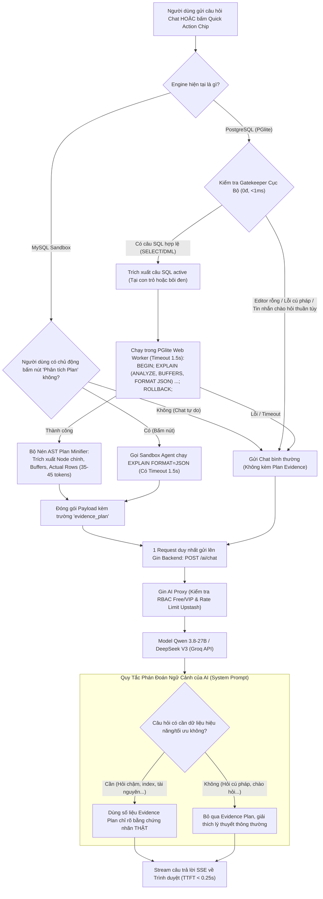

# SPEC-AI-PLAN-EVIDENCE: Tích Hợp Kế Hoạch Thực Thi (Execution Plan Evidence) Tự Động Cho AI Mentor
## Zero-Latency In-Browser EXPLAIN, 40-Token AST Minifier & Upfront Evidence Feeding

- **Mã SPEC:** `SPEC-ai-plan-evidence`
- **Thuộc Epic:** `SP018` (AI Mentor Deep Optimizer Intelligence) / **Stories:** `STR086 - STR088`
- **Trạng thái:** Bản thảo chi tiết (Đồng thuận 100% từ Hội đồng BMAD sau phiên thảo luận Party Mode ngày 14/11/2026)
- **Tác giả:** Hội đồng BMAD (Winston, Amelia, John, Sally, Mary, Vex) & Phê duyệt bởi Chủ dự án (Admin)

---

## 1. Bối cảnh & Lý do (Why)

Trong hệ thống SQLLens, tính năng **AI Mentor** đóng vai trò là gia sư/chuyên gia giải thích CSDL 1-1 cho người học và lập trình viên. Tuy nhiên:
- Khi người dùng hỏi các câu hỏi về hiệu năng (ví dụ: *"Tại sao câu này chạy chậm?"*, *"Sao tôi tạo index rồi mà query không dùng?"*, *"Câu lệnh này nuốt bao nhiêu tài nguyên?"*), các mô hình ngôn ngữ lớn (LLM) thông thường chỉ suy đoán lý thuyết chung chung (mô phỏng hoặc ước lượng mù), không thể đưa ra chẩn đoán chính xác tuyệt đối theo dữ liệu thực tế của sandbox.
- Câu lệnh `EXPLAIN (ANALYZE, BUFFERS, FORMAT JSON)` trong PostgreSQL là nguồn chân lý tuyệt đối (**Ground Truth - Nhãn "Thật"**), cung cấp: Node thực thi thực tế (Seq Scan, Index Scan, Bitmap Heap Scan...), số dòng thực tế (actual rows) so với ước lượng của optimizer, số trang đĩa (shared buffer hits/reads) và thời gian thực thi.
- **Thách thức:** 
  1. Nếu cho AI tự ý gọi Tool (`explain_query`) sẽ gây ra độ trễ mạng cực lớn (4 chặng khứ hồi Client ↔ Server ↔ LLM mất 3-4 giây) và vi phạm nghiêm trọng **Nguyên tắc số 6** (`AGENTS.md`: *"AI chỉ nhận dữ liệu làm bằng chứng và không có quyền gọi công cụ"* - tránh rủi ro Prompt Injection phá hoại CSDL).
  2. Nếu chạy `EXPLAIN ANALYZE` bừa bãi không kiểm soát sẽ gây nguy cơ chạy thật các câu lệnh thay đổi dữ liệu (DML), hoặc làm phình to token (một plan JSON thô ngốn 1.000 - 2.000 tokens) gây sập hạn mức rate-limit và cháy ngân sách API.

---

## 2. Nguyên tắc Bất biến & Giới hạn Thiết kế (Core Invariants)

1. **Tuân thủ Tuyệt đối Nguyên tắc số 6 (`AGENTS.md`):** AI Mentor không có quyền Tool Calling. Mọi dữ liệu đo đạc phải do hệ thống Frontend/Backend thu thập và kiểm duyệt an toàn trước khi cung cấp cho AI dưới dạng bằng chứng tĩnh (`<QUERY_PLAN_EVIDENCE>`).
2. **Bảo vệ Trạng thái Dữ liệu (State Isolation):** Mọi lệnh `EXPLAIN ANALYZE` trên PGlite Client bắt buộc phải chạy trong giao dịch tự hủy:
   ```sql
   BEGIN;
   EXPLAIN (ANALYZE, BUFFERS, FORMAT JSON) <query>;
   ROLLBACK;
   ```
   Dữ liệu bảng không bao giờ bị biến đổi (ngoại trừ sequence counter như `nextval` tuân theo hành vi mặc định của Postgres engine).
3. **Không Gây Tải Lên Server (Zero Server Load for Postgres):** 
   - Với PostgreSQL: 100% lệnh `EXPLAIN` chạy trong PGlite WASM (Web Worker trên trình duyệt người dùng). Không tiêu tốn 1 byte RAM hay 1 chu kỳ CPU của Gin Backend trên Render.
   - Với MySQL: Do chạy trên Docker Azure VM B2ats v2 (tài nguyên giới hạn 2 vCPU), **tuyệt đối KHÔNG tự động chạy ngầm**. Chỉ chạy khi người dùng chủ động bấm nút chẩn đoán (Explicit Action).
4. **Bộ Nén Siêu Cấp 40 Tokens (AST Minifier):** Cắt gọt 97% dung lượng JSON thô, chỉ gửi duy nhất 1-2 dòng tóm tắt tinh gọn (35 - 45 tokens), triệt tiêu nguy cơ cạn kiệt token quota.
5. **Zero Latency Penalty (1 Request Duy Nhất):** Không phát sinh round-trip mạng thăm dò. Dữ liệu Plan được tính toán cục bộ trong 3-5ms tại trình duyệt và đính kèm ngay trong payload chat ban đầu gửi lên Gin Proxy.

---

## 3. Kiến trúc Luồng Dữ liệu (End-to-End Architecture)



---

## 4. Chi Tiết Kỹ Thuật Từng Thành Phần

### 4.1. Gatekeeper 0 Đồng Tại Máy Khách (Client-Side Fast Filter)
Chạy hoàn toàn bằng code TypeScript cục bộ trong 0ms trước khi kích hoạt PGlite:
1. **Kiểm tra Editor:** Nếu nội dung Editor rỗng hoặc không chứa ít nhất 1 câu lệnh hợp lệ thuộc danh mục `EXPLAINABLE` (`SELECT`, `INSERT`, `UPDATE`, `DELETE`, `MERGE`), bỏ qua hoàn toàn.
2. **Kiểm tra Tin Nhắn Chào Hỏi Ngắn:** Nếu câu chat người dùng có độ dài `< 10 ký tự` hoặc khớp biểu thức chào hỏi cơ bản (`/^(hi|hello|chào|bạn là ai|alo)\b/i`), bỏ qua không chạy EXPLAIN.
3. **Xác định Tọa Độ Thực Thi:**
   - Nếu người dùng có bôi đen đoạn mã (Selection) -> Chỉ EXPLAIN đoạn bôi đen.
   - Nếu không bôi đen -> Lấy câu lệnh tại vị trí con trỏ soạn thảo (Statement at cursor).

### 4.2. Bộ Nén Siêu Cấp Plan AST Minifier (`planMinifier.ts`)
Một kết quả `EXPLAIN (ANALYZE, BUFFERS, FORMAT JSON)` của Postgres chứa hàng trăm thuộc tính lặp lại (Startup Cost, Total Cost, Plan Width, Output, Shared Hit, Shared Read, Local, Temp...).
Bộ nén cục bộ duyệt qua cây Node của JSON và chỉ lọc ra các thông số sống còn:
- `node_type`: Loại scan/join (Seq Scan, Index Scan, Bitmap Heap Scan, Hash Join...).
- `relation`: Tên bảng và tên Index tương ứng.
- `rows`: So sánh `actual_rows` vs `plan_rows` (nhận diện lệch thống kê - statistics drift).
- `buffers`: Tổng số `shared hit` + `shared read` (đo lường I/O trang đĩa).
- `filter`: Điều kiện lọc nếu có hoặc `index_cond`.

**Ví dụ Định dạng Đầu ra (Dưới 45 tokens):**
```text
[PLAN_EVIDENCE: Seq Scan on users | Actual Rows: 5 (Est: 5) | Buffers: 3 hit, 0 read | Filter: (age > 20) | Loops: 1]
```
Nếu là một câu lệnh JOIN phức tạp có 2-3 tầng:
```text
[PLAN_EVIDENCE: Hash Join | Actual Rows: 150 | Buffers: 12 hit, 4 read
-> Hash Cond: (o.user_id = u.id)
-> Seq Scan on orders o (Rows: 150, Buffers: 8 hit)
-> Hash -> Index Scan on users_pkey on users u (Rows: 10, Buffers: 4 hit)]
```
*Độ dài tối đa bị cắt ngọn ở mức 80 tokens, đảm bảo không bao giờ làm tràn context.*

### 4.3. Cấu Trúc System Prompt Cho AI Mentor
Trong Gin Proxy, khi phát hiện trường `evidence_plan` trong request, payload được định dạng:

```markdown
<QUERY_PLAN_EVIDENCE>
[PLAN_EVIDENCE: Seq Scan on users | Actual Rows: 5 (Est: 5) | Buffers: 3 hit, 0 read | Filter: (age > 20)]
</QUERY_PLAN_EVIDENCE>

HƯỚNG DẪN XỬ LÝ KẾ HOẠCH THỰC THI (QUERY PLAN):
1. Thẻ <QUERY_PLAN_EVIDENCE> ở trên là kết quả đo đạc THẬT từ database sandbox của người dùng cho câu truy vấn đang mở.
2. NẾU người dùng hỏi về hiệu năng, tốc độ, tối ưu hóa, chỉ mục (index), cách database xử lý hoặc chi phí I/O:
   - BẮT BUỘC sử dụng số liệu trong thẻ này làm BẰNG CHỨNG THỰC TẾ.
   - Chỉ rõ cho người dùng thấy: Optimizer đang dùng phương thức quét nào, đọc bao nhiêu block/trang bộ nhớ, và có hiện tượng quét toàn bảng (Seq Scan) hay không.
3. NẾU người dùng chỉ hỏi về cú pháp SQL, chào hỏi, hoặc hỏi khái niệm lý thuyết không liên quan đến hiệu năng của câu lệnh này:
   - HÃY BỎ QUA hoàn toàn thẻ <QUERY_PLAN_EVIDENCE> và trả lời trực tiếp câu hỏi của họ, không đề cập lan man đến Plan.
```

### 4.4. Trải Nghiệm Người Dùng (UX/UI Enhancements)
1. **Pill Badge Trạng Thái Ngữ Cảnh:**
   - Nằm ngay phía trên bên phải ô nhập chat của AI Mentor:
     `[⚡ Kèm Plan (~40 tokens)]`
   - **Trạng thái:**
     + *Sáng xanh ngọc (Active):* Khi có câu SQL hợp lệ trong editor, báo hiệu hệ thống đã sẵn sàng bằng chứng thực nghiệm.
     + *Clickable Toggle:* Người dùng có thể click để tắt (chuyển sang màu xám mờ: `[Plan: Tắt]`) nếu muốn tiết kiệm quota hoặc chat tán gẫu.
2. **Smart Quick-Action Chips (Gợi ý 1 chạm):**
   Khi người dùng vừa chạy câu lệnh hoặc đang phân vân trong Editor, AI Mentor hiển thị 3 chip gợi ý nhanh:
   - `[⚡ Vì sao câu này chạy chậm?]`
   - `[🔍 Optimizer có dùng Index không?]`
   - `[📊 Đọc bao nhiêu trang bộ nhớ?]`
   Khi bấm chip, hệ thống kích hoạt gửi tin nhắn kèm `evidence_plan` ngay lập tức.

### 4.5. Bảo Vệ Quota & Hạ Tầng (Resource & Cost Protection)
- **Tích hợp RBAC (Đã xây dựng tại SP016 Task106/107):**
  + **Free Tier:** Giới hạn 10 câu hỏi AI Mentor / ngày (quản lý bởi Upstash Redis Rate Limiter). Người dùng dùng hết lượt sẽ thấy thông báo nâng cấp VIP.
  + **VIP Tier:** Không giới hạn lượt hỏi phân tích sâu kèm Plan Evidence.
- **Statement Timeout Khắt Khe:** Lệnh `EXPLAIN ANALYZE` cục bộ được bọc timeout tối đa `1.500ms`. Nếu câu lệnh rơi vào vòng lặp hoặc tích Descartes nặng, PGlite tự động hủy truy vấn và trả về nhãn *"Không thể đo đạc do truy vấn vượt quá thời gian cho phép"*.

---

## 5. Phân Rã Stories & Tasks Chi Tiết (Bắt đầu từ Task119)

### 🌟 Story STR086: Client-Side Plan Minifier & Lightweight PGlite Hook
- **Mục tiêu:** Xây dựng module trích xuất SQL active, chạy `EXPLAIN (ANALYZE, BUFFERS)` an toàn trong PGlite và nén kết quả thành chuỗi tóm tắt dưới 40 tokens.
- **Task thực thi:**
  - `Task119`: Xây dựng hàm `runSafeExplainAnalyze(sql)` bọc `BEGIN...ROLLBACK` (timeout 1.5s), bộ nén `minifyPlanJson(planObj)` AST khống chế 40 tokens, và Hook `useActiveQueryPlan()` tự động tính toán plan tóm tắt tại con trỏ editor.

### 🌟 Story STR087: Upfront Evidence Injection, System Prompt Engineering & Live AI Verification
- **Mục tiêu:** Cập nhật API request payload, tinh chỉnh System Prompt của Gin Backend để tiếp nhận `<QUERY_PLAN_EVIDENCE>` và **bắt buộc chạy kiểm thử thực tế với model AI trong khâu review**.
- **Task thực thi:**
  - `Task120`: 
    + Backend Gin nhận trường `evidence_plan` trong `POST /ai/chat` và `POST /ai/diagnose`.
    + Tinh chỉnh System Prompt với quy tắc phân nhánh ngữ cảnh tự động (Hỏi hiệu năng -> Dùng Evidence Plan; Hỏi lý thuyết/cú pháp -> Bỏ qua).
    + **CHỈ THỊ REVIEW BẮT BUỘC TỪ CHỦ DỰ ÁN (LIVE AGENT REVIEW):** Khi Agent Dev hoàn thành, **Agent Reviewer độc lập BẮT BUỘC PHẢI CHẠY THỬ THẬT** gọi vào model AI (qua test script hoặc API trực tiếp) với payload chứa chuỗi nén 40 tokens thực tế, kiểm tra xem AI Mentor có:
      1. Đọc hiểu chính xác loại Scan (`Seq Scan` / `Index Scan`) và số Buffers đọc không.
      2. Giải thích đúng nguyên nhân gốc rễ (Root Cause) không bị ảo giác (hallucination).
      3. Gắn nhãn kết luận **Thật** và không rò rỉ prompt nội bộ.
      Nếu không đạt chất lượng trả lời thực tế, Reviewer từ chối nghiệm thu!

### 🌟 Story STR088: UI Smart Controls, Action Chips & Rào Chắn MySQL Sandbox
- **Mục tiêu:** Hoàn thiện giao diện người dùng, bổ sung badge trạng thái và rào chắn an toàn cho máy chủ MySQL Sandbox.
- **Task thực thi:**
  - `Task121`: Linh kiện UI `PlanEvidencePill` có đèn trạng thái xanh/xám, cụm 3 nút Quick-Action Chips trong Chat Drawer, và rào chắn Engine Guard chặn đứng mọi trigger tự động ngầm trên MySQL Sandbox.

---

## 6. Tiêu Chí Nghiệm Thu (Acceptance Criteria - AC)

- [ ] **AC1 (Data Safety):** Bất kể câu lệnh trong editor là `INSERT`, `UPDATE` hay `DELETE`, việc chạy trích xuất Plan không làm thay đổi số dòng hoặc nội dung bảng trong PGlite sandbox.
- [ ] **AC2 (Token Efficiency):** Chuỗi `evidence_plan` gửi lên Backend không vượt quá 45 tokens cho câu đơn và không quá 80 tokens cho câu JOIN phức tạp (đo bằng tiktoken / token estimator).
- [ ] **AC3 (Zero Server Load):** Khi người dùng chạy PostgreSQL, 100% quá trình tạo Plan diễn ra tại Web Worker trình duyệt; Gin Backend không nhận thêm bất kỳ request phụ nào trước khi request chat được gửi.
- [ ] **AC4 (MySQL Guard):** Phiên làm việc MySQL hoàn toàn không tự động kích hoạt câu lệnh EXPLAIN nào lên Azure VM nếu không có hành vi click tường minh từ người dùng.
- [ ] **AC5 (Live Verification PASS):** Agent Reviewer chạy thử nghiệm thực tế với model AI đạt kết quả: AI Mentor chỉ ra chính xác loại Scan và số lượng Buffers từ chuỗi nén 40 tokens, đưa ra phân tích sắc sảo mang đúng nhãn **Thật**.
- [ ] **AC6 (Graceful Fallback):** Khi câu lệnh SQL bị lỗi cú pháp, hệ thống im lặng bỏ qua `evidence_plan` và AI Mentor hỗ trợ giải thích lỗi cú pháp bình thường, không văng lỗi runtime.
