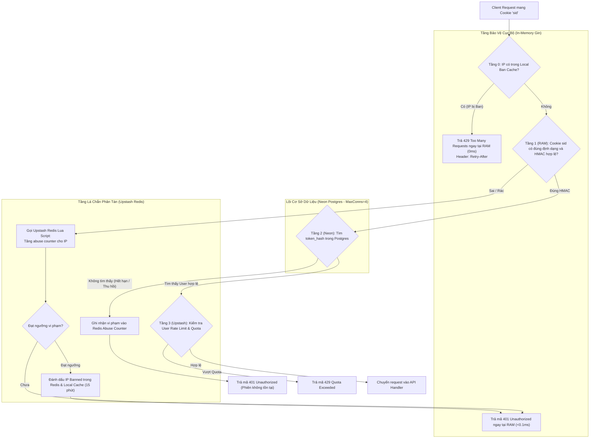

# SPEC-AUTH-SHIELD: Kiên Cố Hóa Authentication SQLLens
## Signed Session Cookie (HMAC-SHA256) & Redis Atomic Abuse Gatekeeper

- **Mã SPEC:** `SPEC-auth-shield`
- **Thuộc Epic:** `SP999` (Việc phát sinh) / **Story:** `STR063`
- **Phiên bản:** 1.0 (Đã được Chủ dự án duyệt 3 Story trong Party Mode)
- **Tác giả:** Hội đồng BMAD (Winston, Amelia, Mary, Sally, John)

---

## 1. Bối cảnh & Lý do (Why)

Hệ thống SQLLens hiện sử dụng cơ chế Stateful Session thông qua cookie `sid` (32 bytes ngẫu nhiên, lưu băm SHA-256 trên Neon Postgres). Nhằm tối ưu chi phí và hỗ trợ tính năng tự động ngủ (auto-suspend) của Neon Postgres trên gói miễn phí, connection pool được giới hạn ở mức nghiêm ngặt: `MaxConns = 4` và `MinConns = 0`.

### Lỗ hổng tài nguyên hiện tại:
Khi kẻ tấn công hoặc botnet liên tục gửi các request mang cookie `sid` giả mạo (`sid` ngẫu nhiên rác), middleware `requireUser` hiện tại đọc thấy cookie có giá trị nên lập tức thực thi câu lệnh SQL:
```sql
SELECT ... FROM users u JOIN sessions s ON ... WHERE token_hash = $1
```
Do Neon chỉ có tối đa 4 kết nối đồng thời, một đợt spam `sid` rác với cường độ vài chục đến vài trăm req/giây sẽ:
1. Chiếm dụng toàn bộ 4 connection của Neon để chạy các truy vấn `SELECT` vô nghĩa (trả về `store.ErrNotFound`).
2. Gây nghẽn kết nối (Connection Pool Exhaustion), khiến các request của người dùng thật đến sau bị treo và nhận lỗi `503 Service Unavailable`.
3. Bộ rate limiter hiện tại của Gin (`rate.go`) chỉ chạy *sau khi* đã tìm ra `User ID` hợp lệ, hoàn toàn vô dụng trước các request mang `sid` rác (User ID rỗng).

### Mục tiêu chiến lược:
**"Càng tránh database càng xa càng tốt"**.
Xây dựng hệ thống phòng thủ 3 tầng:
- **Tầng 0 (RAM Gin - 0ms):** Local Fast-Path Ban Cache chặn đứng ngay các IP đang chịu án phạt mà không tốn lệnh Upstash.
- **Tầng 1 (RAM Gin - < 0.1ms):** Signed Session Cookie (HMAC-SHA256). Token rác hoặc sai chữ ký bị từ chối 401 ngay tại RAM, 0 query vào DB.
- **Tầng 2 (Upstash Redis):** Redis Atomic Abuse Gatekeeper qua Lua script nguyên tử. Tự động cách ly IP spam sau 10 lỗi / 60 giây, cấm 15 phút.

---

## 2. Kiến trúc 3 Tầng Phòng Thủ (Defense in Depth)



---

## 3. Bản Đồ Story & Phân Rã Task

| Story | Tên Story | Task ID | Tên Task | Phạm vi thực hiện |
| :--- | :--- | :--- | :--- | :--- |
| **STR063.1** | Ký số Session Cookie bằng HMAC-SHA256 tại RAM | **Task087** | Hiện thực hóa Signed Session Cookie (HMAC-SHA256) và xác thực tại RAM Gin | `api/internal/auth/auth.go`, `oauth.go`, `auth_test.go` |
| **STR063.2** | Redis Atomic Abuse Gatekeeper qua Lua Script | **Task088** | Hiện thực hóa Redis Atomic Abuse Gatekeeper bằng Lua Script trên Upstash | `api/internal/auth/abuse.go`, `abuse_test.go`, `auth.go` |
| **STR063.3** | Local Ban Cache, Chuyển tiếp phiên & Benchmark | **Task089** | Local Fast-Path Ban Cache trong RAM, Graceful Session Transition & Load Benchmark | `api/internal/auth/cache.go`, `auth_bench_test.go`, `web/messages/*.json` |

---

## 4. Chi Tiết Các Task Triển Khai

### 🔹 Task087: Hiện thực hóa Signed Session Cookie (HMAC-SHA256) và xác thực tại RAM Gin

- **Thuộc:** SP999 / STR063.1
- **Mục tiêu:** Cấp phát cookie `sid` có kèm chữ ký HMAC-SHA256. Middleware `requireUser` kiểm tra tính toàn vẹn chữ ký ngay trong bộ nhớ RAM; từ chối `401 Unauthorized` mọi token sai hoặc rác mà không tốn một query nào vào Neon Postgres.
- **Quy cách kỹ thuật:**
  - Biến môi trường: `SESSION_SECRET` (chuỗi bảo mật ngẫu nhiên tối thiểu 32 ký tự). Nếu rỗng, fallback về key ngẫu nhiên sinh trong bộ nhớ khi chạy dev kèm log cảnh báo.
  - Định dạng token cookie `sid`: `<raw_token_32_bytes>.<hmac_signature_base64url>` (độ dài đúng 87 ký tự).
  - Hàm `signToken(token string, secret []byte) string`:
    ```go
    h := hmac.New(sha256.New, secret)
    h.Write([]byte(token))
    sig := base64.RawURLEncoding.EncodeToString(h.Sum(nil))
    return token + "." + sig
    ```
  - Hàm `verifyToken(signedTok string, secret []byte) (rawToken string, ok bool)`:
    - Tách theo dấu chấm `.` (bắt buộc có đúng 2 phần, phần 1 dài 43 ký tự, phần 2 dài 43 ký tự).
    - Tính HMAC lại trên phần 1, so sánh với phần 2 bằng `subtle.ConstantTimeCompare`.
  - Cập nhật hàm `sessionCookie(token string, maxAge int)`: Nhận `rawToken`, gọi `signToken` trước khi ghi vào `http.Cookie`.
  - Cập nhật hàm `requireUser(c *gin.Context)`:
    - Đọc cookie `sid`. Nếu rỗng -> 401 ngay (như cũ).
    - Gọi `verifyToken`. Nếu `!ok` -> abort `401 Unauthorized` ngay lập tức, **tuyệt đối không gọi `a.store.SessionUser`**.
    - Nếu hợp lệ -> truyền `rawToken` vào `a.store.SessionUser` (Postgres vẫn chỉ lưu `token_hash = sha256(raw_token)`).
- **Tiêu chí nghiệm thu (AC):**
  - **AC1:** Hàm `signToken` và `verifyToken` chạy chính xác theo thuật toán HMAC-SHA256; kiểm tra constant-time chống timing attack.
  - **AC2:** Luồng OAuth callback cấp phát cookie `sid` mang đầy đủ token và chữ ký hợp lệ.
  - **AC3:** Middleware `requireUser` từ chối ngay với mã `401 Unauthorized` (`error.authRequired`) đối với:
    - Cookie thiếu chữ ký (token cũ hoặc rác không có dấu chấm).
    - Cookie sai chữ ký (bị sửa 1 byte trong token hoặc chữ ký).
    - Cookie có định dạng thừa/thiếu phần tử.
    - Không có bất kỳ truy vấn nào được thực thi trên Neon Postgres trong các trường hợp trên.
  - **AC4:** Request mang cookie hợp lệ tra cứu session và user bình thường từ Neon Postgres.
  - **AC5:** Unit test trong `api/internal/auth/auth_test.go` đạt 100% pass cho tất cả các kịch bản token.
- **Lệnh kiểm tra:** `cd api && go test -v -run TestAuth_CookieHMAC ./internal/auth/...`

---

### 🔹 Task088: Hiện thực hóa Redis Atomic Abuse Gatekeeper bằng Lua Script trên Upstash

- **Thuộc:** SP999 / STR063.2
- **Mục tiêu:** Phát hiện hành vi lạm dụng (gửi sid sai HMAC liên tục hoặc gửi sid tra DB ra Not Found) theo từng Client IP. Sử dụng Lua script nguyên tử trên Upstash Redis để tự động tạm khóa (Ban 15 phút) khi vi phạm quá ngưỡng, chặn đứng request bằng mã `429 Too Many Requests`.
- **Quy cách kỹ thuật:**
  - Module mới: `api/internal/auth/abuse.go`.
  - Helper trích xuất Client IP: Hàm `clientIP(c *gin.Context) string` ưu tiên đọc header `X-Forwarded-For` (lấy IP đầu tiên), fallback về `c.ClientIP()`.
  - Lua script nguyên tử:
    ```lua
    local is_banned = redis.call('EXISTS', KEYS[2])
    if is_banned == 1 then
        local ttl = redis.call('TTL', KEYS[2])
        return {1, ttl}
    end
    local current = redis.call('INCR', KEYS[1])
    if current == 1 then
        redis.call('EXPIRE', KEYS[1], tonumber(ARGV[2]))
    end
    if current > tonumber(ARGV[1]) then
        redis.call('SET', KEYS[2], '1', 'EX', tonumber(ARGV[3]))
        redis.call('DEL', KEYS[1])
        return {1, tonumber(ARGV[3])}
    end
    local ttl = redis.call('TTL', KEYS[1])
    return {0, current, ttl}
    ```
  - Các tham số cấu hình:
    - Ngưỡng vi phạm (`limit`): 10 lần.
    - Cửa sổ theo dõi (`window`): 60 giây.
    - Thời gian cấm (`block_duration`): 900 giây (15 phút).
  - Tích hợp vào Gin:
    - Thêm middleware `AbuseGate(c *gin.Context)`: Kiểm tra IP có đang bị ban không (gọi Lua script hoặc đọc key ban). Nếu bị ban, abort `429 Too Many Requests` (`error.rateLimited`) kèm header `Retry-After: <ttl_giay>`.
    - Khi `requireUser` phát hiện token sai HMAC hoặc DB trả về `store.ErrNotFound` -> gọi hàm ghi nhận vi phạm `RecordAbuse(ctx, ip)`.
- **Tiêu chí nghiệm thu (AC):**
  - **AC1:** Lua script chạy nguyên tử trên Upstash Redis thông qua REST client hiện có, đảm bảo TTL phía server.
  - **AC2:** Khi một IP vi phạm từ lần thứ 1 đến 10 trong vòng 60 giây, request nhận mã lỗi thông thường (401).
  - **AC3:** Ở lần vi phạm thứ 11, IP tự động chuyển sang trạng thái Banned trong 15 phút; request nhận ngay mã `429 Too Many Requests` kèm header `Retry-After`.
  - **AC4:** Mọi request tiếp theo từ IP đang bị ban (kể cả request hợp lệ) đều bị từ chối với mã 429 trước khi vào handler.
  - **AC5:** Sau 15 phút, trạng thái ban tự động hết hạn, IP được phục hồi quyền truy cập bình thường.
  - **AC6:** Unit/Integration test trong `api/internal/auth/abuse_test.go` đạt 100% pass.
- **Lệnh kiểm tra:** `cd api && go test -v -run TestAbuseGate ./internal/auth/...`

---

### 🔹 Task089: Local Fast-Path Ban Cache trong RAM, Graceful Session Transition & Load Benchmark

- **Thuộc:** SP999 / STR063.3
- **Mục tiêu:** Xây dựng bộ nhớ đệm cục bộ trong RAM của Gin để chặn IP bị ban mà không tốn lệnh Upstash; xử lý chuyển tiếp mượt mà cho người dùng có phiên cũ; viết kịch bản benchmark tải chứng minh Neon Postgres không chịu bất kỳ áp lực nào khi bị spam tải.
- **Quy cách kỹ thuật:**
  - Module: `api/internal/auth/cache.go`.
  - Tạo cấu trúc `LocalBanCache`:
    ```go
    type LocalBanCache struct {
        mu    sync.RWMutex
        items map[string]time.Time // ip -> expiry time
    }
    ```
    - Khi một IP bị phát hiện ban từ Upstash -> đưa vào `LocalBanCache` với thời hạn tối đa 60 giây.
    - Tầng 0 Gatekeeper: Kiểm tra `LocalBanCache.IsBanned(ip)`. Nếu đúng -> trả mã `429` ngay trong **0ms**, hoàn toàn trong RAM, **không gọi sang Upstash REST API**.
    - Tự động dọn dẹp các mục hết hạn định kỳ.
  - Graceful Session Transition:
    - Khi người dùng gửi cookie `sid` cũ (chưa có HMAC), hệ thống từ chối nhẹ nhàng với `401 Unauthorized` (`error.authRequired`), không tính vào abuse counter nếu định dạng là raw token 32 byte hợp lệ trước đây.
    - Frontend Next.js kích hoạt hàm `markAnon()`, giữ nguyên câu SQL đang soạn qua `sqlRef` và hiển thị Dialog đăng nhập lại để nhận `sid` mới có chữ ký.
    - Thêm thông báo i18n trong `web/messages/vi.json` và `en.json` cho trường hợp mã lỗi `429` do rate-limited.
  - Benchmark tải thực nghiệm (`api/internal/auth/auth_bench_test.go`):
    - Dùng `httptest.Server` giả lập tải 2.000 req/giây bắn `sid` rác liên tục.
    - Theo dõi số lượng kết nối `Active Connections` trên Neon Mock / Postgres Test.
- **Tiêu chí nghiệm thu (AC):**
  - **AC1:** Khi một IP bị ban tiếp tục spam 1.000 request, 100% request bị chặn tại RAM (Tầng 0), số lượng HTTP request gọi sang Upstash REST tăng thêm = 0.
  - **AC2:** Người dùng mang session cũ chưa ký được chuyển hướng đăng nhập lại mượt mà, không gặp lỗi crash hay trắng màn hình.
  - **AC3:** Giao diện frontend hiển thị thông báo thân thiện bằng tiếng Việt và tiếng Anh khi nhận mã 429 hoặc khi phiên hết hạn.
  - **AC4:** Benchmark tải 2.000 req/s đạt kết quả:
    - 100% request rác bị chặn với mã 401 hoặc 429.
    - Số lượng connection hoạt động trên Neon Postgres giữ nguyên bằng 0.
    - Thời gian phản hồi trung bình (latency) cho request rác < 0.2ms.
  - **AC5:** Toàn bộ test suite `api` và `web` chạy qua 100%: `go test ./...` và `npm run check` thoát mã 0.
- **Lệnh kiểm tra:**
  - Backend: `cd api && go test -v -bench=. ./internal/auth/...`
  - Frontend: `cd web && npm run check`

---

## 5. Kế Hoạch Triển Khai & Bàn Giao

Theo đúng quy trình `_bmad-output/QUY_TRINH.md`:
1. Mỗi Task sẽ được thực hiện trong một **git worktree riêng** (`task/Task087`, `task/Task088`, `task/Task089`).
2. Senior Developer (**Amelia**) triển khai code và unit test, đảm bảo `go test ./...` pass 100%.
3. Một **Task-Reviewer độc lập** (context mới) sẽ kiểm tra mã nguồn, đối chiếu nghiêm ngặt từng tiêu chí AC trước khi bàn giao.
4. Viết file bàn giao `ban_giao_task0xx.md`, commit và merge vào `main`.

---

> *Tài liệu SPEC này là căn cứ tối cao để triển khai và nghiệm thu các task kiên cố hóa hệ sinh thái xác thực của SQLLens.*

