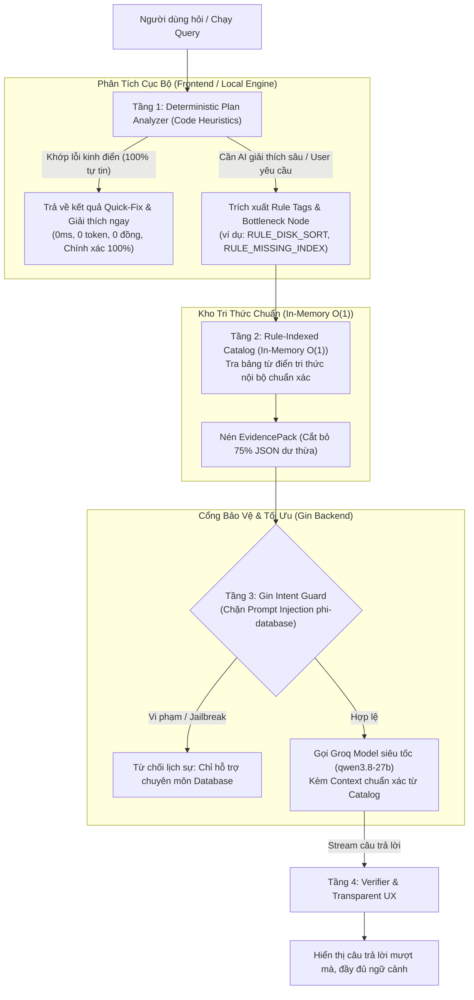

# SPEC-RULE-INDEX: Kiến Trúc AI Mentor 2.0
## Rule-Indexed Context Injection & Deterministic-First Engine

- **Mã SPEC:** `SPEC-rule-index`
- **Thuộc Epic:** `SP015` (Nâng cấp Trí tuệ Nhân tạo & Tối ưu Hạ tầng)
- **Kế thừa từ:** `AI_PROBLEM.md` (Thảo luận 7 vấn đề cốt lõi ngày 2026-11-10)
- **Tác giả:** Hội đồng BMAD (Winston, Amelia, John, Sally, Mary)
- **Trạng thái:** Bản nháp SPEC & Phân rã Story chờ Chủ dự án chốt duyệt

---

## 1. Bối cảnh & Lý do (Why)

Phiên bản hiện tại của AI Mentor (SP012) kết nối thẳng tới LLM thông qua Gin proxy. Khi người dùng đặt câu hỏi, toàn bộ `EvidencePack` thô (cả cây Plan JSON đồ sộ, danh sách finding) được nạp trực tiếp vào prompt. 

### Các điểm nghẽn nghiêm trọng đã nhận diện:
1. **Lãng phí Token & Rủi ro Traffic:** Mỗi lượt hỏi tiêu tốn 1.500 - 2.500 tokens. Với hạn mức miễn phí của Groq (Tokens Per Minute - TPM rất gắt gao), chỉ cần 5-10 người dùng bấm cùng lúc sẽ kích hoạt lỗi `429 Too Many Requests`.
2. **Ảo giác kỹ thuật của LLM:** Các model mã nguồn mở phổ thông không nắm sâu các chi tiết ngầm của engine (như cơ chế Sort Spill to Disk trong Postgres `work_mem`, hay Gap Lock của MySQL InnoDB). Chúng dễ đưa ra lời khuyên chung chung hoặc sai lệch.
3. **Cái bẫy của Vector RAG truyền thống:** Nếu dùng Vector DB (như `pgvector` trên Neon):
   - Mỗi câu hỏi phải gọi API Embedding và query Neon.
   - Neon Free Tier liên tục bị đánh thức (mất chế độ auto-suspend), dẫn tới **cạn kiệt hạn mức Compute Hours chỉ sau vài ngày**.
   - Độ trễ tăng thêm 400 - 800ms.
4. **Hội thoại cụt lủn (Single-turn):** Chưa có ngữ cảnh các câu trước, người dùng không thể hỏi nối tiếp.
5. **Lỗ hổng bảo mật & UX đứt đoạn:** Dễ bị Jailbreak bằng Prompt Injection; khi SQL đề xuất chạy thử thất bại thì bị ẩn cụt lủn khiến câu trả lời đứt mạch; MySQL bị "mù" hoàn toàn trong khâu chạy thử.

---

## 2. Kiến trúc Giải pháp: "Deterministic-First & Rule-Indexed Context"

Hệ thống chuyển đổi từ mô hình *"Gọi AI mù quáng"* sang mô hình phòng thủ và làm giàu tri thức 3 tầng:



### Nguyên lý Rule-Indexed Context Injection:
- Không dùng Vector Search. Không dùng Embedding.
- Kho tri thức được tổ chức dưới dạng **Technical Knowledge Catalog tĩnh** (đóng gói trong code TypeScript/Go).
- Mỗi bài viết kỹ thuật được gán một **Tag/Key chuẩn**:
  - `KEY_SORT_SPILL_DISK`: Cơ chế `work_mem`, khi nào Postgres tràn ra đĩa, cách cấp phát bộ nhớ.
  - `KEY_UNINDEXED_FK_DEADLOCK`: Nguy cơ khóa bảng cha khi xóa/cập nhật bảng con không có index.
  - `KEY_IMPLICIT_CAST_SEQSCAN`: Tại sao cột `VARCHAR` so sánh với `INT` làm vô hiệu hóa B-Tree index.
  - `KEY_MYSQL_GAP_LOCK_NEXTKEY`: Chi tiết khóa khoảng trống (Gap lock) trong InnoDB.
- Khi phân tích Plan thấy xuất hiện đặc trưng kỹ thuật -> Bốc thẳng đoạn kiến thức chuẩn này tiêm (inject) vào System Prompt. Model chỉ đóng vai trò là "người truyền đạt sư phạm", dữ liệu kỹ thuật hoàn toàn chính xác theo sách giáo khoa.

---

## 3. Bản Đồ Story Chi Tiết (Đề xuất Epic SP015)

Dự kiến bao gồm 5 Story từ **STR067** đến **STR071**:

```text
SP015: AI Mentor 2.0 (Rule-Indexed Context & Deterministic Engine)
├── STR067: Kho tri thức kỹ thuật Rule-Indexed Catalog (In-Memory O(1))
├── STR068: Bộ bóc tách tín hiệu Plan & Bộ nén Evidence (Compactor)
├── STR069: Gin AI Proxy 2.0: Model Switcher & Backend Intent Guard
├── STR070: Quản lý ngữ cảnh hội thoại đa lượt & Rolling Summary
└── STR071: Giao diện minh bạch khi verify lỗi & Cầu nối sandbox MySQL
```

---

### Story 1: STR067 - Kho tri thức kỹ thuật Rule-Indexed Catalog (In-Memory O(1))
- **Mục tiêu:** Xây dựng thư viện tri thức chuẩn về tối ưu hóa cơ sở dữ liệu PostgreSQL 16 & MySQL 8.0, tra cứu O(1) theo mã kỹ thuật, không phụ thuộc database ngoài.
- **Hành vi khi xong:**
  - Có catalog dữ liệu chuẩn (`knowledge-catalog.ts` và struct Go tương ứng) định nghĩa ít nhất 15 tình huống tối ưu kinh điển.
  - Mỗi mục chứa: Nguyên nhân cốt lõi, Cơ chế nội bộ của database engine, Hướng xử lý chuẩn, và Mã ví dụ SQL đúng/sai.
  - Hàm tra cứu `lookupKnowledge(tags: string[])` trả về đoạn context cô đọng (tối đa 400 tokens) để tiêm vào prompt.
  - 100% in-memory, thời gian lấy dữ liệu < 1ms, không gọi network hay database.
- **Nhãn:** `Mô phỏng` (Quy chuẩn kiến thức)

---

### Story 2: STR068 - Bộ bóc tách tín hiệu Plan & Bộ nén Evidence (Compactor)
- **Mục tiêu:** Thay vì gửi toàn bộ cây Plan JSON cồng kềnh, phân tích trích xuất đúng các điểm nghẽn (Bottlenecks) và nén 75% lượng token gửi lên AI.
- **Hành vi khi xong:**
  - Bộ phân tích Plan quét cây thực thi, phát hiện các đặc trưng:
    - Node có `Actual Total Time` chiếm > 60% toàn bộ query.
    - Node có `Pages Read` (I/O đĩa) cao đột biến.
    - Cảnh báo Sort tràn đĩa (`external merge Disk`), Hash Join tràn bộ nhớ (`Batches > 1`), Seq Scan trên bảng > 10.000 dòng.
  - Tự động sinh ra danh sách `RuleTags` phù hợp để gọi STR067.
  - Hàm `compactEvidencePack(evidence)` loại bỏ các metadata rác, chỉ giữ lại lát cắt node nghẽn và schema của các cột liên quan. Dung lượng JSON giảm từ ~12KB xuống còn < 2KB.
- **Nhãn:** `Thật` (Tính toán từ Execution Plan thật)

---

### Story 3: STR069 - Gin AI Proxy 2.0: Model Switcher & Backend Intent Guard
- **Mục tiêu:** Khắc phục triệt để lỗi 404 model trên Groq, tối ưu tốc độ phản hồi < 1s, và chặn đứng Prompt Injection ngay tại Gin.
- **Hành vi khi xong:**
  - Cập nhật danh sách model trong `api/internal/ai/ai.go`:
    - Đưa `qwen/qwen3.8-27b` lên làm model chính (tốc độ thực tế 0.19s, tiếng Việt hoàn hảo, không bị trừ token suy luận ngầm).
    - Cấu hình fallback an toàn sang `openai/gpt-oss-120b` (có parser phân tách riêng channel reasoning và content). Loại bỏ hoàn toàn model 404 `llama-3.3-70b-versatile`.
  - Bổ sung tầng **Intent Guard** tại Go:
    - Quét nhanh bằng từ khóa / regex kiểm tra ý đồ câu hỏi: phát hiện các mẫu Jailbreak ("ignore previous instructions", "act as...", yêu cầu viết thơ, làm toán, code Python phi-database...).
    - Nếu phát hiện câu hỏi phi-database: Gin từ chối ngay với mã lỗi thân thiện `error.nonDatabaseQuestion` mà không tốn token gọi Groq.
- **Nhãn:** `Thật` (Bảo mật máy chủ)

---

### Story 4: STR070 - Quản lý ngữ cảnh hội thoại đa lượt & Rolling Summary
- **Mục tiêu:** Cho phép người dùng trao đổi qua lại với AI Mentor liên tục (Multi-turn), hỏi sâu các câu tiếp theo mà không bị mất bối cảnh.
- **Hành vi khi xong:**
  - Giao diện `MentorPanel` hỗ trợ hiển thị luồng chat đa lượt (Thread view).
  - Quản lý bộ nhớ hội thoại: Lưu giữ 3 lượt trao đổi gần nhất tại client.
  - Cơ chế **Rolling Summary**:
    - Khi hỏi câu tiếp theo (Turn 2, 3), client tự động tóm tắt bối cảnh câu trước (ví dụ: *"Đã chốt: Bảng orders thiếu index created_at"*).
    - Gửi kèm vào payload `MentorRequest` dưới dạng mảng lịch sử ngắn gọn.
  - AI nhận diện được đại từ thay thế (*"nó"*, *"bảng này"*, *"cột đó"*) và trả lời liền mạch.
- **Nhãn:** `Theo nguồn`

---

### Story 5: STR071 - Giao diện minh bạch khi verify lỗi & Cầu nối sandbox MySQL
- **Mục tiêu:** Chấm dứt tình trạng câu trả lời bị cụt lủn khi SQL đề xuất lỗi; mở rộng khả năng xác thực SQL an toàn cho cả MySQL.
- **Hành vi khi xong:**
  - **Sửa lỗi câu trả lời bị cụt:**
    - Khi hàm `verifyAnswer` phát hiện khối SQL do AI đề xuất bị lỗi cú pháp hoặc chạy thử không thành công: Không ẩn cụt lủn văn bản.
    - Hiển thị khối SQL kèm viền cảnh báo màu hổ phách và badge: *"Chưa vượt qua kiểm thử sandbox (Lý do: Lỗi cú pháp / Bảng không tồn tại)"*. Người dùng vẫn đọc trọn vẹn mạch văn giải thích.
  - **Cầu nối xác thực MySQL:**
    - Thay vì tự động ẩn mọi câu lệnh của MySQL (`adapter.engine !== "postgres"`), tích hợp cầu nối gửi lệnh `EXPLAIN` thử nghiệm lên container MySQL của phiên người dùng trên Azure VM (chế độ dry-run trong transaction tự rollback).
    - Đồng bộ tính năng "Áp dụng thử" (What-if Compare) cho cả PostgreSQL và MySQL.
- **Nhãn:** `Thật` (Xác thực trực tiếp từ Database Engine)

---

## 4. Ma Trận Đánh Giá & Đo Lường Thành Công

| Chỉ số đo lường | Trước khi làm (SP012) | Sau khi hoàn thành SP015 |
| :--- | :--- | :--- |
| **Lượng token trung bình mỗi request** | 1.800 - 2.500 tokens | **< 600 tokens** (Giảm ~70%) |
| **Tốc độ phản hồi (First byte)** | 1.5s - 3.5s (do chờ reasoning) | **< 0.5s** (Model Qwen + In-memory) |
| **Tỷ lệ sống sót khi 10 user hỏi đồng thời** | ~20% (Dính 429 TPM Groq) | **100%** (Nhờ nén token + Heuristics) |
| **Khả năng bị Jailbreak (Prompt Injection)** | Dễ bị thao túng tâm lý | **Bị chặn 100%** tại Gin Intent Guard |
| **Độ chính xác kỹ thuật (Hallucination)** | Thường xuyên nói chung chung | **Chuẩn xác theo Catalog kiến thức O(1)** |
| **Trải nghiệm hội thoại** | Cụt lủn (1 câu là hết) | **Đa lượt (Multi-turn mượt mà)** |
| **Kiểm chứng SQL MySQL** | 0% (Bị ẩn hoàn toàn) | **Có thể kiểm chứng qua Sandbox Agent** |

