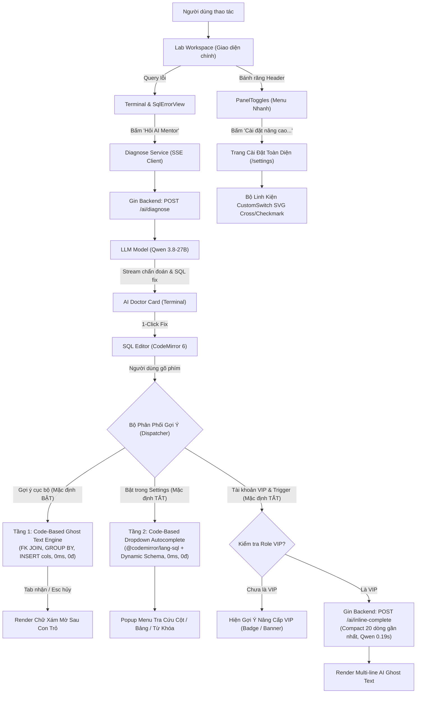

# SPEC-SMART-EDITOR: Trợ Lý Soạn Thảo Thông Minh, Phân Quyền VIP & Trải Nghiệm Người Dùng
## Hướng Tới Trải Nghiệm Soạn Thảo 0ms, Tối Ưu Chi Phí Tuyệt Đối & Hệ Thống Đa Tầng

- **Mã SPEC:** `SPEC-smart-editor`
- **Thuộc Epic:** `SP016` (Smart Editor, User Tiering & Terminal AI Diagnosis)
- **Kế thừa từ:** `_bmad-output/MUC_TIEU_TRUOC_MAT.md` (Chỉ đạo chiến lược của Chủ dự án ngày 2026-11-12)
- **Tác giả:** Hội đồng BMAD (Winston, Amelia, Sally, John, Mary)
- **Trạng thái:** Bản nháp SPEC & Phân rã Story chờ Chủ dự án chốt duyệt

---

## 1. Bối cảnh & Lý do Kiến trúc (Why)

Qua quá trình vận hành và kiểm thử thực tế từ Task001 đến Task102, SQLLens đã hoàn thiện trọn vẹn 3 trụ cột phân tích: Mô phỏng B-Tree, Cây thực thi Plan Runner và Sơ đồ Schema tương tác. Tuy nhiên, ở khâu trải nghiệm người dùng trực tiếp tại **Trình soạn thảo SQL** và **Terminal kết quả**, hệ thống còn 3 điểm nghẽn lớn cần giải quyết ngay:

1. **Lỗi đứt gãy tại Terminal ("Hỏi AI Mentor về lỗi này"):**
   - Khi query bị lỗi (syntax error, missing table, wrong column), nút "Hỏi AI Mentor" được hiển thị nhưng khi click lại không có phản hồi, tab Network trống trơn do thiếu prop `onAskAi` tại tầng giao diện cha (`lab-workspace.tsx`).
   - Mặc dù backend Go Gin ở Task095 (`POST /ai/diagnose`) đã sẵn sàng xử lý SSE stream, frontend chưa có service client và chưa có giao diện chẩn đoán tại chỗ.

2. **Bài toán chi phí Token & Tốc độ Autocomplete:**
   - Nếu mỗi lần người dùng gõ phím đều kích hoạt AI Copilot, chi phí API token sẽ bùng nổ, dễ chạm ngưỡng Rate Limit (TPM) của các nhà cung cấp mô hình AI miễn phí.
   - Trong thực tế, **80% các gợi ý viết SQL thông dụng** (như `JOIN ... ON ...` dựa vào khóa ngoại, danh sách cột trong `GROUP BY`, hoặc danh sách cột khi `INSERT INTO`) hoàn toàn có thể suy luận bằng **thuật toán Heuristics cục bộ (Deterministic Code)** với thời gian tính toán **0ms**, độ chính xác **100%**, và **0đ chi phí**.
   - Việc phân tách rõ ràng giữa **Code-Based Ghost Text (Mặc định BẬT - 0đ)**, **Code-Based Dropdown (Mặc định TẮT - 0đ)** và **AI Copilot (Mặc định TẮT - dành riêng cho VIP)** là chiến lược sống còn để bảo vệ hạ tầng và tạo động lực chuyển đổi tài khoản.

3. **Thiếu tính cá nhân hóa & Quy chuẩn điều khiển (Settings & Switch):**
   - Người dùng có thói quen làm việc khác nhau: người thích hiển thị số dòng, người muốn giao diện tối tương phản cao, người muốn tắt gợi ý để tự gõ rèn luyện.
   - Cần một trang `/settings` chuyên nghiệp, tinh tế cùng bộ linh kiện điều khiển đồng nhất: **Custom Switch độc quyền (SVG Cross/Checkmark)** với cơ chế hoạt họa 3D ấn tượng.

---

## 2. Kiến trúc Tổng thể Giải pháp (System Architecture)



---

## 3. Bản Đồ 6 Story Chiến Lược (Đề xuất Epic SP016)

```text
SP016: Smart Editor, User Tiering & Terminal AI Diagnosis
├── STR074: Chẩn đoán Lỗi Terminal bằng AI Doctor & 1-Click Fix (Mục 1)
├── STR075: Linh kiện CustomSwitch Độc Quyền & Màn hình Cài Đặt /settings Nâng Cao (Mục 3, 4)
├── STR076: Hệ Thống Phân Quyền Tài Khoản Đa Cấp (RBAC) & Cổng Nâng Cấp VIP (Mục 2)
├── STR077: Trình Gợi Ý Dropdown Popup theo Schema CSDL (Code-based Autocomplete - Mặc định TẮT) (Mục 5)
├── STR078: Trợ Lý Gợi Ý Viết Tiếp Cục Bộ (Code-based Inline Ghost Text - Mặc định BẬT) (Mục 6)
└── STR079: AI Inline Copilot Deep Completion Dành Riêng Cho VIP (Mặc định TẮT) (Mục 7)
```

---

### Story 1: STR074 - Chẩn đoán Lỗi Terminal bằng AI Doctor & 1-Click Fix
- **Thuộc mục tiêu:** Mục 1 trong `MUC_TIEU_TRUOC_MAT.md`.
- **Mục tiêu:** Kích hoạt tính năng "Hỏi AI Mentor về lỗi này" tại Terminal, kết nối SSE tới endpoint `/ai/diagnose` đã có sẵn tại Gin, hiển thị thẻ chẩn đoán AI Doctor Card ngay dưới lỗi kèm nút "Áp dụng sửa ngay (1-Click Fix)".
- **Hành vi khi xong (Acceptance Criteria):**
  1. Khi câu lệnh SQL thực thi bị lỗi, bấm nút "Hỏi AI Mentor về lỗi này" (test id `ask-ai-button`):
     - Giao diện chuyển sang trạng thái loading với icon spinner quay mượt mà, chặn click lặp.
     - Tab Network xuất hiện request `POST /ai/diagnose` với payload chuẩn `{ sql, error, engine, locale, question }`.
  2. Phía dưới thẻ lỗi mở rộng một khối **AI Doctor Card**:
     - Hiển thị văn bản giải thích nguyên nhân gốc rễ (Root Cause) truyền trực tiếp qua Server-Sent Events (SSE).
     - Bóc tách chính xác khối mã SQL sửa chữa đề xuất (bọc trong thẻ Code block có cú pháp nổi bật).
  3. Cung cấp nút hành động **"Áp dụng sửa ngay (1-Click Fix)"**:
     - Bấm nút này sẽ thay thế câu lệnh bị lỗi trong SQL Editor bằng câu lệnh SQL đã sửa, tự động đóng AI Doctor Card hoặc chuyển trạng thái sang "Đã áp dụng".
  4. Xử lý lỗi ngoại lệ: Nếu server mất kết nối hoặc hết quota, hiển thị thông báo lỗi rõ ràng kèm nút "Thử lại".
- **Giao diện (GD):** Có.
- **Nhãn kết luận:** `Thật` (Chẩn đoán lỗi từ database thật & đề xuất chạy thử).
- **Phân công chính:** Amelia.

---

### Story 2: STR075 - Linh kiện CustomSwitch Độc Quyền & Màn hình Cài Đặt `/settings` Nâng Cao
- **Thuộc mục tiêu:** Mục 3 và Mục 4 trong `MUC_TIEU_TRUOC_MAT.md`.
- **Mục tiêu:** Xây dựng linh kiện `CustomSwitch` chuẩn thiết kế với SVG Cross/Checkmark và hiệu ứng trượt 3D độc quyền; nâng cấp menu thả nhanh Header và tạo trang cấu hình chi tiết `/settings`.
- **Hành vi khi xong (Acceptance Criteria):**
  1. Đóng gói linh kiện `Switch` (`web/src/components/ui/custom-switch.tsx`):
     - Chuẩn xác 100% theo mã CSS / styled-components quy định: kích thước 46x24px, slider bo tròn, vòng tròn 18px với SVG Cross (đỏ/xám) và SVG Checkmark (xanh lục), hiệu ứng chuyển động `cubic-bezier`.
     - Hỗ trợ đầy đủ các props: `checked`, `onChange`, `disabled`, `id`, `name`, `aria-label`.
     - Phím Space/Enter tương tác chuẩn trợ năng (Accessibility A11y).
  2. Nâng cấp Dropdown Header (`PanelToggles`):
     - Giữ nguyên 4 toggle vùng giao diện hiện tại (SQL, Simulation, Findings, Terminal).
     - Bổ sung `<DropdownMenuSeparator />` và nút **"Cài đặt nâng cao..."** kèm biểu tượng cài đặt, điều hướng sang route `/settings`.
  3. Xây dựng trang `/settings`:
     - **Nhóm 1 - Soạn thảo SQL (Editor):** Hiển thị số dòng (Switch, Mặc định BẬT), Tự động ngắt dòng (Switch, Mặc định BẬT), Tô sáng dòng hiện tại (Switch, Mặc định BẬT), Kích thước phông chữ (Radio group: 13px, 14px, 16px).
     - **Nhóm 2 - Giao diện & Màu sắc (Appearance):** Theme (Tối / Sáng / Auto), Tăng độ tương phản (Switch, Mặc định TẮT).
     - **Nhóm 3 - Trợ lý soạn thảo (Autocomplete):**
       + Gợi ý viết tiếp trực tiếp (Inline Ghost Text): **Switch Mặc định BẬT**.
       + Menu gợi ý dạng popup (Code-based Dropdown): **Switch Mặc định TẮT**.
       + Gợi ý sâu từ AI Copilot: **Switch Mặc định TẮT** (kèm badge VIP vàng ánh kim).
     - **Nhóm 4 - Tài khoản & VIP:** Hiển thị cấp độ tài khoản hiện tại kèm nút CTA "Nâng cấp VIP".
  4. Lưu trữ cấu hình:
     - Toàn bộ thiết lập được lưu vào `localStorage` (key `sqllens_settings_v1`) và đồng bộ tức thì vào Context/Store của ứng dụng.
- **Giao diện (GD):** Có.
- **Nhãn kết luận:** `Theo nguồn` (Lưu trữ tùy biến người dùng).
- **Phân công chính:** Sally.

---

### Story 3: STR076 - Hệ Thống Phân Quyền Tài Khoản Đa Cấp (RBAC) & Cổng Nâng Cấp VIP
- **Thuộc mục tiêu:** Mục 2 trong `MUC_TIEU_TRUOC_MAT.md`.
- **Mục tiêu:** Thiết lập cơ chế phân quyền 3 cấp độ (Guest, User thường, VIP) trong cơ sở dữ liệu Neon, JWT claims, Gin middleware bảo vệ API, và giao diện giới thiệu / nâng cấp gói VIP.
- **Hành vi khi xong (Acceptance Criteria):**
  1. Cấu trúc CSDL Neon & JWT:
     - Migration bảng `users`: thêm cột `role VARCHAR(20) DEFAULT 'user'`, `vip_until TIMESTAMPTZ NULL`.
     - JWT Payload bổ sung trường `{ "role": "user" | "vip", "vip_until": ... }`.
  2. Middleware bảo vệ tầng Backend Go Gin:
     - Bổ sung middleware `RequireVip()` tại các endpoint độc quyền (như `/ai/inline-complete`).
     - Trả về mã HTTP `403 Forbidden` kèm JSON `{ "error": "vip_required", "message": "Tính năng AI Copilot yêu cầu tài khoản VIP" }` khi người dùng thường cố tình gọi API.
  3. Giao diện nhận diện Role & Trạng thái VIP:
     - Header và Avatar người dùng hiển thị badge **"VIP"** (viền vàng ánh kim, hiệu ứng tỏa sáng nhẹ) đối với tài khoản VIP.
     - User thường thấy nút "Nâng cấp VIP" ở Header và trong trang `/settings`.
  4. Modal / Trang nâng cấp VIP (`/upgrade`):
     - Bảng so sánh trực quan quyền lợi: Free (Ghost text Heuristics 0đ, Quota cơ bản) vs VIP (AI Inline Copilot đa dòng, Quota AI mở rộng, Ưu tiên CPU sandbox).
     - Hỗ trợ nhập mã kích hoạt (Promo code / Voucher) để lập tức nâng quyền tài khoản lên VIP có thời hạn (`vip_until`).
- **Giao diện (GD):** Có.
- **Nhãn kết luận:** `Thật` (Xác thực phân quyền máy chủ).
- **Phân công chính:** Winston & John.

---

### Story 4: STR077 - Trình Gợi Ý Dropdown Popup theo Schema CSDL (Code-based Autocomplete - Mặc định TẮT)
- **Thuộc mục tiêu:** Mục 5 trong `MUC_TIEU_TRUOC_MAT.md`.
- **Mục tiêu:** Tích hợp menu dropdown popup truyền thống của CodeMirror 6, nạp schema động từ sandbox CSDL (PGlite / MySQL), gợi ý từ khóa SQL, tên bảng và tên cột chuẩn xác với độ trễ < 1ms, 0đ chi phí.
- **Hành vi khi xong (Acceptance Criteria):**
  1. Trạng thái mặc định: **TẮT (OFF)** trong cài đặt. Khi người dùng bật tính năng này trong `/settings`, extension CodeMirror mới được kích hoạt.
  2. Schema Injection động:
     - Lắng nghe sự thay đổi của danh sách bảng `tables` trong `lab-workspace.tsx`.
     - Xây dựng từ điển schema chuẩn `{ tableName: [col1, col2, ...] }`.
     - Cấu hình extension `sql({ dialect: DIALECT[engine], schema })` từ `@codemirror/lang-sql`.
  3. Trải nghiệm tương tác Popup:
     - Khi người dùng gõ ký tự, menu dropdown xổ xuống với biểu tượng phân loại trực quan (icon Bảng, icon Cột, icon Từ khóa SQL).
     - Hỗ trợ tìm kiếm mờ (Fuzzy filtering).
     - Phím `Enter` hoặc `Tab` chọn gợi ý, phím mũi tên `Up`/`Down` điều hướng danh sách, phím `Esc` đóng menu.
  4. Hiệu năng & Ràng buộc:
     - 100% chạy cục bộ trên trình duyệt, không gọi network, thời gian lọc < 2ms, không gây đơ con trỏ gõ.
- **Giao diện (GD):** Có.
- **Nhãn kết luận:** `Thật` (Dựa trên cấu trúc Schema CSDL thật).
- **Phân công chính:** Amelia.

---

### Story 5: STR078 - Trợ Lý Gợi Ý Viết Tiếp Cục Bộ (Code-based Inline Ghost Text - Mặc định BẬT)
- **Thuộc mục tiêu:** Mục 6 trong `MUC_TIEU_TRUOC_MAT.md`.
- **Mục tiêu:** Xây dựng động cơ gợi ý viết tiếp mã SQL cục bộ (Client-side Heuristic Engine) hiển thị dưới dạng chữ mờ xám (Ghost Text) ngay sau con trỏ, tự động suy luận quan hệ khóa ngoại, mệnh đề `GROUP BY` và danh sách cột `INSERT INTO` mà không dùng AI, 0đ chi phí, phản hồi 0ms.
- **Hành vi khi xong (Acceptance Criteria):**
  1. Trạng thái mặc định: **BẬT (ON)** trong hệ thống.
  2. Động cơ phân tích cú pháp Heuristics (Rule-based AST Matcher):
     - **Dự đoán `JOIN ... ON ...` thông minh:**
       + Phân tích bảng trong mệnh đề `FROM <table_a> [alias_a] JOIN `.
       + Quét đồ thị khóa ngoại (Foreign Key Graph) trong schema: nếu `table_b` có FK trỏ tới `table_a` (hoặc ngược lại), gợi ý ngay đoạn ghost text:
         `<table_b> [alias_b] ON alias_b.<fk_col> = alias_a.<pk_col>`.
     - **Dự đoán `GROUP BY` tự động:**
       + Khi người dùng gõ `GROUP BY `, động cơ quét ngược lại danh sách cột trong mệnh đề `SELECT`.
       + Loại bỏ các cột nằm trong hàm tổng hợp (`COUNT`, `SUM`, `AVG`, `MIN`, `MAX`), tự động điền danh sách các cột trần: `GROUP BY col1, col2`.
     - **Dự đoán `INSERT INTO`:**
       + Khi gõ `INSERT INTO <table_name> `, tự động gợi ý danh sách toàn bộ cột của bảng: `(col1, col2, col3) VALUES ()`.
     - **Dự đoán tiếp bước (Lifecycle Next Clause):**
       + Sau `SELECT ... FROM <table>` -> gợi ý tiếp ` WHERE ` hoặc ` ORDER BY id DESC`.
  3. Cơ chế hiển thị & Bắt phím trong CodeMirror 6:
     - Sử dụng `Decoration.widget({ side: 1 })` chèn một thẻ DOM mờ xám (`opacity-40 select-none pointer-events-none text-muted-foreground font-mono`).
     - Phím `Tab`: Chấp nhận (Accept) gợi ý, chèn đoạn text vào editor và đưa con trỏ đến cuối đoạn chèn.
     - Phím `Escape`: Hủy bỏ (Dismiss) đoạn ghost text hiện tại.
     - Khi tiếp tục gõ: Nếu ký tự gõ trùng với ký tự tiếp theo của ghost text thì cắt ngắn đoạn gợi ý; nếu ký tự khác biệt thì hủy bỏ gợi ý ngay lập tức.
  4. Hiệu năng:
     - Thời gian tính toán < 1ms, không gây giật lag khi gõ nhanh.
- **Giao diện (GD):** Có.
- **Nhãn kết luận:** `Thật` (Suy luận trực tiếp từ cấu trúc Schema CSDL).
- **Phân công chính:** Winston & Amelia.

---

### Story 6: STR079 - AI Inline Copilot Deep Completion Dành Riêng Cho VIP (Mặc định TẮT)
- **Thuộc mục tiêu:** Mục 7 trong `MUC_TIEU_TRUOC_MAT.md`.
- **Mục tiêu:** Cung cấp trải nghiệm Copilot sâu cho tài khoản VIP: tự động đọc hiểu ngữ cảnh bài toán và các bình luận (comment) tiếng Việt để sinh cả một khối truy vấn phức tạp (CTE, Window function), với thời gian phản hồi siêu tốc 0.19s qua model Qwen 3.8-27B.
- **Hành vi khi xong (Acceptance Criteria):**
  1. Trạng thái mặc định: **TẮT (OFF)**, chỉ kích hoạt khi người dùng bật trong `/settings` VÀ tài khoản có quyền `role = "vip"`.
  2. Cơ chế kích hoạt thông minh (Smart Trigger & Anti-Spam):
     - **Comment Trigger:** Kích hoạt ngay khi người dùng xuống dòng sau một comment ý đồ (ví dụ: `-- Lấy top 3 sản phẩm có doanh thu cao nhất mỗi danh mục\n`).
     - **Debounce Trigger:** Kích hoạt khi người dùng dừng gõ quá **600ms** tại một câu lệnh chưa hoàn tất.
     - **Phím tắt chủ động:** Nhấn `Ctrl + Space` (hoặc `Cmd + I`).
  3. Tối ưu hóa Payload & Endpoint Backend (`POST /ai/inline-complete`):
     - Client chỉ gửi 15-20 dòng mã gần nhất xung quanh con trỏ + danh sách bảng/cột rút gọn (không gửi toàn bộ dump dữ liệu).
     - Gin proxy xác thực quyền VIP, chuyển tiếp request tới model `qwen/qwen3.8-27b` với tham số `max_tokens = 128` và `stop_sequences = [";", "\n\n"]`.
     - Tốc độ phản hồi trung bình < 300ms (First token 0.19s).
  4. Hiển thị Multi-line Ghost Text & Tương tác:
     - Khối mã AI đề xuất hiển thị nhiều dòng mờ xám nối tiếp con trỏ.
     - Nhấn `Tab` để chèn trọn vẹn khối mã, nhấn `Esc` để từ chối.
     - Ghi nhận trạng thái: Nếu người dùng Free vô tình kích hoạt bằng phím tắt, hiển thị popover tinh tế: *"AI Copilot là đặc quyền của gói VIP. Nhấn để nâng cấp"*.
- **Giao diện (GD):** Có.
- **Nhãn kết luận:** `Thật` (Gợi ý mã có ngữ cảnh, được xác thực cú pháp).
- **Phân công chính:** Winston, Amelia & John.

---

## 4. Bảng Ma Trận So Sánh & Đo Lường Thành Công

| Tiêu chí | Trước khi làm (Hiện tại) | Sau khi hoàn thành SP016 |
| :--- | :--- | :--- |
| **Nút "Hỏi AI Mentor" ở Terminal** | Bấm không phản hồi (Lỗi prop) | **Mở AI Doctor Card SSE, 1-Click Fix tức thì** |
| **Linh kiện Switch điều khiển** | Dùng switch mặc định / chưa chuẩn hóa | **100% CustomSwitch SVG Cross/Checkmark 3D độc quyền** |
| **Trang Cài đặt hệ thống** | Chưa có trang `/settings` riêng | **Trang `/settings` toàn diện 4 phân khu + lưu trữ Local** |
| **Chi phí gợi ý Code thông thường** | Không có hoặc gọi AI tốn kém | **0đ, 0 token, 0ms (Code-based Heuristics 100%)** |
| **Độ trễ gợi ý JOIN FK & GROUP BY** | Thủ công người dùng tự gõ | **Tức thì 0ms (Ghost Text tự động điền)** |
| **Phân tầng người dùng (RBAC)** | Chưa phân biệt Free vs VIP | **RBAC 3 cấp rõ ràng, JWT Shield bảo vệ API VIP** |
| **Tốc độ AI Copilot cho VIP** | Chưa có | **< 0.2s (Model Qwen 3.8-27B siêu tốc)** |

---

## 5. Kế Hoạch Bàn Giao & Phân Nhánh Story

| Story | Nhánh Git / Worktree | Phụ trách chính | Reviewer độc lập | Trọng tâm kiểm thử máy (`npm run check` & Vitest) |
| :--- | :--- | :--- | :--- | :--- |
| **STR074** | `worktree-str074-terminal-fix` | Amelia | task-reviewer-1 | Test click `ask-ai-button`, test mock SSE stream, test 1-Click Fix chèn vào editor |
| **STR075** | `worktree-str075-custom-switch-settings` | Sally | task-reviewer-2 | Test render CustomSwitch, test accessibility, test route `/settings` và lưu LocalStorage |
| **STR076** | `worktree-str076-rbac-vip` | Winston | task-reviewer-3 | Test Go middleware `RequireVip()`, test JWT claims, test upgrade modal flow |
| **STR077** | `worktree-str077-dropdown-autocomplete` | Amelia | task-reviewer-4 | Test CodeMirror autocomplete extension, test schema dynamic binding |
| **STR078** | `worktree-str078-inline-ghost-text` | Winston + Amelia | task-reviewer-5 | Test Heuristic parser (FK JOIN, GROUP BY, INSERT), test `Tab` accept / `Esc` dismiss |
| **STR079** | `worktree-str079-ai-copilot-vip` | Winston + Amelia | task-reviewer-6 | Test Gin proxy `/ai/inline-complete`, test trigger debounce & comment, test VIP gate |

---

## 6. Bản Rã 10 Task Chi Tiết Thực Thi (Task103 -> Task112)

```text
SP016 (SPEC-smart-editor)
├── STR074 (Terminal AI Doctor & 1-Click Fix)
│   └── Task103: Nối client SSE /ai/diagnose, hiển thị AI Doctor Card và 1-Click Fix
├── STR075 (CustomSwitch & Cài đặt nâng cao)
│   ├── Task104: Xây dựng linh kiện CustomSwitch SVG Cross/Checkmark và SettingsContext
│   └── Task105: Nâng cấp Dropdown Header nâng cao và Trang Cài Đặt /settings toàn diện 4 phân khu
├── STR076 (Phân quyền RBAC & Gói VIP)
│   ├── Task106: Phân quyền RBAC Backend Gin & Neon DB: Schema role/vip_until, JWT claims và Middleware RequireVip
│   └── Task107: Giao diện nhận diện Badge VIP, Modal nâng cấp tài khoản và Cổng kích hoạt mã VIP (Promo Code)
├── STR077 (Code-based Dropdown Autocomplete)
│   └── Task108: Tích hợp CodeMirror 6 Dropdown Autocomplete theo Schema Sandbox CSDL động (Mặc định TẮT)
├── STR078 (Code-based Inline Ghost Text)
│   ├── Task109: Động cơ Heuristic AST gợi ý cục bộ: Foreign Key JOIN ON, GROUP BY non-aggregate và INSERT column list
│   └── Task110: Extension CodeMirror 6 Inline Ghost Text: Render chữ mờ xám sau con trỏ, phím Tab nhận và Esc hủy
└── STR079 (AI Inline Copilot cho VIP)
    ├── Task111: Backend Gin Proxy /ai/inline-complete: Nén context 20 dòng, gọi model Qwen 3.8-27B (0.19s) và kiểm tra Role VIP
    └── Task112: Tích hợp AI Copilot Multi-line Ghost Text vào CodeMirror 6: Smart trigger (Comment / Debounce 600ms / Ctrl+Space)
```

