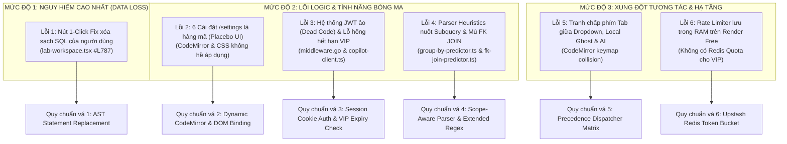

# SPEC-SP016-HARDENING: Quy Chuẩn Kỹ Thuật Vá Lỗi Toàn Diện SP016
## Tài Liệu Tham Chiếu Thực Nghiệm & Hướng Dẫn Khắc Phục Lỗi Từ Logic Đến Mã Nguồn

- **Mã SPEC:** `SPEC-SP016-HARDENING`
- **Thuộc Epic:** `SP016` (Smart Editor, User Tiering & Terminal AI Diagnosis)
- **Tài liệu gốc tham chiếu:** `_bmad-output/SPEC_SMART_EDITOR.md`
- **Hội đồng Thẩm định & Phản biện BMad:**
  - 📋 **John** (Product Manager)
  - 🏗️ **Winston** (System Architect)
  - 💻 **Amelia** (Senior Software Engineer)
  - 🎨 **Sally** (UX Designer)
  - 📊 **Mary** (Business Analyst)
- **Ngày lập:** 2026-11-14
- **Trạng thái:** **QUY CHUẨN THAM CHIẾU DUYỆT (GROUND TRUTH AUDIT SPEC)**

---

## 1. Tổng Quan Kết Quả Thẩm Định SP016 (Executive Summary)

Epic SP016 đã được phiên agent trước thực thi với khối lượng lớn (91 file thay đổi, hơn 11.200 dòng mã và kiểm thử tự động). Mặc dù toàn bộ 10 Task (Task103 - Task112) đều được báo cáo đạt "100% PASS Vitest và Go Test", nhưng qua đợt phản biện độc lập với context hoàn toàn mới, Hội đồng BMad đã phát hiện **6 lỗi nghiêm trọng từ logic thiết kế đến triển khai thực tế**.

Các bài kiểm thử tự động của phiên trước chỉ kiểm tra từng linh kiện (component/unit) trong môi trường giả lập cô lập (mocked context), che giấu các đứt gãy nguy hiểm khi tích hợp hệ thống thực tế.



---

## 2. Chi Tiết 6 Lỗi Cốt Lõi, Bằng Chứng Mã Nguồn & Quy Chuẩn Khắc Phục

---

### LỖI 1 (CRITICAL): Nút 1-Click Fix Tại Terminal Xóa Sạch Mã Nguồn Trong Editor
- **Mã lỗi:** `BUG-SP016-01`
- **Thuộc Story/Task:** STR074 / Task103
- **Tập tin liên quan:** 
  - `web/src/modules/lab/lab-workspace.tsx` (dòng 780-791)
  - `web/src/components/result-grid/sql-error-view.tsx` (dòng 387-391)
- **Mức độ:** **CRITICAL (Gây mất mát dữ liệu người dùng - Data Loss)**

#### Hiện trạng & Bằng chứng mã nguồn:
Trong `lab-workspace.tsx`:
```tsx
// lab-workspace.tsx: dòng 787
<SqlErrorView
  message={state.message}
  position={state.position}
  sql={state.sql}
  title={mysql ? tm("sqlErrorTitle") : undefined}
  engine={engine}
  onApplyFix={(newSql) => setSql(newSql)}  // <--- LỖI TỬ HUYỆT
  onRebuild={resetClean}
  onAskAi={() => {}}
/>
```
Khi người dùng viết một kịch bản SQL gồm 10 câu lệnh (ví dụ tạo 3 bảng, nạp dữ liệu, và 5 câu truy vấn). Người dùng đặt con trỏ ở câu lệnh thứ 4 và nhấn chạy. `state.sql` chỉ chứa đúng câu lệnh thứ 4. Khi câu lệnh thứ 4 lỗi, AI Doctor phân tích và trả về `suggestedSql` cho riêng câu lệnh đó. 
Khi người dùng nhấn **"Áp dụng sửa ngay (1-Click Fix)"**, hàm `onApplyFix` thực thi `setSql(suggestedSql)`, **ghi đè toàn bộ nội dung Editor thành duy nhất câu lệnh vừa sửa**. 9 câu lệnh còn lại bị xóa sạch vĩnh viễn, không có lịch sử undo!

#### Quy chuẩn khắc phục (Fix Specification):
1. Không được dùng `setSql(newSql)` nguyên khối nếu tài liệu đầy đủ (`sql`) khác với câu lệnh được sửa (`state.sql`).
2. Xây dựng tiện ích thay thế chuẩn vị trí:
   - Nếu toàn bộ tài liệu chỉ có 1 câu lệnh trùng khớp với `state.sql` -> Cập nhật trực tiếp `setSql(suggestedSql)`.
   - Nếu tài liệu gồm nhiều câu lệnh: Xác định vị trí offset của `state.sql` trong `sql` đầy đủ (hoặc dùng `getStatementAtOffset`). Thay thế chính xác lát cắt ký tự `[start, end]` của câu lệnh lỗi bằng `suggestedSql`, bảo toàn 100% các câu lệnh trước và sau nó.
3. Hỗ trợ CodeMirror transaction với `userEvent: "input.paste"` hoặc `userEvent: "undo"` để người dùng có thể nhấn `Ctrl+Z` khôi phục nếu cần.

---

### LỖI 2 (HIGH): Toàn Bộ 6 Tùy Chọn Trong Trang `/settings` Là "Hàng Mã" (Placebo Settings)
- **Mã lỗi:** `BUG-SP016-02`
- **Thuộc Story/Task:** STR075 / Task104, Task105
- **Tập tin liên quan:**
  - `web/src/modules/settings/settings-view.tsx`
  - `web/src/contexts/settings-context.tsx`
  - `web/src/components/sql-editor/sql-editor-impl.tsx`
- **Mức độ:** **HIGH (Giao diện đánh lừa người dùng, tính năng không hoạt động)**

#### Hiện trạng & Bằng chứng mã nguồn:
Trong `settings-context.tsx`, 6 trường cài đặt được lưu trữ vào LocalStorage:
`lineNumbers`, `lineWrapping`, `highlightActiveLine`, `fontSize`, `theme`, `contrastBoost`.
Tuy nhiên, trong [sql-editor-impl.tsx](file:///c:/SQLLens/web/src/components/sql-editor/sql-editor-impl.tsx#L237-L277):
```tsx
// sql-editor-impl.tsx: Các thông số bị hardcode hoàn toàn
basicSetup={{ foldGutter: false, highlightActiveLine: true, autocompletion: false }} // highlightActiveLine bị ghim true
EditorView.lineWrapping, // lineWrapping bị ghim cứng vào extensions
[&_.cm-content]:!text-[16px] min-[901px]:[&_.cm-content]:!text-[13px] // fontSize bị Tailwind ghim cứng
```
- `settings.lineNumbers`: Hoàn toàn không được truyền vào CodeMirror extensions (CodeMirror tự bật gutter mặc định, không tắt được).
- `settings.lineWrapping`: Bị ghim cứng trong mảng extensions, người dùng tắt trong cài đặt thì editor vẫn tự động xuống dòng.
- `settings.highlightActiveLine`: Bị ghim `true` trong `basicSetup`.
- `settings.fontSize`: Bị class CSS của Tailwind `!text-[13px]` đè bẹp, chuyển sang 14px hay 16px cỡ chữ vẫn giữ nguyên.
- `settings.theme` và `settings.contrastBoost`: Không có bất kỳ dòng code nào trong dự án lắng nghe 2 biến này để cập nhật thẻ `<html class="dark">` hay `data-contrast="boost"`.

#### Quy chuẩn khắc phục (Fix Specification):
1. **Tại `sql-editor-impl.tsx`:**
   - Đọc đầy đủ `settings.lineNumbers`, `settings.lineWrapping`, `settings.highlightActiveLine`, `settings.fontSize`.
   - Cấu hình động mảng `extensions`:
     - Nếu `settings.lineWrapping`: nạp `EditorView.lineWrapping`, ngược lại bỏ qua.
     - Tạo theme dynamic cho font size: `EditorView.theme({ ".cm-content, .cm-gutters": { fontSize: `${settings.fontSize}px` } })`.
     - Cấu hình `basicSetup={{ ..., highlightActiveLine: settings.highlightActiveLine, lineNumbers: settings.lineNumbers }}`.
2. **Tại `settings-context.tsx` & Root Layout:**
   - Bổ sung hiệu ứng `useEffect` lắng nghe `settings.theme` và `settings.contrastBoost`:
     - Đồng bộ class trên `document.documentElement`: `dark`, `light`, `contrast-high`.
     - Cập nhật biến màu CSS tương ứng.

---

### LỖI 3 (HIGH): Hệ Thống JWT "Ảo" (Dead Code) & Lỗ Hổng Bỏ Qua Hạn VIP Trong Backend
- **Mã lỗi:** `BUG-SP016-03`
- **Thuộc Story/Task:** STR076 / Task106, Task107
- **Tập tin liên quan:**
  - `api/internal/auth/jwt.go`
  - `api/internal/auth/middleware.go` (dòng 127-137)
  - `api/internal/store/store.go` (dòng 44-52)
  - `web/src/modules/vip/api/copilot-client.ts`
- **Mức độ:** **HIGH (Kiến trúc chết, tiềm ẩn lỗ hổng bảo mật phân quyền RBAC)**

#### Hiện trạng & Bằng chứng mã nguồn:
1. **JWT Dead Code:**
   - `GenerateUserToken` trong `jwt.go` được viết và test rất kỹ nhưng **không có bất kỳ API endpoint hay luồng đăng nhập nào trong SQLLens gọi tới nó**.
   - Phía frontend (`copilot-client.ts`), fetch gọi `/api/ai/inline-complete` mà **không hề gửi header `Authorization: Bearer <token>`**. Hệ thống thực tế chạy bằng Cookie Session của Neon. Việc cài cắm kiểm tra JWT trong middleware tạo ra ảo tưởng bảo mật không có thật.
2. **Lỗ hổng kiểm tra Role bỏ quên thời hạn VIP:**
   Trong [middleware.go](file:///c:/SQLLens/api/internal/auth/middleware.go#L127):
   ```go
   // RequireRole chỉ so sánh chuỗi trần:
   if !allowed[strings.ToLower(role)] {
       // abort forbidden
   }
   ```
   Khi người dùng nạp mã VIP 30 ngày, cơ sở dữ liệu lưu `role = 'vip'` và `vip_until = '2026-12-14'`. Sau ngày 2026-12-14, nếu hệ thống chưa chạy cronjob quét hạ role về `user`, người dùng này **vẫn qua mặt được `RequireRole("vip")`** vì chuỗi role trong bảng `users` vẫn là `"vip"`.

#### Quy chuẩn khắc phục (Fix Specification):
1. **Về luồng xác thực:**
   - Chuẩn hóa: Toàn bộ API (kể cả `/ai/inline-complete`) sử dụng thống nhất cơ chế **Session Cookie** của Neon đã sẵn có (`a.requireUser`). Frontend gửi request kèm `credentials: "same-origin"`.
   - Giữ hàm JWT như một tiện ích mở rộng cho external API, nhưng trong middleware nội bộ phải ưu tiên đọc `store.User` từ session.
2. **Về kiểm tra hạn VIP:**
   - Trong `middleware.go`, hàm `RequireVip()` và `RequireRole()` khi gặp role `"vip"` **bắt buộc phải kiểm tra qua `u.IsVIP()`**:
     ```go
     if strings.ToLower(role) == "vip" && !u.IsVIP() {
         abortVipRequired(c)
         return
     }
     ```
   - Đảm bảo nếu `now > vip_until` thì lập tức bị chặn 403 Forbidden.

---

### LỖI 4 (HIGH): Bộ Phân Tích Cú Pháp Heuristics Nuốt Subquery & Mù Tên Bảng Khi Gõ JOIN
- **Mã lỗi:** `BUG-SP016-04`
- **Thuộc Story/Task:** STR078 / Task109
- **Tập tin liên quan:**
  - `web/src/modules/editor/heuristics/group-by-predictor.ts` (dòng 113-124)
  - `web/src/modules/editor/heuristics/fk-join-predictor.ts` (dòng 127-135)
- **Mức độ:** **HIGH (Tính năng cốt lõi gợi ý sai ngữ nghĩa hoặc không kích hoạt)**

#### Hiện trạng & Bằng chứng mã nguồn:
1. **Bug nuốt Subquery trong `predictGroupBy`:**
   ```ts
   // group-by-predictor.ts: dòng 113
   const selectMatches = Array.from(beforeGroupBy.matchAll(/\bSELECT\b/gi));
   const lastSelectMatch = selectMatches[selectMatches.length - 1]; // <--- LẤY SELECT CUỐI CÙNG
   ```
   Với câu lệnh:
   `SELECT u.dept, COUNT(*) FROM users u WHERE u.id IN (SELECT user_id FROM orders) GROUP BY `
   Regex lấy trúng `SELECT user_id` của subquery trong `WHERE`, dẫn tới việc gợi ý:
   `GROUP BY user_id` (SAI NGỮ NGHĨA HOÀN TOÀN, phải là `u.dept`).
2. **Điểm mù khi gõ tên bảng trong `predictFkJoin`:**
   ```ts
   // fk-join-predictor.ts: dòng 127
   const joinEndRegex = /\b(?:(?:LEFT|RIGHT|INNER|FULL|CROSS)\s+)?JOIN(\s*)$/i;
   ```
   Regex chỉ kích hoạt khi con trỏ đứng ngay sau từ khóa `JOIN `. Nếu người dùng đã tự tay gõ tên bảng được nối:
   `SELECT * FROM users u JOIN orders `
   Vì cuối chuỗi là chữ `orders ` chứ không phải `JOIN `, regex trả về `null` ngay lập tức! Tính năng quan trọng nhất là gợi ý vế `ON orders.user_id = u.id` bị vô hiệu hóa 100%!

#### Quy chuẩn khắc phục (Fix Specification):
1. **Sửa `predictGroupBy`:**
   - Xây dựng thuật toán bóc tách có nhận thức về cặp ngoặc (Paren-Depth Aware): Bỏ qua tất cả các từ khóa `SELECT` nằm ở độ sâu ngoặc `depth > 0`. Chỉ lấy `SELECT` cấp cao nhất (Root Statement Level).
2. **Sửa `predictFkJoin`:**
   - Mở rộng Regex để nhận diện cả 2 trường hợp:
     - **Trường hợp A (Vừa gõ JOIN):** `... JOIN ` -> gợi ý `<candidata_table> ON ...`
     - **Trường hợp B (Đã gõ tên bảng sau JOIN):** `... JOIN <target_table> [alias] ` -> phát hiện ngay bảng mục tiêu `<target_table>`, tra cứu quan hệ khóa ngoại giữa `<target_table>` và các bảng trước đó để gợi ý ngay:
       `ON <target_ref>.<fk_col> = <existing_ref>.<pk_col>`.

---

### LỖI 5 (MEDIUM): Xung Đột Tranh Chấp Phím Tab Giữa Dropdown Menu, Ghost Text & AI Copilot
- **Mã lỗi:** `BUG-SP016-05`
- **Thuộc Story/Task:** STR077, STR078, STR079 / Task108, Task110, Task112
- **Tập tin liên quan:**
  - `web/src/components/sql-editor/sql-editor-impl.tsx` (dòng 236-255)
  - `web/src/components/sql-editor/extensions/inline-ghost-text.ts` (dòng 280)
  - `web/src/components/sql-editor/extensions/ai-copilot.ts` (dòng 451)
- **Mức độ:** **MEDIUM (Trải nghiệm soạn thảo bị giật lag, cướp phím bất thường)**

#### Hiện trạng & Bằng chứng mã nguồn:
Cả 3 extension đều được nhét đồng thời vào CodeMirror:
1. `dropdownAutocomplete` kích hoạt popup với `defaultKeymap: true` (bắt phím Tab để chọn item).
2. `inlineGhostText` đăng ký `Prec.highest(keymap.of([{ key: "Tab", run: acceptGhostText }]))`.
3. `aiCopilot` cũng đăng ký `Prec.highest(keymap.of([{ key: "Tab", run: acceptAiGhostText }]))`.

Khi người dùng đang mở menu Dropdown gợi ý danh sách cột, đồng thời phía sau con trỏ vẫn có Ghost Text mờ xám: Người dùng dùng phím mũi tên chọn 1 cột trong menu và nhấn `Tab` với ý định chèn cột đó vào, thì `Prec.highest` của Ghost Text cướp phím `Tab` trước, chèn đoạn text mờ xám và đóng sầm popup lại!
Ngoài ra, nếu cả Local Ghost Text và AI Ghost Text cùng trả về kết quả tại vị trí `pos`, cả hai widget cùng render đè lên nhau thành một chuỗi chữ mờ dị dạng!

#### Quy chuẩn khắc phục (Fix Specification):
1. **Thiết lập ma trận ưu tiên (Precedence Matrix) qua Dispatcher:**
   - Khi Menu Dropdown đang mở (`completionStatus(view.state) === "active"`): Phím `Tab` và `Enter` **bắt buộc phải nhường cho Dropdown**. Ghost text không được can thiệp.
   - Khi Menu Dropdown đóng:
     - Nếu có Local Ghost Text -> `Tab` chấp nhận Local Ghost Text.
     - Nếu không có Local Ghost Text và có AI Ghost Text -> `Tab` chấp nhận AI Ghost Text.
2. **Cơ chế triệt tiêu lẫn nhau (Mutual Exclusion):**
   - Khi Local Heuristics sinh ra gợi ý (0ms) -> Hủy bỏ ngay lập tức timer gọi AI Copilot.
   - Khi AI Ghost Text trả về -> Tự động xóa Local Ghost Text trước khi vẽ AI Ghost Text để chống trùng lặp.

---

### LỖI 6 (MEDIUM): Rate Limiter AI Copilot Lưu Trong RAM Trên Hạ Tầng Render Free
- **Mã lỗi:** `BUG-SP016-06`
- **Thuộc Story/Task:** STR079 / Task111
- **Tập tin liên quan:**
  - `api/internal/ai/inline_complete.go` (dòng 178-222)
  - `api/cmd/server/main.go` (dòng 58)
- **Mức độ:** **MEDIUM (Rủi ro cạn kiệt tài nguyên API LLM bên thứ 3)**

#### Hiện trạng & Bằng chứng mã nguồn:
Trong `inline_complete.go`:
```go
type inlineLimiter struct {
    limit  int
    window time.Duration
    mu     sync.Mutex
    m      map[string]*inlineBucket // <--- LƯU TRONG BỘ NHỚ RAM
}
```
Trên Render Free (Singapore), server tự động tắt sau 15 phút không có request. Khi có request mới, container khởi động lại và bản đồ `m` trong RAM bị xóa sạch.
Quan trọng hơn, trong khi endpoint `/ai/chat` được bảo vệ chặt chẽ bởi `a.Gate(quota.AIMessage)` kết nối tới Upstash Redis, thì `/ai/inline-complete` hoàn toàn không có Redis Quota. Một người dùng VIP có thể spam hàng trăm request trong thời gian ngắn mà không bị ghi nhận hạn mức token.

#### Quy chuẩn khắc phục (Fix Specification):
1. Chuyển cơ chế Rate Limit của VIP Inline Complete sang **Upstash Redis** (tận dụng `budget` đã có tại `main.go`).
2. Thiết lập hạn mức quota riêng cho VIP (ví dụ: tối đa 60 inline calls/phút và 1.000 calls/ngày).
3. Fallback an toàn: Nếu Redis tạm thời mất kết nối thì mới sử dụng `inlineLimiter` trong RAM làm phao cứu sinh.

---

## 3. Bản Đồ 6 Story Chiến Lược & Phân Rã Chi Tiết (Epic SP017)

```text
SP017: Smart Editor & Platform Hardening (Khắc phục triệt để & Hoàn thiện SP016)
├── STR080: 1-Click Fix An Toàn & Bảo Toàn Script (Khắc phục BUG-SP016-01)
├── STR081: Hiện Thực Hóa 6 Cài Đặt Settings Vào CodeMirror & DOM Root (Khắc phục BUG-SP016-02)
├── STR082: Chuẩn Hóa RBAC & Khắc Phục Lỗ Hổng Hạn VIP Trong Backend (Khắc phục BUG-SP016-03)
├── STR083: Nâng Cấp Động Cơ Heuristics Nhận Thức Scope & Mở Rộng FK JOIN (Khắc phục BUG-SP016-04)
├── STR084: Bộ Điều Phối Ưu Tiên (Precedence Dispatcher) CodeMirror 6 (Khắc phục BUG-SP016-05)
└── STR085: Bảo Vệ Hạ Tầng AI Copilot Bằng Upstash Redis Token Bucket (Khắc phục BUG-SP016-06)
```

---

### Story 1: STR080 - 1-Click Fix An Toàn & Bảo Toàn Script
- **Thuộc mục tiêu:** Khắc phục `BUG-SP016-01` (Data loss khi bấm 1-Click Fix).
- **Mục tiêu:** Khi người dùng nhấn "Áp dụng sửa ngay (1-Click Fix)", chỉ câu lệnh bị lỗi được thay thế tại vị trí tương ứng trong Editor, toàn bộ các câu lệnh khác (trước và sau) được bảo toàn 100%, có hỗ trợ Undo stack (`Ctrl+Z`).
- **Phạm vi mã nguồn:**
  - `web/src/modules/lab/lab-workspace.tsx`
  - `web/src/components/result-grid/sql-error-view.tsx`
  - `web/src/components/sql-editor/statement-at-cursor.ts`
  - `web/src/components/result-grid/sql-error-view.test.tsx`
- **Hành vi khi xong (Acceptance Criteria):**
  1. Khi `sql` đầy đủ của Editor chỉ gồm 1 câu lệnh trùng với câu lệnh bị lỗi (`state.sql`) -> cập nhật trực tiếp `setSql(suggestedSql)`.
  2. Khi `sql` đầy đủ chứa nhiều câu lệnh:
     - Dùng cơ chế đối soát offset và ranh giới statement: Xác định vị trí bắt đầu và kết thúc của câu lệnh bị lỗi trong tài liệu `sql`.
     - Thay thế chính xác lát cắt ký tự của câu lệnh lỗi bằng `suggestedSql`.
     - Bảo toàn 100% cấu trúc, ngắt dòng, chú thích và các câu lệnh khác xung quanh.
  3. Lịch sử hoàn tác (Undo/Redo):
     - Việc áp dụng fix được kích hoạt qua transaction hợp lệ để người dùng có thể nhấn `Ctrl+Z` khôi phục lại câu lệnh cũ nếu muốn.
  4. Trạng thái giao diện:
     - Nút 1-Click Fix chuyển sang trạng thái "Đã áp dụng" (Checkmark xanh) và vô hiệu hóa nút để tránh click lặp lại.
  5. Ca kiểm thử tự động:
     - Test kịch bản script 3 câu lệnh, câu giữa bị lỗi, bấm 1-Click Fix -> Câu 1 và Câu 3 vẫn nguyên vẹn 100%.
- **Giao diện (GD):** Có.
- **Nhãn kết luận:** `Thật`.
- **Phân công Task:** Task113 (Amelia).

---

### Story 2: STR081 - Hiện Thực Hóa 6 Cài Đặt Settings Vào CodeMirror & DOM Root
- **Thuộc mục tiêu:** Khắc phục `BUG-SP016-02` (6 cài đặt là Placebo hàng mã).
- **Mục tiêu:** Kết nối thực tế toàn bộ 6 tùy chọn trong `/settings` vào CodeMirror Editor và Root DOM, xóa bỏ trạng thái "hàng mã".
- **Phạm vi mã nguồn:**
  - `web/src/components/sql-editor/sql-editor-impl.tsx`
  - `web/src/contexts/settings-context.tsx`
  - `web/src/modules/settings/settings-view.tsx`
  - `web/src/app/[locale]/layout.tsx`
- **Hành vi khi xong (Acceptance Criteria):**
  1. **Font Size (13px, 14px, 16px):**
     - Khi người dùng chọn kích thước phông chữ trong `/settings`, SQL Editor lập tức áp dụng cỡ chữ tương ứng trên cả vùng soạn thảo (`.cm-content`) và cột số dòng (`.cm-gutters`).
  2. **Line Wrapping:**
     - Khi bật toggle "Tự động ngắt dòng", nạp extension `EditorView.lineWrapping`; khi tắt toggle, loại bỏ extension để các dòng dài hiển thị thanh cuộn ngang mượt mà.
  3. **Line Numbers:**
     - Khi bật toggle "Hiển thị số dòng", hiển thị cột số dòng; khi tắt toggle, ẩn cột số dòng ở lề trái mà không làm ảnh hưởng tới `errorGutter`.
  4. **Highlight Active Line:**
     - Khi bật toggle, tô sáng dòng con trỏ đang đứng (`.cm-activeLine`); khi tắt, tắt hiệu ứng nền sáng của dòng active.
  5. **Theme & Contrast:**
     - Khi đổi Theme ("dark" | "light" | "auto"), cập nhật class `dark` trên thẻ `<html>` và đồng bộ biến màu hệ thống.
     - Khi bật "Tăng độ tương phản" (Contrast Boost), thêm class `contrast-high` lên `<html>`, điều chỉnh các biến màu `var(--surface)`, `var(--text)` đạt chuẩn tương phản cao WCAG AAA.
  6. Toàn bộ thiết lập được lưu trữ bền vững trong `localStorage` và tự động khôi phục khi reload trang.
- **Giao diện (GD):** Có.
- **Nhãn kết luận:** `Theo nguồn`.
- **Phân công Task:** Task114 (Sally).

---

### Story 3: STR082 - Chuẩn Hóa Phân Quyền RBAC Backend Gin & Khắc Phục Lỗ Hổng Hạn VIP
- **Thuộc mục tiêu:** Khắc phục `BUG-SP016-03` (Lỗ hổng kiểm tra role bỏ quên `vip_until` và dead-code JWT).
- **Mục tiêu:** Củng cố cơ chế phân quyền RBAC đa cấp trong Gin Backend, đảm bảo kiểm tra thời hạn VIP thực tế (`vip_until`), ngăn chặn tài khoản hết hạn truy cập API độc quyền, và chuẩn hóa luồng Session Cookie cho endpoint `/ai/inline-complete`.
- **Phạm vi mã nguồn:**
  - `api/internal/auth/middleware.go`
  - `api/internal/auth/auth.go`
  - `api/internal/store/store.go`
  - `web/src/modules/vip/api/copilot-client.ts`
- **Hành vi khi xong (Acceptance Criteria):**
  1. **Kiểm tra hạn VIP trong Middleware:**
     - Trong `RequireVip()` và `RequireRole("vip")`: Nếu người dùng có role là `"vip"` nhưng `u.VipUntil != nil` và `now > *u.VipUntil` -> lập tức từ chối với mã HTTP `403 Forbidden` (`{"error": {"code": "vip_expired", "messageKey": "error.vipExpired"}}`).
  2. **Đồng nhất xác thực Session Cookie:**
     - Endpoint `/ai/inline-complete` và `/api/ai/inline-complete` sử dụng thống nhất middleware xác thực session cookie (`a.requireUser`, `a.RequireVip()`).
     - Frontend client `copilot-client.ts` cấu hình `credentials: "same-origin"` chuẩn xác.
  3. **Tự động quét dọn trạng thái hết hạn:**
     - Khi người dùng gọi `/api/me` hoặc khi xác thực session, nếu phát hiện `vip_until` đã quá hạn, tự động hạ role về `"user"` trong Neon Postgres.
  4. Ca kiểm thử tự động đạt 100%:
     - User guest -> 401 Unauthorized.
     - User thường -> 403 Forbidden (vip_required).
     - User VIP còn hạn -> 200 OK.
     - User VIP đã hết hạn -> 403 Forbidden (vip_expired).
- **Giao diện (GD):** Không.
- **Nhãn kết luận:** `Thật`.
- **Phân công Task:** Task115 (Winston).

---

### Story 4: STR083 - Nâng Cấp Động Cơ Heuristics Nhận Thức Scope & Mở Rộng FK JOIN
- **Thuộc mục tiêu:** Khắc phục `BUG-SP016-04` (Subquery bug trong GROUP BY và điểm mù FK JOIN).
- **Mục tiêu:** Khắc phục lỗi nuốt subquery trong mệnh đề `GROUP BY` và mở rộng khả năng suy luận `JOIN ... ON ...` ngay cả khi người dùng đã tự tay gõ tên bảng.
- **Phạm vi mã nguồn:**
  - `web/src/modules/editor/heuristics/group-by-predictor.ts`
  - `web/src/modules/editor/heuristics/fk-join-predictor.ts`
  - `web/src/modules/editor/heuristics/sql-heuristics.test.ts`
- **Hành vi khi xong (Acceptance Criteria):**
  1. **Paren-Depth Aware trong `predictGroupBy`:**
     - Thuật toán quét ngược mệnh đề `SELECT` chỉ nhận diện các từ khóa `SELECT` ở cấp độ ngoặc ngoài cùng (`parenDepth === 0`).
     - Bỏ qua hoàn toàn các `SELECT` nằm trong subquery của `WHERE` (như `WHERE col IN (SELECT ...)`), `JOIN (SELECT ...)`, hoặc CTE.
     - Khi câu lệnh có subquery trong `WHERE`, hàm trả về chính xác danh sách cột non-aggregate của truy vấn cha.
  2. **Extended Regex trong `predictFkJoin`:**
     - Mở rộng Regex để nhận diện cả 2 trường hợp:
       - Trường hợp A: Vừa gõ `... JOIN ` -> gợi ý `<candidate_table> [alias] ON ...`
       - Trường hợp B: Đã gõ `... JOIN <target_table> [alias] ` -> phát hiện ngay bảng mục tiêu `<target_table>`, tra cứu đồ thị khóa ngoại giữa `<target_table>` và các bảng trước đó để gợi ý tiếp:
         `ON <target_ref>.<fk_col> = <existing_ref>.<pk_col>`.
  3. Thời gian phân tích < 1ms, 0đ chi phí, không bao giờ văng ngoại lệ.
  4. Unit test bao phủ toàn bộ các ca subquery phức tạp, nhiều cấp ngoặc lồng nhau và nhiều bảng foreign key.
- **Giao diện (GD):** Có (kết quả hiển thị trong Editor).
- **Nhãn kết luận:** `Thật`.
- **Phân công Task:** Task116 (Amelia).

---

### Story 5: STR084 - Bộ Điều Phối Ưu Tiên (Precedence Dispatcher) CodeMirror 6
- **Thuộc mục tiêu:** Khắc phục `BUG-SP016-05` (Tranh chấp phím Tab và render chồng đè).
- **Mục tiêu:** Xây dựng cơ chế Dispatcher thông minh phân xử phím `Tab`/`Enter` giữa Dropdown Menu, Inline Ghost Text và AI Copilot; triệt tiêu xung đột render chồng đè giữa Local và AI.
- **Phạm vi mã nguồn:**
  - `web/src/components/sql-editor/sql-editor-impl.tsx`
  - `web/src/components/sql-editor/extensions/inline-ghost-text.ts`
  - `web/src/components/sql-editor/extensions/ai-copilot.ts`
  - `web/src/components/sql-editor/extensions/dropdown-autocomplete.ts`
- **Hành vi khi xong (Acceptance Criteria):**
  1. **Nhường quyền cho Dropdown Popup:**
     - Kiểm tra trạng thái `completionStatus(view.state) === "active"`: Nếu Dropdown popup của CodeMirror đang mở, phím `Tab` và `Enter` bắt buộc nhường cho việc chọn item trong Dropdown list.
     - `acceptGhostText` và `acceptAiGhostText` tự động trả về `false` khi dropdown đang active.
  2. **Triệt tiêu xung đột giữa Local và AI Ghost Text:**
     - Khi Local Heuristics tính toán ra gợi ý hợp lệ (0ms):
       - Hiển thị Local Ghost Text.
       - Hủy bỏ (clear timer/abort) cuộc gọi của AI Copilot để tránh tốn token vô ích.
     - Khi AI Ghost Text trả về từ server:
       - Tự động xóa Local Ghost Text trước khi kích hoạt `setAiGhostTextEffect`.
       - Đảm bảo tại một thời điểm con trỏ chỉ có tối đa 1 widget ghost text được hiển thị.
  3. Phím `Escape` hủy bỏ cả 2 loại ghost text sạch sẽ, không để lại rác trên DOM.
  4. Unit test kiểm thử hành vi tương tác phím khi Dropdown mở, khi có ghost text local và khi có ghost text AI.
- **Giao diện (GD):** Có.
- **Nhãn kết luận:** `Thật`.
- **Phân công Task:** Task117 (Winston & Sally).

---

### Story 6: STR085 - Bảo Vệ Hạ Tầng AI Copilot Bằng Upstash Redis Token Bucket
- **Thuộc mục tiêu:** Khắc phục `BUG-SP016-06` (Rate limiter lưu trong RAM trên Render free).
- **Mục tiêu:** Chuyển bộ đếm Rate Limiter của VIP Inline Complete từ bộ nhớ RAM sang Upstash Redis; thiết lập hạn mức quota bền vững chống cạn kiệt tài nguyên API upstream khi Render Free restart.
- **Phạm vi mã nguồn:**
  - `api/internal/ai/inline_complete.go`
  - `api/cmd/server/main.go`
  - `api/internal/ai/ai.go`
  - `api/internal/quota/quota.go`
- **Hành vi khi xong (Acceptance Criteria):**
  1. **Upstash Redis Rate Limiting:**
     - Tận dụng `budget` (Upstash Redis) đã có trong Gin backend để triển khai thuật toán Token Bucket / Sliding Window cho `/ai/inline-complete`.
     - Key lưu trữ theo định dạng `ratelimit:inline_vip:<user_id>`.
     - Giới hạn: tối đa 60 requests/phút cho mỗi tài khoản VIP.
  2. **Hạn mức ngày (Daily Ceiling):**
     - Thiết lập trần tối đa 1.000 inline completions/ngày cho tài khoản VIP để ngăn chặn tool/bot spam tự động làm cạn kiệt key LLM upstream.
  3. **Fallback An Toàn:**
     - Nếu Redis tạm thời mất kết nối (Redis unavailable), tự động fallback về `inlineLimiter` trong RAM thay vì chặn đứng người dùng (graceful degradation).
  4. Unit test và mock test kiểm thử giới hạn 60 req/phút, mã lỗi 429 và fallback an toàn.
- **Giao diện (GD):** Không.
- **Nhãn kết luận:** `Thật`.
- **Phân công Task:** Task118 (Winston).

---

## 4. Ma Trận 6 Task Kỹ Thuật Thực Thi (Task113 -> Task118)

| Mã Task | Thuộc Story | File Cần Sửa | Trọng Tâm Khắc Phục | Phụ Trách | Reviewer Độc Lập |
| :--- | :--- | :--- | :--- | :--- | :--- |
| **Task113** | **STR080** | `lab-workspace.tsx`<br/>`sql-error-view.tsx` | Sửa nút 1-Click Fix: thay thế cục bộ statement lỗi theo offset, bảo toàn 100% các câu lệnh còn lại trong script. | Amelia | task-reviewer-1 |
| **Task114** | **STR081** | `sql-editor-impl.tsx`<br/>`settings-context.tsx`<br/>`settings-view.tsx` | Nạp động `fontSize`, `lineWrapping`, `lineNumbers`, `highlightActiveLine` vào CodeMirror; kết nối `theme` & `contrast` vào `<html>`. | Sally | task-reviewer-2 |
| **Task115** | **STR082** | `middleware.go`<br/>`auth.go`<br/>`copilot-client.ts` | Bắt buộc kiểm tra `u.IsVIP()` trong `RequireRole("vip")`; chuẩn hóa Session Cookie cho `/ai/inline-complete`. | Winston | task-reviewer-3 |
| **Task116** | **STR083** | `group-by-predictor.ts`<br/>`fk-join-predictor.ts` | Khắc phục bug subquery trong `GROUP BY` (paren-depth = 0); mở rộng `predictFkJoin` khi đã gõ `JOIN <table> `. | Amelia | task-reviewer-4 |
| **Task117** | **STR084** | `sql-editor-impl.tsx`<br/>`inline-ghost-text.ts`<br/>`ai-copilot.ts` | Xây dựng Dispatcher phân xử phím `Tab`; nhường quyền cho Dropdown popup; triệt tiêu xung đột giữa Local và AI ghost text. | Winston + Sally | task-reviewer-5 |
| **Task118** | **STR085** | `inline_complete.go`<br/>`main.go` | Chuyển VIP rate limit từ RAM sang Upstash Redis; thiết lập hạn mức bảo vệ API upstream. | Winston | task-reviewer-6 |

---

## 5. Tiêu Chuẩn Nghiệm Thu Kỹ Thuật (Acceptance Criteria)

Tất cả các task vá lỗi chỉ được coi là hoàn tất khi thỏa mãn 100% các điều kiện sau:

1. **Kiểm thử máy (Machine Verification):**
   - Chạy `npm run check` (TypeScript + Biome) trong `web/` không có cảnh báo hay lỗi.
   - Chạy `vitest run` trong `web/` pass 100% toàn bộ unit và integration tests.
   - Chạy `go test ./...` trong `api/` pass 100% các gói `ai`, `auth`, `store`.
2. **Kiểm thử hành vi thực tế (E2E Integration Verification):**
   - **Test Case 1-Click Fix:** Viết 3 câu SQL, chạy câu 2 bị lỗi, bấm 1-Click Fix -> Câu 1 và Câu 3 vẫn nguyên vẹn, câu 2 được cập nhật đúng mã sửa.
   - **Test Case Settings:** Đổi font size sang 16px trong `/settings` -> Chữ trong SQL Editor phóng to rõ rệt; tắt line wrapping -> code dài xuất hiện thanh cuộn ngang.
   - **Test Case Heuristics:** Gõ `WHERE id IN (SELECT id FROM b) GROUP BY ` -> Gợi ý đúng cột của câu cha; Gõ `FROM users u JOIN orders ` -> Gợi ý ngay `ON orders.user_id = u.id`.
   - **Test Case Phím Tab:** Mở dropdown autocompletion, bấm Tab -> Chọn item của dropdown, không bị ghost text cướp phím.
3. **Biên bản bàn giao:**
   - Mỗi task vá có biên bản bàn giao độc lập, được merge sạch vào `main` qua git worktree riêng biệt theo đúng quy trình `QUY_TRINH.md`.

---
*Tài liệu này là quy chuẩn tham chiếu cao nhất cho toàn bộ công tác kiểm thử và sửa lỗi của Epic SP016.*
