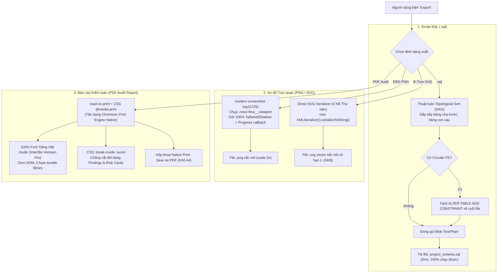
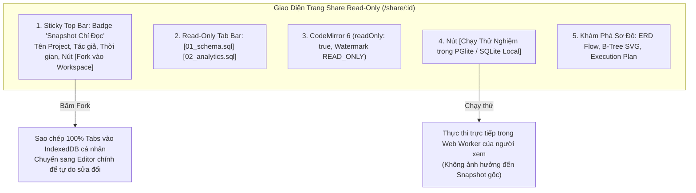
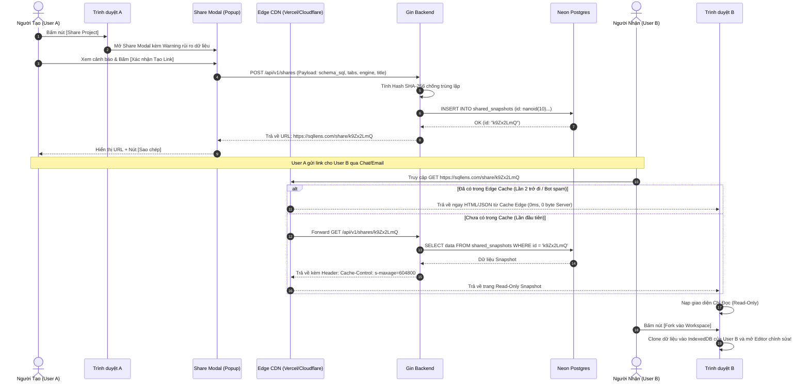

# SPEC-WORKSPACE-EXPORT-SHARE: Quản Lý Dự Án/Tabs, Xuất Báo Cáo & Chia Sẻ Snapshot

## Local-First Workspace, Client-Side Multi-Format Export & RESTful Route Param Sharing

- **Mã SPEC:** `SPEC-workspace-export-share`
- **Thuộc Epic:** `SP019` (Dự kiến mở rộng hậu V1) / `SP999`
- **Trạng thái:** Bản thảo Đề xuất Kỹ thuật (Draft for Critique)
- **Tác giả:** Hội đồng BMAD (Winston, Amelia, John, Sally, Mary)
- **Người thẩm định & Bẻ luận điểm:** Chủ dự án (Admin)

---

## 1. Tổng quan & Mục tiêu

Sau khi hoàn thành 18 Epic cốt lõi (SP001 - SP018), SQLLens đã sở hữu đầy đủ sức mạnh của một phòng thí nghiệm CSDL: Sandbox PGlite/MySQL, B-Tree visualizer, Conflict simulator, Plan runner, Findings engine và AI Mentor.

Tuy nhiên, người dùng đang gặp phải **3 rào cản lớn về mặt sản phẩm (Product Usability & Growth)**:

1. **Bế tắc không gian làm việc (Single-Editor Bottleneck):** Người dùng chỉ có đúng 1 ô soạn thảo SQL duy nhất. Muốn thử kịch bản mới buộc phải xóa kịch bản cũ hoặc tự lưu tạm ra file ngoài.
2. **Khó lưu trữ & Báo cáo kết quả (No Export Artifacts):** Kiến trúc đã phân tích ra Findings rất hay, sơ đồ rất đẹp, nhưng người dùng không thể tải về máy dạng PDF nộp bài/kẹp PRD, không tải được file `.sql` hoàn chỉnh hay ảnh sơ đồ vector.
3. **Thiếu tính năng lan tỏa & Chia sẻ (No Viral/Share Loop):** Hai người dùng không thể gửi link cho nhau để cùng xem 1 thiết kế database.

Tài liệu này đặc tả chi tiết kiến trúc và giải pháp cho 3 tính năng trên, đồng thời nêu rõ các giả định kỹ thuật và các điểm yếu tiềm tàng để **Chủ dự án (Admin) phản biện, bẻ gãy và tinh chỉnh**.

---

## 2. Nguyên tắc Bất biến (Core Invariants)

1. **Bảo mật & Quyền riêng tư (`AGENTS.md` - Core Rule 7):** Tuyệt đối không tự ý lưu vết hoặc log code SQL nháp của người dùng lên máy chủ. Mọi trạng thái soạn thảo dở dang (Drafts) phải được lưu cục bộ (Local-First).
2. **Bảo toàn Tài nguyên Hạ tầng (Zero Server Burn):** Render Free Backend chỉ có 512MB RAM và Neon DB Free chỉ có 0.5GB dung lượng. Tuyệt đối **không** render PDF bằng headless browser (Puppeteer) trên server; tuyệt đối **không** lưu autosave liên tục lên cloud DB.
3. **Nhãn dữ liệu minh bạch (`AGENTS.md` - Core Rule 1 & 2):** Mọi báo cáo xuất ra (dù là PDF, Text hay Ảnh) đều phải giữ nguyên vẹn 3 nhãn phân loại: `Thật`, `Mô phỏng`, `Ước lượng`. Không bao giờ kết luận chung chung "thiết kế này ổn".
4. **URL Chuẩn RESTful & Resource Identity:** ID chia sẻ phải nằm ở Route Param (`/share/:id`), bảo đảm tính tương thích với Next.js Dynamic Routes, Edge Caching và sinh OpenGraph Card xem trước trên mạng xã hội.

---

## 3. Ý TƯỞNG 1: Lưu Tạm (Draft), Multi-Tab / Pages, Engine SQLite & Phân Quyền RLS

### 3.1. Phân tích Bài toán (The Problem) & Các Quyết Định Bản Lề

- Hiện tại, state của SQL Editor được lưu trong React state/Zustand đơn giản. Khi F5 hoặc chuyển màn hình, nếu không cẩn thận sẽ mất code.
- Người dùng thường có 2 nhu cầu khác biệt:
  - **Nhu cầu A (Multi-Query trong 1 DB):** Đang có sẵn bảng `users` và `orders`. Tab 1 viết câu lệnh tạo bảng, Tab 2 viết câu query phân tích doanh thu, Tab 3 viết query test index.
  - **Nhu cầu B (Multi-Project độc lập):** Dự án A là "Hệ thống Bán lẻ" (Postgres), Dự án B là "Ví điện tử Deadlock test" (MySQL), Dự án C là "Nhập môn CSDL" (SQLite).
- **Quyết định bản lề về SQLite (Thống nhất với Chủ dự án):**
  - **KHÔNG dùng SQLite WASM làm kho lưu nháp (Internal Storage) thay thế IndexedDB:** Việc nhúng SQLite WASM chỉ để lưu bảng tabs/projects là "dùng đại bác bắn chim sẻ", gây gánh nặng thêm ~1.5MB - 2MB bundle size và ngốn bộ nhớ WebAssembly không cần thiết. **IndexedDB là giải pháp chuẩn xác nhất** vì nó là C++ native tích hợp sẵn 100% trong trình duyệt, phản hồi 0ms, không tốn thêm 1 byte bundle.
  - **ĐẨY SQLite TRỞ THÀNH DATABASE ENGINE THỨ 3 CỦA SQLLENS:** Đây là bước đi chiến lược! Bộ ba engine của SQLLens sẽ hoàn thiện:
    1. `PostgreSQL` (PGlite Web Worker in-browser).
    2. `MySQL` (Docker Sandbox trên Azure VM).
    3. `SQLite` (SQLite WASM / official sqlite3 in-browser) — cực kỳ lý tưởng cho sinh viên, lập trình viên di động (Android/iOS) và người mới học SQL nhập môn với chi phí hạ tầng = 0đ (100% client-side execution). Hỗ trợ export/import trực tiếp file `.sqlite` / `.db`.

---

### 3.2. Kiến trúc Đề xuất: "Hybrid 2-Tier Workspace (Local-First & Cloud RLS)"

```mermaid
flowchart TD
    subgraph ClientLayer ["Client Trình Duyệt (Local-First & Zero Friction)"]
        UI_Editor["SQL Editor & Tab Bar (Pages / Tabs)"] --> LocalStore["Zustand Workspace Store"]
        LocalStore -->|Debounced 300ms Autosave| IDB[("IndexedDB: sqllens_workspaces<br/>(C++ Native, Zero Server Cost)")]

        subgraph EngineSelector ["Bộ Ba Engine CSDL (Database Engines)"]
            EnginePG["1. PostgreSQL (PGlite)"]
            EngineMySQL["2. MySQL (Docker Sandbox)"]
            EngineSQLite["3. SQLite (WASM in-browser) - NEW"]
        end
        UI_Editor <--> EngineSelector

        subgraph LocalPartitioning ["Client Scoping (Phân vùng theo Auth State)"]
            IDB --> GuestScope["Scope: 'guest' (Khách vãng lai, gõ ngay)"]
            IDB --> UserScope["Scope: 'user_{uuid}' (Đã đăng nhập)"]
        end
    end

    subgraph CloudLayer ["Hạ Tầng Cloud (Neon Postgres & Row-Level Security)"]
        ExplicitSync["Người dùng bấm 'Save Cloud' / 'Share'"] --> GinProxy["Gin Backend API (/api/v1/projects)"]
        GinProxy -->|"Inject: SET LOCAL app.current_user_id = JWT_UUID"| NeonDB[("Neon Postgres (Cloud DB)")]

        subgraph RLSProtection ["Cơ Chế Phân Quyền Row-Level Security (RLS)"]
            NeonDB --> PolicyProjects["RLS Policy trên bảng 'projects'<br/>(Chỉ xem/sửa project của chính mình)"]
            NeonDB --> PolicyTabs["RLS Policy trên bảng 'tabs'<br/>(Cô lập theo project_id thuộc quyền)"]
            NeonDB --> PolicyCollab["RLS Policy: 'project_members'<br/>(Phân quyền Owner / Editor / Viewer)"]
        end
    end

    UserScope -.->|Đồng bộ Cloud khi Sign In| ExplicitSync
```



---

### 3.3. Cơ Chế Phân Quyền & Bảo Mật 2 Tầng (Two-Tier Security Model)

#### Tầng 1: Client-Side Scoping (IndexedDB) — Đảm bảo Zero Friction & Bảo vệ Máy Công Cộng

1. **Khách vãng lai (Guest User):**
   - Được phép tạo nhiều Tabs, nhiều Projects hoàn toàn miễn phí tại IndexedDB cục bộ.
   - Tuyệt đối không ép đăng nhập khi tạo Tab/Project mới. Giữ vững tôn chỉ "Vào là dùng được ngay".
2. **Phòng chống rò rỉ trên Máy Dùng Chung (Shared PC / School Lab):**
   - Dữ liệu IndexedDB được đánh dấu namespace theo Auth State: `workspace_scope: 'guest'` hoặc `workspace_scope: 'user_<uuid>'`.
   - Khi người dùng đăng xuất (Logout): Hiển thị modal bảo mật xác nhận:
     > _"Bạn có muốn xóa dữ liệu nháp của phiên làm việc này trên máy tính này không?"_
     - Lựa chọn A (Mặc định cho máy công cộng): Xóa sạch workspace cục bộ của user đó để bảo vệ đồ án/bài tập.
     - Lựa chọn B (Cho máy cá nhân): Giữ lại bản nháp offline.
   - Khi một tài khoản đăng nhập lần đầu trên máy đã có bản nháp `guest`: Cung cấp tính năng 1-Click _"Nhập các tab nháp của khách vào tài khoản của tôi"_.

#### Tầng 2: Cloud-Side Isolation (Neon DB Native RLS) — Chuẩn Mực Multi-Tenant

Khi người dùng bấm "Lưu vào Cloud" hoặc chia sẻ/cộng tác nhóm, dữ liệu được gửi lên Neon Postgres. Toàn bộ tính năng phân quyền được giao phó cho **Row-Level Security (RLS)** của PostgreSQL:

1. **Thiết kế Bảng Cơ sở Dữ liệu (`projects` & `project_tabs`):**

   ```sql
   -- 1. Bảng Projects
   CREATE TABLE cloud_projects (
       id UUID PRIMARY KEY DEFAULT gen_random_uuid(),
       owner_id UUID NOT NULL REFERENCES users(id) ON DELETE CASCADE,
       title VARCHAR(120) NOT NULL DEFAULT 'Untitled Project',
       engine VARCHAR(16) NOT NULL DEFAULT 'pglite', -- 'pglite' | 'mysql' | 'sqlite'
       is_public BOOLEAN NOT NULL DEFAULT FALSE,
       created_at TIMESTAMPTZ NOT NULL DEFAULT NOW(),
       updated_at TIMESTAMPTZ NOT NULL DEFAULT NOW()
   );

   -- 2. Bảng Tabs thuộc Project
   CREATE TABLE cloud_project_tabs (
       id UUID PRIMARY KEY DEFAULT gen_random_uuid(),
       project_id UUID NOT NULL REFERENCES cloud_projects(id) ON DELETE CASCADE,
       title VARCHAR(100) NOT NULL DEFAULT 'Query.sql',
       content_sql TEXT NOT NULL DEFAULT '',
       order_idx INT NOT NULL DEFAULT 0,
       created_at TIMESTAMPTZ NOT NULL DEFAULT NOW(),
       updated_at TIMESTAMPTZ NOT NULL DEFAULT NOW()
   );

   -- 3. Bảng Thành viên / Cộng tác (Collaborators)
   CREATE TABLE cloud_project_members (
       project_id UUID NOT NULL REFERENCES cloud_projects(id) ON DELETE CASCADE,
       user_id UUID NOT NULL REFERENCES users(id) ON DELETE CASCADE,
       role VARCHAR(16) NOT NULL DEFAULT 'viewer', -- 'editor' | 'viewer'
       PRIMARY KEY (project_id, user_id)
   );
   ```

2. **Kích Hoạt và Thiết Lập RLS Policies:**

   ```sql
   -- Kích hoạt RLS
   ALTER TABLE cloud_projects ENABLE ROW LEVEL SECURITY;
   ALTER TABLE cloud_project_tabs ENABLE ROW LEVEL SECURITY;
   ALTER TABLE cloud_project_members ENABLE ROW LEVEL SECURITY;

   -- Policy cho Projects: Chủ sở hữu toàn quyền, Member được xem/sửa tùy role, Public thì ai cũng xem được
   CREATE POLICY rls_projects_owner ON cloud_projects
       FOR ALL
       USING (owner_id = NULLIF(current_setting('app.current_user_id', true), '')::uuid);

   CREATE POLICY rls_projects_collaborators ON cloud_projects
       FOR SELECT
       USING (
           is_public = TRUE OR
           EXISTS (SELECT 1 FROM cloud_project_members m
                   WHERE m.project_id = cloud_projects.id
                     AND m.user_id = NULLIF(current_setting('app.current_user_id', true), '')::uuid)
       );

   -- Policy cho Tabs: Kế thừa quyền từ Project tương ứng
   CREATE POLICY rls_tabs_access ON cloud_project_tabs
       FOR ALL
       USING (
           EXISTS (
               SELECT 1 FROM cloud_projects p
               WHERE p.id = cloud_project_tabs.project_id
                 AND (
                     p.owner_id = NULLIF(current_setting('app.current_user_id', true), '')::uuid
                     OR EXISTS (SELECT 1 FROM cloud_project_members m
                                WHERE m.project_id = p.id
                                  AND m.user_id = NULLIF(current_setting('app.current_user_id', true), '')::uuid)
                 )
           )
       );
   ```

3. **Cơ chế Gán Ngữ Cảnh tại Gin Backend (Go):**
   Trong Gin Handler (sau khi Middleware Auth giải mã JWT thành công):
   ```go
   // Thực thi trước bất kỳ câu query nào trong transaction:
   tx.Exec("SET LOCAL app.current_user_id = $1", claims.UserID)
   ```
   **Lợi ích:** Dù code backend Go có lỗi hoặc có sơ hở logic thì ở tầng database, Postgres RLS lập tức chặn đứng, không bao giờ một user có thể đọc hoặc ghi trộm Tab của user khác!

---

### 3.4. Mô hình Dữ liệu Local (IndexedDB Schema)

```typescript
interface WorkspaceProject {
  id: string; // nanoId local, vd: "prj_loc_123"
  scope: "guest" | string; // 'guest' hoặc user_id nếu đã login
  title: string; // "Hệ thống Bán lẻ"
  engine: "pglite" | "mysql" | "sqlite"; // Đầy đủ 3 engines
  activeTabId: string;
  createdAt: number;
  updatedAt: number;
}

interface EditorTab {
  id: string; // vd: "tab_abc"
  projectId: string;
  title: string; // "01_schema.sql", "02_queries.sql"
  content: string; // Nội dung SQL
  isDirty: boolean;
  order: number;
}
```

---

### 3.5. Xử Lý Xung Đột State DB giữa Các Tabs trong Cùng 1 Project

- **Quy tắc:** Tất cả các Tab trong cùng 1 Project **dùng chung 1 phiên Database Sandbox** (Shared Session).
- **Lý do:** Người dùng thường viết `CREATE TABLE` ở Tab 1 và muốn chạy `SELECT` ở Tab 2. Nếu mỗi Tab cô lập một sandbox riêng biệt:
  - RAM client sẽ tăng gấp n lần (mở 5 tab = 5 PGlite instances = ~150MB RAM).
  - Không thể thực hiện kịch bản liên hoàn (Tab 1 tạo bảng, Tab 2 viết trigger/query).
- **Giải pháp UX thông minh:** Khi chuyển đổi giữa các Tab, CodeMirror nạp nội dung của tab tương ứng, nhưng schema tree và state DB giữ nguyên. Nếu Tab 1 chạy câu lệnh làm thay đổi schema (DDL), UI thông báo nhẹ góc dưới: _"Schema đã cập nhật từ Tab 1"_ để người dùng ở Tab 2 không bị bỡ ngỡ.

---

---

## 4. Ý TƯỞNG 2: Xuất / Download (PDF Audit, Sơ đồ PNG/SVG, File .sql)

### 4.1. Phân tích Bài toán

Người dùng sau khi tối ưu xong schema và query cần "mang kết quả đi":

- Sinh viên: Cần nộp bài tập lớn hoặc đồ án CSDL cho giảng viên.
- Kỹ sư / Tech Lead: Cần kẹp bằng chứng vào Pull Request, Design Doc hoặc báo cáo kiến trúc cho ban giám đốc.
- DBA: Cần tải file DDL chuẩn đã được tối ưu về deploy lên database thật mà không bị lỗi ràng buộc khóa ngoại.

---

### 4.2. Kiến trúc Đề xuất: "Anti-Bloat Client-Side Exporter"



---

### 4.3. Đặc tả Kỹ thuật Chi Tiết 3 Định Dạng Xuất

#### 1. Định dạng 1: File Script Chuẩn Hóa (`.sql`) với Topological Sort

- **Vấn đề cốt lõi:** Người dùng viết bảng lộn xộn trong Editor. Nếu tải về mà bảng `orders` (bảng con có FK) nằm trước bảng `users` (bảng cha) thì khi chạy trên Postgres/MySQL/SQLite sẽ bị văng lỗi `foreign key constraint fails`.
- **Giải pháp kỹ thuật:**
  - Áp dụng thuật toán **Topological Sort (Đồ thị có hướng DAG)** duyệt qua toàn bộ các cặp Foreign Key được định nghĩa trong schema.
  - Sắp xếp thứ tự tạo bảng: Bảng độc lập (không có FK) tạo trước $\rightarrow$ Bảng phụ thuộc cấp 1 tạo tiếp theo $\rightarrow$ Bảng phụ thuộc cấp n.
  - Trường hợp phát hiện **Circular Dependency** (Bảng A tham chiếu B, B tham chiếu A): Tự động tách mệnh đề `FOREIGN KEY` ra khỏi câu lệnh `CREATE TABLE` và sinh thành các câu lệnh `ALTER TABLE ... ADD CONSTRAINT ...` đặt ở khối cuối cùng của file.
  - Bổ sung header metadata chuẩn hóa:
    ```sql
    -- ==============================================================
    -- Generated by SQLLens Architecture Platform (https://sqllens.com)
    -- Engine: PostgreSQL (PGlite) | Exported: 2026-11-15 14:50:00
    -- Project: E-Commerce Microservices Architecture
    -- Dependency Order: [categories, products, users, orders, order_items]
    -- ==============================================================
    ```

#### 2. Định dạng 2: Sơ đồ ERD & B-Tree (`PNG` / `SVG`)

- **Sơ đồ ERD (React Flow):**
  - Sử dụng thư viện **`modern-screenshot`** (`qq15725/modern-screenshot` trên GitHub).
  - Khắc phục triệt để các nhược điểm của `html-to-image`: Hỗ trợ đầy đủ CSS hiện đại (Tailwind classes, CSS variables, `oklch`, border-radius, box-shadow), không bị crash trên Safari/iOS.
  - **Tối ưu hóa Viewport:** Dùng `@xyflow/react` method `getNodesBounds(nodes)` và `getViewportForBounds(...)` nhắm thẳng vào container `.react-flow__viewport` để chỉ chụp đúng vùng chứa các bảng, loại bỏ hoàn toàn các thanh công cụ thừa (minimap, zoom controls).
  - **Chống cảm giác UI Freeze:** Tận dụng callback `progress` của `modern-screenshot` để hiển thị thanh tiến trình trực quan trên giao diện: _"Đang xuất ảnh sơ đồ: 60%..."_.
- **Cây Chỉ Mục B-Tree (SVG Trực tiếp):**
  - **Không dùng Canvas:** Vì B-Tree Visualizer của SQLLens được dựng bằng DOM SVG thuần túy.
  - Sử dụng trực tiếp `new XMLSerializer().serializeToString(svgElement)` để xuất file `.svg`.
  - **Ưu điểm:** Dung lượng siêu nhẹ (~15KB), độ nét véc-tơ vô hạn (infinite zoom), không tốn thêm 1 KB thư viện bên thứ 3.

#### 3. Định dạng 3: Báo cáo Kiểm toán CSDL Chuyên Nghiệp (Audit Report PDF)

- **Quyết định Công nghệ:** Sử dụng **CSS `@media print` + `react-to-print`** (Trường phái Native Browser Engine).
- **Lý do lựa chọn:**
  - **Bảo toàn hạ tầng (Zero Server Burn):** Tuyệt đối không dùng Puppeteer/Chromium trên Render Free (vốn chỉ có 512MB RAM, chắc chắn dính lỗi OOM sập server).
  - **Tiếng Việt 100% chuẩn xác:** Ăn theo trực tiếp Webfont của ứng dụng (`Inter` hoặc `Be Vietnam Pro`) được Chromium/WebKit render vector gốc. Loại bỏ hoàn toàn nguy cơ biến chữ tiếng Việt thành các ô vuông lỗi font ``.
  - **Dung lượng siêu nhẹ (Zero-Bloat):** Không phải nhúng bộ thư viện PDF nặng 1MB kèm font base64 vào bundle JavaScript của ứng dụng.
  - **Chống "cắt đôi bảng":** Thiết lập CSS chuẩn:
    ```css
    @media print {
      .audit-card,
      .finding-row,
      .plan-step {
        break-inside: avoid;
        page-break-inside: avoid;
      }
      @page {
        size: A4 portrait;
        margin: 15mm 12mm 15mm 12mm;
      }
    }
    ```
- **Bố cục Khổ A4 Chuẩn Mực (Executive Layout - Tối đa 2 đến 3 trang):**
  - **Trang 1: Bìa & Điểm Sức Khỏe Tổng Quan (Executive Health Summary):**
    - Tên Dự án, Engine CSDL, Ngày tạo, Tác giả.
    - **Database Health Score (0 - 100):** Biểu đồ tròn trực quan đánh giá độ sẵn sàng Production.
    - Tóm tắt số lượng rủi ro: `X Critical`, `Y Warning`, `Z Info`.
  - **Trang 2: Bảng Rủi Ro & Bằng Chứng Cụ Thể (Findings & Evidence):**
    - Từng rủi ro được in thành card rõ ràng kèm đề xuất khắc phục (Remediation).
    - **Tuân thủ Core Rule 1 & 2:** Bắt buộc gắn đúng 3 nhãn minh bạch: `Thật` (Sandbox đo được), `Mô phỏng` (Engine tính toán), `Ước lượng` (Optimizer dự đoán).
  - **Trang 3: Kế Hoạch Thực Thi & So Sánh (Execution Plan Comparison):**
    - Bảng chỉ số Buffer Hit, Shared Blocks, Rows Scanned trước và sau khi thêm Index.
    - **Disclaimer bắt buộc (Miễn trừ trách nhiệm):** In rõ ở chân trang: _"Báo cáo được kiểm thử trong môi trường giả lập Sandbox PGlite/MySQL. Hiệu năng thực tế phụ thuộc vào cấu hình phần cứng, dung lượng đĩa và biến số môi trường production."_

---

---

## 5. Ý TƯỞNG 3: Chia Sẻ Dự Án (Share Link), Phòng Thủ Đa Tầng Edge Cache & Giao Diện Snapshot Read-Only

### 5.1. Triết Lý & Chiến Lược Phòng Thủ Đa Tầng (Multi-Layered Edge Defense)
Học tập từ kiến trúc chia sẻ phiên của ChatGPT và Google Gemini: **Một bản Share là một Snapshot BẤT BIẾN (Immutable Read-Only Snapshot)**.
- **Phòng thủ chống Bot Spam càn quét Neon DB (0.5GB Free):**
  - **Chiều Đọc (`GET /share/:id`):** Áp dụng **Edge Caching tuyệt đối**. Thiết lập HTTP Header:
    ```http
    Cache-Control: public, max-age=86400, s-maxage=604800, stale-while-revalidate=86400
    ```
    Toàn bộ các truy cập xem link share được Vercel Edge Network / Cloudflare CDN chặn và trả về từ bộ nhớ cache rìa mạng (Edge). Dù bot có gửi 1.000.000 lượt đọc thì **0 byte và 0 request** nào chạm tới backend Gin Render hay Neon Postgres!
  - **Chiều Ghi (`POST /api/v1/shares`):**
    - **Deduplication bằng SHA-256 (Khử trùng lặp nội dung):** Trước khi ghi DB, Backend băm mã `hash(schema_sql + tabs_content)`. Nếu nội dung trùng với một snapshot đã có, API trả về ngay ID đã có mà không cấp thêm dòng mới trong Neon DB.
    - **Rate Limit Upstash Redis (Core Rule 7):** Giới hạn 5 lần tạo share/giờ đối với khách vãng lai, 50 lần/ngày đối với user đã đăng nhập.
    - **TTL Tự Hủy (Time-To-Live):** Snapshot của khách vãng lai được gắn hạn 30 ngày (sau 30 ngày Cronjob dọn dẹp để bảo toàn 0.5GB Neon). Snapshot của User VIP/đã đăng nhập được lưu vĩnh viễn.

---

### 5.2. Chính Sách Trách Nhiệm Dữ Liệu & Popup Cảnh Báo An Toàn (Share Modal)
- **Quan điểm cốt lõi:** Khi người dùng chủ động nhấn *Share*, họ là người quyết định công khai thiết kế CSDL của mình ra Internet. Tuy nhiên, SQLLens thể hiện sự chuyên nghiệp và minh bạch bằng **Hộp thoại Cảnh Báo Trách Nhiệm (Share Modal)**.
- **Quy cách Giao diện Share Popup (Chuẩn Shadcn Dialog & SQLLens Design System):**
  - **Header:** Icon chia sẻ + Tiêu đề *"Chia sẻ Snapshot Dự Án"*.
  - **URL Box:** Ô input chứa đường dẫn hoàn chỉnh (vd: `https://sqllens.com/share/k9Zx2LmQ`) đi kèm nút `[ Sao chép ]` màu Lamp `#f2b84b` (khi bấm đổi thành `Đã chép! ✓`).
  - **Amber Warning Callout (Khối Cảnh Báo Hổ Phách - Token `--severity-uncertain`):**
    > ⚠️ **Lưu ý Quan Trọng Về Bảo Mật Dữ Liệu:**
    > *"Liên kết này là công khai (Public). Bất kỳ ai có đường dẫn đều có thể xem toàn bộ cấu trúc bảng và các câu truy vấn trong snapshot này. Vui lòng kiểm tra kỹ để chắc chắn bạn không chia sẻ thông tin mật nội bộ, mật khẩu, token hoặc dữ liệu cá nhân nhạy cảm."*
  - **Thông tin tóm tắt:** Hiển thị số lượng Tabs và Engine đi kèm (vd: *Bao gồm 3 Tabs SQL • Engine: PostgreSQL PGlite*).

---

### 5.3. Đặc Tả Giao Diện Trang Chia Sẻ Chỉ Đọc (`/share/:id`) & Tham Chiếu Prototype

#### 🎯 Tham Chiếu Trực Tiếp File Giao Diện Mẫu (UI Prototype Reference):
Toàn bộ thiết kế giao diện của **Popup Share** và **Trang Share Read-Only (`/share/:id`)** đã được xây dựng hoàn chỉnh và lưu trữ tại:
👉 **[share_preview_prototype.html](file:///c:/SQLLens/_bmad-output/share_preview_prototype.html)**

> [!IMPORTANT]
> **Tiêu Chuẩn Nghiệm Thu Giao Diện (UI Acceptance Criteria) cho Kỹ Sư Triển Khai:**
> Khi hiện thực hóa trang `/share/[id]/page.tsx` và Share Modal, kỹ sư dev **bắt buộc phải bám sát 100%** các thông số thiết kế đã được thể hiện trong file prototype trên:
> 1. **Typography:** Font chính `Public Sans` cho toàn bộ văn bản UI, Font `JetBrains Mono` cho câu lệnh SQL, số dòng và các chỉ số kỹ thuật.
> 2. **Hệ màu Phòng Lab (Lab Dark Theme):** Bề mặt `--stage: #0e0e10;` (tối nhất), `--ground: #171719;` (nền app header), `--surface: #131217;` (nền panel/modal), viền mỏng `--line: #2a2a2e;`.
> 3. **Màu đèn Thương hiệu (Brand Lamp):** Nút hành động chính (Primary Button) và từ khóa SQL dùng đúng màu **`--lamp: #f2b84b;`** với chữ đen `--lamp-ink: #17130a;`.
> 4. **Góc bo phẳng (Radius 4px):** Khóa cứng `--radius: 4px;` cho mọi nút bấm, thẻ Card và Dialog; không dùng bo tròn bầu bĩnh.
> 5. **Logo Gốc:** Sử dụng đúng component Logo SVG hình cây B-Tree phân cấp chuẩn mực của SQLLens.



#### Chi tiết các thành phần trên màn hình `/share/:id`:
1. **Thanh Header Cố Định (Sticky Read-Only Topbar - Cao chuẩn 44px):**
   - **Pill Badge:** Hiển thị nhãn `● Snapshot Chỉ Đọc` với màu `--severity-uncertain` (`#d8dc52` trên nền `#24260e`).
   - **Project Metadata:** Tiêu đề dự án (vd: *"Thiết kế CSDL Ví Điện Tử Deadlock"*), Người chia sẻ (hoặc *"Khách vãng lai"*), Ngày tạo snapshot, Engine CSDL (PostgreSQL / MySQL / SQLite).
   - **Nút Hành Động Trọng Tâm (Primary CTA Button):** `[ 🍴 Fork vào Workspace ]` (Nút màu vàng Lamp `#f2b84b` nổi bật nhất). Khi người xem bấm vào nút này:
     - Toàn bộ dữ liệu tabs và schema được nạp thẳng vào **IndexedDB** của người xem.
     - Hệ thống tự động chuyển hướng về trang Editor chính (`/`) với thông báo Toast: *"Đã fork dự án vào Workspace cá nhân của bạn. Bạn có thể tự do chỉnh sửa!"*.
2. **Thanh Tab Bar (Chỉ Đọc):**
   - Cho phép người xem click chuyển qua lại giữa các Tab SQL để đọc câu lệnh DDL và DML.
   - Không có nút thêm tab `[+]` hay nút đóng tab `[x]` (vì đang ở chế độ xem snapshot).
3. **Khu Vực Soạn Thảo (Read-Only CodeMirror Editor):**
   - Đặt thuộc tính `readOnly: true`.
   - Vẫn hỗ trợ đầy đủ: Tô màu cú pháp (Syntax Highlighting chuẩn `sql-editor-impl.tsx`), số dòng, tìm kiếm (`Ctrl + F`), watermark mờ `READ_ONLY` và nút bấm nhanh `[ Sao chép Code ]`.
   - Con trỏ hiển thị ở dạng đọc, không cho phép gõ phím.
4. **Nút "Chạy Thử Nghiệm Cục Bộ" (Local Sandbox Execution):**
   - Người xem có thể bấm nút `[ ▶ Chạy thử Sandbox ]`.
   - Câu SQL sẽ được thực thi trực tiếp trên Web Worker PGlite hoặc SQLite cục bộ trên máy của người xem (0 byte tải lên server, an toàn 100%, không làm thay đổi bản snapshot gốc).
5. **Khu Vực Trực Quan Hóa (Visualizer Panel):**
   - Người xem vẫn có thể bấm xem tab **ERD Sơ đồ bảng**, **Cây B-Tree** và **Explain Plan** của snapshot đó.

---

### 5.4. Sơ Đồ Tuần Tự (Sequence Diagram): Chia Sẻ, Edge Cache & Fork



---

### 5.5. Thiết Kế Bảng Cơ Sở Dữ Liệu (`shared_snapshots`) trên Neon DB
```sql
CREATE TABLE shared_snapshots (
    id VARCHAR(16) PRIMARY KEY, -- NanoID 10 ký tự an toàn, ví dụ: 'k9Zx2LmQ'
    creator_id UUID REFERENCES users(id) ON DELETE SET NULL, -- NULL nếu là khách vãng lai
    content_hash VARCHAR(64) NOT NULL, -- SHA-256 hash của payload (chống trùng lặp dữ liệu)
    title VARCHAR(120) NOT NULL DEFAULT 'Untitled Project',
    engine VARCHAR(16) NOT NULL DEFAULT 'pglite', -- 'pglite' | 'mysql' | 'sqlite'
    payload JSONB NOT NULL, -- Chứa toàn bộ: { tabs: [...], activeTab: "...", schema_sql: "..." }
    views_count INT NOT NULL DEFAULT 0,
    forks_count INT NOT NULL DEFAULT 0,
    created_at TIMESTAMPTZ NOT NULL DEFAULT NOW(),
    expires_at TIMESTAMPTZ NULL -- NULL = Vĩnh viễn (cho User login); 30 ngày cho Anonymous
);

CREATE INDEX idx_shared_snapshots_hash ON shared_snapshots(content_hash);
CREATE INDEX idx_shared_snapshots_created_at ON shared_snapshots(created_at);
```

---

## 6. Tổng Kết Phản Biện & Các Điểm Đã Thống Nhất Cùng Chủ Dự Án

### Điểm yếu của Ý tưởng 1 (Lưu tạm, Tabs, SQLite & RLS) - [ĐÃ THỐNG NHẤT & CHỐT GIẢI PHÁP]:
1. **Xung đột State DB giữa các Tabs:** 
   - *Quyết định:* Tất cả các tab trong cùng 1 project chạy chung 1 session database sandbox (Shared Session). CodeMirror chuyển tab không reload DB. Nếu Tab 1 chạy DDL thay đổi cấu trúc bảng, UI phát tín hiệu nhẹ báo hiệu schema đã được đồng bộ để tránh side-effect ngầm.
2. **Nguy cơ mất trắng khi Clear Cache & Bảo vệ Máy Dùng Chung (Lab/Net):** 
   - *Quyết định:* Phân vùng IndexedDB thành 2 namespace (`guest` và `user_<uuid>`). Khi user đăng xuất trên máy công cộng, modal bảo mật sẽ hỏi xác nhận xóa sạch workspace offline hay giữ lại. Giữ vững trải nghiệm không ép buộc đăng nhập cho khách vãng lai.
3. **Ứng dụng của SQLite:**
   - *Quyết định:* Không dùng SQLite WASM làm kho lưu nháp (tránh nặng bundle 2MB), mà định vị đưa SQLite trở thành **Database Engine thứ 3** chính thức của SQLLens (chạy in-browser WASM, 100% offline, zero server cost) song song với PostgreSQL và MySQL.
4. **Phân quyền RLS:**
   - *Quyết định:* Triển khai mô hình **Hybrid 2 tầng**. Cục bộ thì client-scoping không ép đăng nhập; khi đồng bộ lên Cloud Neon DB thì kích hoạt **PostgreSQL Row-Level Security (RLS)** 100% trên `cloud_projects`, `cloud_project_tabs`, `cloud_project_members`. Gin Backend inject `SET LOCAL app.current_user_id` để DB tự cô lập quyền triệt để.

### Điểm yếu của Ý tưởng 2 (Export PDF, Sơ đồ PNG/SVG & Script SQL) - [ĐÃ THỐNG NHẤT & CHỐT GIẢI PHÁP]:
1. **Tràn bộ nhớ & UI Freeze khi chụp sơ đồ lớn (50 bảng):** 
   - *Quyết định:* Thay thế `html-to-image` bằng **`modern-screenshot`** (`qq15725`). Nhắm chuẩn xác vào `.react-flow__viewport`, hỗ trợ scale 2x và callback `progress` hiển thị thanh tiến trình trực quan, chống cảm giác đơ ứng dụng. Đối với B-Tree Visualizer, dùng trực tiếp **XMLSerializer** xuất SVG vector thuần 0 KB thư viện.
2. **Font Tiếng Việt UTF-8 & Lỗi ngắt trang cắt đôi bảng trong PDF:** 
   - *Quyết định:* Chọn trường phái **CSS `@media print` + `react-to-print`** tận dụng engine in ấn native của Chromium/WebKit. Không tốn 1 byte bundle, giữ nguyên vẹn 100% font tiếng Việt sắc nét và các ký hiệu toán học. Dùng CSS `break-inside: avoid` bảo đảm các card rủi ro và bảng kế hoạch thực thi không bao giờ bị cắt đôi giữa 2 trang A4.
3. **Lỗi khóa ngoại (FK) khi xuất file `.sql`:**
   - *Quyết định:* Tích hợp thuật toán **Topological Sort (DAG)** để sắp xếp thứ tự tạo bảng theo quan hệ cha - con. Tự động tách `ALTER TABLE ... ADD CONSTRAINT` về cuối file nếu phát hiện quan hệ vòng (Circular Dependency), cam kết file `.sql` tải về thực thi được ngay 100%.
4. **Bảo toàn hạ tầng & Uy tín thương hiệu:**
   - *Quyết định:* Tuyệt đối không dùng Puppeteer trên backend Render Free (tránh OOM 512MB RAM). Bắt buộc nhúng Watermark minh bạch 3 nhãn (`Thật`, `Mô phỏng`, `Ước lượng`) và điều khoản Disclaimer kỹ thuật trong bản in PDF.

### Điểm yếu của Ý tưởng 3 (Share Link, Edge Cache & Giao Diện Read-Only) - [ĐÃ THỐNG NHẤT & CHỐT GIẢI PHÁP]:
1. **Spam làm tràn Neon DB (0.5GB Free):** 
   - *Quyết định:* Thiết lập cơ chế phòng thủ đa tầng. Áp dụng **Edge Caching tuyệt đối** cho chiều đọc (`Cache-Control: s-maxage=604800`) — bot spam hàng triệu lượt đọc chỉ chạm tới Edge CDN, 0 byte chạm tới server. Với chiều ghi, áp dụng Deduplication SHA-256 (trùng nội dung trả lại link cũ) + Rate limit Upstash Redis + TTL tự hủy 30 ngày cho khách vãng lai.
2. **Rủi ro Rò rỉ Dữ liệu Nhạy Cảm (PII):** 
   - *Quyết định:* Người dùng tự chịu trách nhiệm khi quyết định chia sẻ công khai. Hệ thống hiển thị **Share Modal** với hộp cảnh báo màu hổ phách (Amber Warning) nhắc nhở rõ ràng trước khi copy link.
3. **Trải nghiệm Giao Diện Trang Share & Nút Bắt Đầu Tiếp (Fork):**
   - *Quyết định:* Trang `/share/:id` là bản Snapshot Chỉ Đọc (Read-Only CodeMirror + Visualizer). Nút trọng tâm là **`[ Fork vào Workspace ]`** (Màu Lamp `#f2b84b`) giúp người nhận clone 100% snapshot về IndexedDB cá nhân để tiếp tục mở rộng, chỉnh sửa tự do. Có sẵn nút **`[ Chạy thử Sandbox ]`** câu query trực tiếp trong Web Worker PGlite/SQLite của người xem mà không ảnh hưởng snapshot gốc.
   - **Giao diện tham chiếu chuẩn hóa:** Đã được nghiệm thu và lưu trữ tại [share_preview_prototype.html](file:///c:/SQLLens/_bmad-output/share_preview_prototype.html).

---

## 7. Kết Luận & Kế Hoạch Hiện Thực Hóa (Next Actions)

Tài liệu SPEC đã hoàn thành 100% việc tiếp thu, phản biện và chốt hạ cả 3 Ý tưởng lớn cùng Chủ dự án:
- **Ý tưởng 1:** Local-First Workspace (IndexedDB) + SQLite Engine thứ 3 + Hybrid 2-Tier RLS (Neon DB).
- **Ý tưởng 2:** Anti-Bloat Exporter (`modern-screenshot` cho ERD, Direct SVG cho B-Tree, `@media print` cho PDF, Topological Sort cho `.sql`).
- **Ý tưởng 3:** RESTful Route Param (`/share/:id`) + Immutable Snapshot + Edge Caching + Share Modal cảnh báo + UI Read-Only với tính năng Fork to Workspace.
- **UI Acceptance Prototype:** File [share_preview_prototype.html](file:///c:/SQLLens/_bmad-output/share_preview_prototype.html) là kim chỉ nam thẩm mỹ cho toàn bộ quá trình hiện thực hóa.

Khi Chủ dự án phê duyệt toàn diện SPEC: Tiến hành bóc tách thành các Story và Task chi tiết trong `SP019` / `SP999` để subagent Amelia triển khai theo quy trình `QUY_TRINH.md`.
