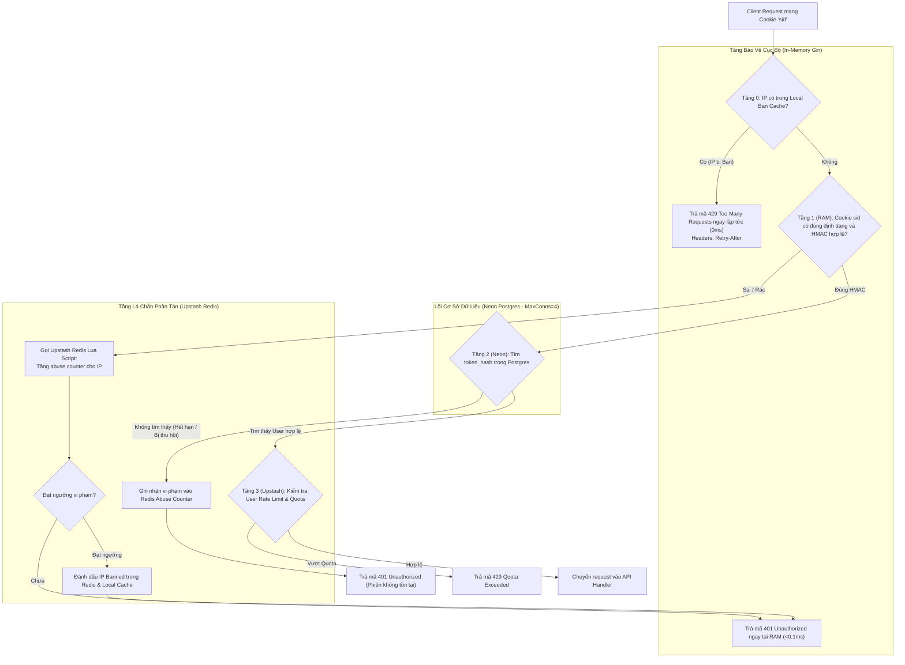

# Architecture Diagrams: 2-Layer Auth Shield

Tài liệu này mô tả kiến trúc lá chắn bảo vệ 2 tầng cho luồng xác thực của SQLLens.

## Sơ đồ luồng xử lý Request với 2 tầng lá chắn

## So sánh trước và sau khi áp dụng Lá chắn

| Tiêu chí | Trước khi có Lá chắn | Sau khi áp dụng Lá chắn (SPEC-auth-shield) |
| :--- | :--- | :--- |
| **Bắn `sid` rác ngẫu nhiên** | Chạm Neon Postgres cho **mọi request** -> Kiệt pool 4 conn -> Sập site (503). | Chặn đứng tại RAM của Gin bằng HMAC trong **< 0.1ms**, **0 query vào DB**. |
| **Spam `sid` rác dồn dập** | Không có cơ chế khóa IP, kẻ tấn công DoS tự do. | Redis Lua Script tự động cách ly IP vi phạm sau 10 lần sai; local cache chặn trong 0ms. |
| **Token bị thu hồi (Revoke)** | Vẫn tra DB kiểm tra bình thường. | Tra DB bình thường nhưng nếu bắn token cũ liên tục sẽ bị tính vào abuse counter. |
| **Tải trên Neon Postgres** | Rất nhạy cảm với bot quét lỗi / tấn công từ chối dịch vụ. | Database chỉ phục vụ request có chữ ký chuẩn mực, hoàn toàn an toàn. |
| **Tải trên Upstash Redis** | Chỉ dùng cho Quota sau khi đã tra DB. | Quản lý abuse counter và blacklist phân tán; có Local RAM Cache bảo vệ số lệnh Redis. |

